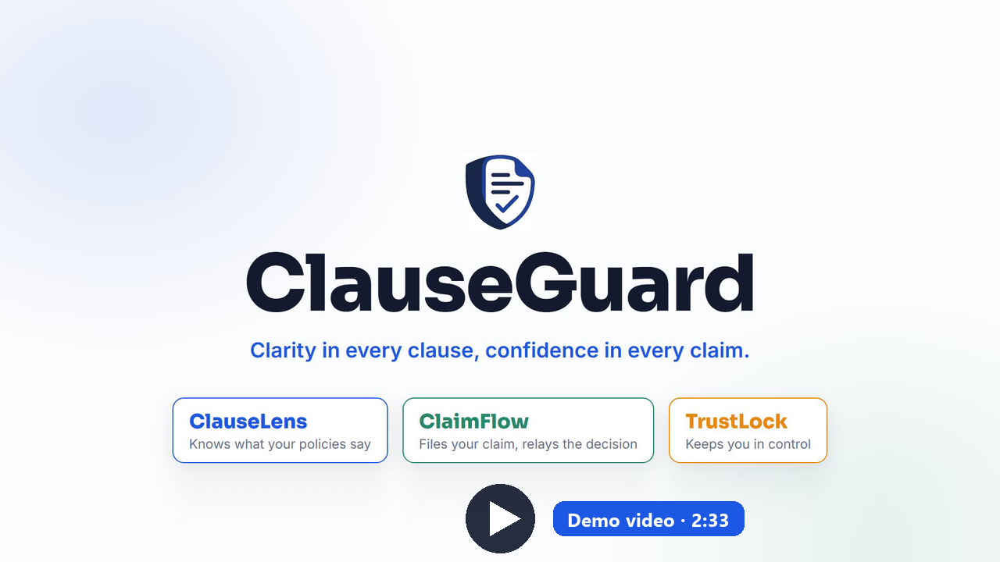
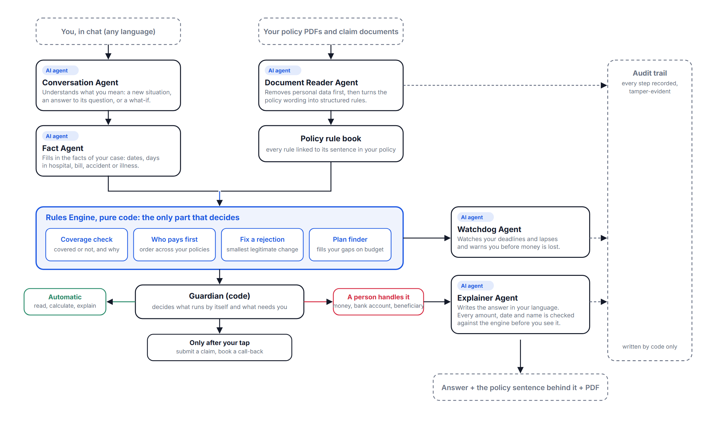

# ClauseGuard

*Clarity in every clause, confidence in every claim.*

ClauseGuard is an AI insurance assistant for policyholders. It reads the policies a household already holds, answers coverage questions with the clause that decides them, prepares and files claims on the insurer's own form after the policyholder confirms, and relays the insurer's decision back to the chat.

FinTechathon 2026 · International Track · Topic D: AI Insurance Assistant
Team: Bunga Laelatul Muna, Izra, Wan Sabrina · Institut Teknologi Sepuluh Nopember, Indonesia

<p align="center">
  <a href="documentation-submission/clauseguard.mp4">
    
  </a>
</p>

## Live prototype

**https://clauseguard.up.railway.app/**

Source code: **https://github.com/bungagana/clauseguard**

The prototype runs on a sandbox insurer with synthetic personas and synthetic policies.

**User information is in the Technical Documentation** ([PDF](documentation-submission/ClauseGuard_Technical_Documentation.pdf), Table 11, Judge access). It lists the demo accounts and explains how to sign in and how to reach the insurer desk. The demo passwords and the insurer desk token are given in the registration form submitted to the organizer.

## What it does

ClauseGuard has 3 core features and 3 supporting features.

| Feature | What it does |
|---|---|
| **ClauseLens** | Decides whether an event is covered, how much is paid, the filing deadline and which policy pays first, and quotes the deciding clause |
| **ClaimFlow** | Reads hospital documents, fills in the insurer's own claim form, files the claim after confirmation and relays the insurer's decision |
| **TrustLock** | Limits every agent action with four permission tiers, a single-use confirmation and a hash-chained audit log |
| Claim Simulator | Recomputes the answer when one fact changes, without touching a real claim |
| Deadline Tracker | Lists filing windows and premium grace periods with the money that turns on each date |
| PDF Export | Saves an answer, its clause evidence and the claim form as a document |

The language model never decides. Five AI agents read, ask and explain. A deterministic rules engine decides coverage, amounts, deadlines and payer order. A code-level Guardian checks every tool call.

## Architecture

<p align="center">
  
</p>

## Repository contents

```
.
├── clauseguard/                 Backend: rules engine, AI agents, security layer, sandbox insurer API
├── clauseguard-web/             Frontend: landing page, chat, insurer desk (Next.js)
├── documentation-submission/    Technical documentation, security self-assessment, execution evidence, demo video
└── .github/workflows/           Continuous integration
```

### Backend (`clauseguard/`)

A Python 3.10 service built on FastAPI. It exposes a sandbox insurer API with 52 JSON endpoints.

| Path | Contents |
|---|---|
| `clauseguard/solver.py`, `allocation.py`, `recourse.py`, `twin.py`, `timeline.py`, `plans/` | The deterministic solvers: verdict, benefit coordination across policies, recourse after a denial, plan selection and the deadline timeline |
| `clauseguard/agent/` | The conversation loop and the five AI agents (Conversation, Fact, Document Reader, Explainer, Watchdog), the planner, claim form builder and appeal logic |
| `clauseguard/extractor/`, `privacy/` | Quarantined document extraction, hidden-text detection and local personal data redaction |
| `clauseguard/security/` | The Guardian: tool registry, permission tiers, single-use confirmation nonces, output guard, kill switch and the hash-chained audit log |
| `clauseguard/sandbox/` | The sandbox insurer: API, seeded personas and policies, claims desk, history and PDF export |
| `clauseguard/storage/` | SQLite for local use, Postgres for the hosted service |
| `data/` | Synthetic personas and policies, public reference data and benchmark sets |
| `bench/`, `scripts/` | Evaluation and reproduction scripts |
| `tests/` | The automated test suite |
| `evidence/` | Generated evaluation reports and the audit log of a recorded run |
| `deploy/` | Database migrations and deployment notes |
| `ui/` | A small static sandbox page served by the backend |

More detail: [`clauseguard/ARCHITECTURE.md`](clauseguard/ARCHITECTURE.md) and [`clauseguard/SECURITY.md`](clauseguard/SECURITY.md).

### Frontend (`clauseguard-web/`)

A Next.js 14 (App Router) application in TypeScript with Tailwind CSS.

| Path | Contents |
|---|---|
| `app/page.tsx`, `components/landing/` | The landing page with the architecture diagram and benchmark results |
| `app/chat/`, `components/chat/` | The chat interface: verdict, clause and allocation cards, document reads, claim form preview, confirmation card, deadline and what-if panels, the "Behind the answer" panel |
| `app/insurer/` | The sandbox insurer's claims desk, where a person decides each claim |
| `app/login/` | Sign-in for hosted deployments |
| `lib/` | API client and message handling |
| `next.config.mjs` | Proxies browser calls through `/api/cg/*` to the backend |

## Run locally

You need Python 3.10 or newer and Node.js 20 or newer. A Gemini API key is optional. Without a key the rules engine and the cards still work, and the chat tells you plainly that the AI is unavailable.

**1. Backend** (terminal 1, from the repository root)

```bash
cd clauseguard
python -m venv .venv
# Windows PowerShell:  .venv\Scripts\Activate.ps1      macOS and Linux:  source .venv/bin/activate
pip install -r requirements.txt
cp .env.example .env        # Windows: copy .env.example .env
# edit .env: set GEMINI_API_KEY (optional) and CG_ADMIN_TOKEN (needed for the insurer desk)
python scripts/serve.py --fresh --port 8000
```

**2. Frontend** (terminal 2, from the repository root)

```bash
cd clauseguard-web
npm install
cp .env.example .env.local  # Windows: copy .env.example .env.local
npm run dev
```

**3. Open** http://localhost:3000. Choose a persona and ask a question such as *"I was admitted for dengue on 25 September for 3 days. Can I claim, and what is the deadline?"*. The insurer desk is at http://localhost:3000/insurer and asks for the value of `CG_ADMIN_TOKEN`.

Main settings:

| Variable | Where | Purpose |
|---|---|---|
| `GEMINI_API_KEY` | backend `.env` | Enables the language model features (optional) |
| `CG_ADMIN_TOKEN` | backend `.env` | Token for the insurer desk and the kill switch. Without it those endpoints are disabled |
| `CG_AUTH=supabase` | backend `.env` | Requires sign-in with a confirmed Supabase account (hosted mode). Leave unset for local use |
| `NEXT_PUBLIC_API_URL` | frontend `.env.local` | Backend address, `http://localhost:8000` by default |

## Test

Backend, from `clauseguard/` with the virtual environment active:

```bash
python -m pytest -q                              # automated test suite
python scripts/run_tasks.py --no-llm             # 33 scripted tasks, including 10 adversarial tasks
python scripts/run_adversarial.py --no-guard     # attack suite with enforcement on and off
python scripts/verify_audit.py evidence/operation_run_2026-10-19.jsonl   # verify a recorded audit chain
```

Frontend, from `clauseguard-web/`:

```bash
npx tsc --noEmit        # type check
npm run lint
npm run build
```

Further evaluations (benchmark accuracy, plan selection, allocation, latency) are listed with their commands in the Execution Evidence document, and their generated reports are in [`clauseguard/evidence/`](clauseguard/evidence/). The same backend and frontend checks run on every push through [GitHub Actions](.github/workflows/ci.yml).


## Table 1. Demo Credentials

| Account                      | Password        |
|------------------------------|-----------------|
| rizky@demo.clauseguard.id    | `!password21!!`  |
| santoso@demo.clauseguard.id  | `!password21!!`  |
| dewi@demo.clauseguard.id     | `!password21!!`  |


## Documentation

| Document | File |
|---|---|
| Technical Documentation (architecture, algorithms, security design, API, sandbox, database, demo account information) | [PDF](documentation-submission/ClauseGuard_Technical_Documentation.pdf) |
| Security Self-Assessment (permission tiers, threat model, tests, data and privacy, known risks) | [PDF](documentation-submission/ClauseGuard_Security_Self_Assessment.pdf) |
| Execution Evidence (operation record with screenshots and audit log, scripted test results) | [PDF](documentation-submission/ClauseGuard_Execution_Evidence.pdf) |
| Demo video | [MP4](documentation-submission/clauseguard.mp4) |
| Pitch Deck | [PDF](documentation-submission/ClauseGuard%20-%20Pitch%20Deck.pdf) |

## Notes

ClauseGuard is a research prototype. All personas, policies and claims in the sandbox are synthetic, no real money moves, and every answer is indicative. The insurer in the prototype is a simulation, and an insurer officer decides every claim.

## License

Apache License 2.0. See [`clauseguard/LICENSE`](clauseguard/LICENSE).
