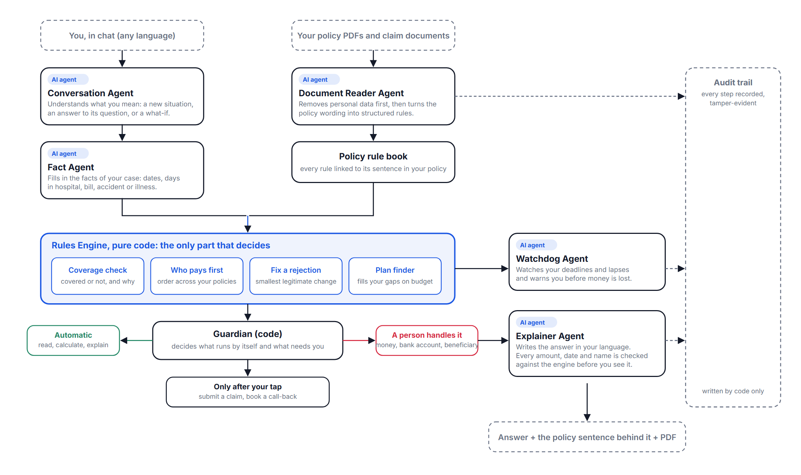

# ClauseGuard

**Clarity in every clause, confidence in every claim.**
FinTechathon 2026 Shenzhen · International Track · Topic D (AI Insurance Assistant)

ClauseGuard reads a policyholder's own insurance documents, turns every clause into a typed rule, and answers *what am I covered for, how much, by when, and how do I claim it* from those rules alone. Every amount is traced to the sentence it came from. Actions (submitting a claim, booking a call-back) run only inside permission tiers enforced in code, after the customer confirms; money and identity changes are never executed by the agent.

## Team

| Member | Role |
|---|---|
| Bunga Laelatul Muna | Team lead · agent design, solvers, evaluation |
| Izra | Backend, sandbox insurer, security layer |
| Wan Sabrina | Web client, interaction design, demo |

Institut Teknologi Sepuluh Nopember (ITS), Surabaya, Indonesia.

## What it does

Three core features, each a working part of the app:

- **ClauseLens — policy analysis.** "Covered for Rp 1,500,000; file by 26 November; here is the sentence that decides it." If one missing fact would change the answer, it asks for that one fact and nothing else.
- **ClauseLens, across a portfolio.** National health insurance, an employer plan, a hospital-cash plan, an accident policy and a road-accident fund are combined: who pays first, who tops up, what is still owed.
- **ClaimFlow — claim handling.** The insurer's own claim form is laid out from that insurer's wording, filled from typed facts only, shown to the customer, and sent to the sandbox insurer only after a Confirm tap. Uploaded invoices and discharge summaries travel with it.
- **TrustLock — AI guardrails.** Observe/Draft/Act, a one-time confirmation before anything is sent, no tool that can change a payout account, an insurer-side halt switch, a hash-chained audit log.
- **Also included:** Claim Simulator (change one fact, every answer is recomputed), Deadline Tracker (filing windows, grace periods, lapses, claim updates), PDF Export. **Shows its work.** A "How was this decided?" panel exposes the clauses that fired, a what-if panel recomputes every answer when a fact is flipped, and a hash-chained audit log records each step.

## Architecture



Live demo: **https://clauseguard-red.vercel.app** (web client on Vercel; the backend runs on the team's machine and is exposed through a tunnel during demonstrations, so it may be offline at other times — the site then replays recorded scenes).

| Component | Kind | Responsibility |
|---|---|---|
| Document Reader | model, quarantined | Extracts a policy PDF into typed clause tuples (limits, waiting periods, deadlines, exclusions, required documents), each linked to its source sentence. Hidden-text and PII checks run before any model call. |
| Conversation Agent | model | Reads each message in context: new situation, follow-up, correction, answer to a question, or hypothetical; detects the customer's language. |
| Planner | model + rule floor | Chooses the intent and the read-only tools; safety classifications (misrepresentation, out-of-scope, privileged actions) are decided by rules the model cannot override. |
| Fact Binder | model + rules | Binds the message to typed fact slots (event, dates, cause, facility, amounts). |
| Rules Engine | code only | Deterministic solvers: verdict, claim allocation across policies, recourse after a denial, adjudication twin, entitlement timeline, plan selection. |
| Permission Enforcer | code only | Four tiers: read (T0), compute (T1), submit after a UI confirmation bound to a single-use server nonce (T2), money/identity changes (T3: ticket only, no executing tool). Circuit breaker and insurer-side halt switch. |
| Form Builder · Document Matcher | model, validated | Lays out the insurer's claim form from its clauses (values are filled in code) and checks an upload against the policy's own document requirements. |
| Composer | model, verified | Words the reply in the customer's language; every figure, date and name is checked against solver output before display. |
| Watchdog | code only | Deadlines, grace periods and claim-status changes surfaced proactively. |
| Audit log | code only | Hash-chained event log; the verifier points at the first altered line. |

Design rule: the model never produces a verdict, an amount, a permission decision or an argument of a privileged tool. It reads, binds and words; code decides.

## Repository layout

| Path | Contents |
|---|---|
| [`clauseguard/`](clauseguard/) | Backend (Python 3.10, FastAPI): extractor, solvers, agents, security layer, sandbox insurer, benchmarks, tests. Start at [`clauseguard/README.md`](clauseguard/README.md) and [`clauseguard/ARCHITECTURE.md`](clauseguard/ARCHITECTURE.md). |
| [`clauseguard-web/`](clauseguard-web/) | Web client (Next.js 14, TypeScript): landing page, chat, evidence chain, what-if panel, judge-side process panel, insurer claims desk at `/insurer`. |
| [`clauseguard/docs/`](clauseguard/docs/) | Technical documentation, security self-assessment, execution-evidence index, deck source, diagrams. |
| [`clauseguard/evidence/`](clauseguard/evidence/) | Benchmark and evaluation reports with the raw run files they are computed from. |
| [`clauseguard/data/`](clauseguard/data/) | Scripted scenarios, adversarial fixtures, public datasets (see below), sandbox seed. |
| [`SUBMISSION/`](SUBMISSION/) | The six submission items mapped to files, plus the evidence set. |

## Models

| Model | Used for | Notes |
|---|---|---|
| Gemini 3.6 Flash | Policy extraction (once per document, cached) | Two-pass, schema-constrained, quarantined; fallback chain to other Flash versions |
| Gemini 3.5 Flash-Lite | Conversation context, planning, fact binding, composing, claim-document reading, form layout, document matching | Temperature 0, JSON schema output, disk cache |
| Gemini Embedding 001 | Clause search and ICD-10 candidate retrieval | Hybrid with BM25; a local ONNX embedding is available as a free alternative |
| none | Verdicts, allocation, recourse, timeline, permission tiers, audit | Pure Python |

Without an API key every step has a deterministic fallback (rule planner, rule binder, template wording), which is how the test suite and the scripted scenarios run.

## Data

| Dataset | Size | Source and licence | Used for |
|---|---|---|---|
| Insurance-contract reasoning benchmark (Mridul, Kapa & Seneviratne, 2026) | 58 scenarios × 10 synthetic US life-insurance contracts, 580 clause-traced labels | public, CC-BY-4.0; not redistributed, fetched by script | Accuracy against published LLM baselines |
| Real policy documents | 6 retail policy PDFs (Astra, Chubb, Great Eastern, Roojai/Sompo) + 30 Indonesian RIPLAY product summaries | insurers' public documents; not redistributed, fetched by script with URL and hash | Extractor development and sandbox policy wording |
| CMS Exchange Public Use Files, plan year 2026 | 834 standard plans, 4,183 variants, 9,052 premium rows (Texas) | US Government, public domain | Plan selection and claim-allocation experiments on real cost-sharing terms |
| InsuranceQA | 16,860 real consumer questions (200-question fixed sample) | research use, Feng et al. 2015 | Off-script robustness of intent and fact binding |
| UK Financial Ombudsman decisions | 150 decisions quoting policy wording | Crown copyright, OGL v3 | Clause-interpretation and recourse checks |
| KFF claim-denial statistics 2023 | 238 rows | public | Base rates for risk messaging |
| Sandbox personas | 3 synthetic households, 14 policies, seeded claims | synthetic; BPJS Kesehatan and Jasa Raharja modelled from public regulation | Demo and scripted scenarios |

Provenance for every file: [`clauseguard/data/real/README.md`](clauseguard/data/real/README.md) and `manifest.json` (URL, date, SHA-256).

## Results

### Public benchmark: coverage verdicts (COVERED / DENIED / NOT APPLICABLE)

| System | Accuracy | Fabricated denials (NOT APPLICABLE read as DENIED) | Condition |
|---|---|---|---|
| Gemini 3 | 65.2 % | 26.6 % | benchmark authors' run, web chat, n = 580 |
| ChatGPT 5.3 | 72.9 % | 6.7 % | benchmark authors' run, web chat, n = 580 |
| Claude Sonnet 4.6 | 87.8 % | 2.4 % | benchmark authors' run, web chat, n = 580 |
| **ClauseGuard** (extracted rules + rules engine) | **84.6 %** [77.8, 90.0] | **1.4 %** | our run, Gemini Flash reads, code decides, n = 390 |
| ClauseGuard on the benchmark's own rules (ceiling) | 91.8 % [83.3, 98.0] | 2.9 % | n = 342; what remains between 84.6 and 91.8 is document reading, not reasoning |

A same-API long-context baseline (whole contract in the prompt, same model, same schema) scores 87.5 % on the 112 items it was run on; on the 32 items common to both, the difference is not significant (McNemar p = 1.0). Full tables, confidence intervals and the error taxonomy: [`clauseguard/evidence/bench_report.md`](clauseguard/evidence/bench_report.md).

### Agent-level evaluation (deterministic mode unless stated)

| Measure | Result | Evidence |
|---|---|---|
| Scripted tasks (20 functional, 10 adversarial, 3 plan recommendation) | 33 / 33 | `task_report.md` |
| Off-script questions, blind batch written and run once before any fix | 3 / 14 (out-of-sample, no model) | `offscript_blind_report.md` |
| Attack suite, enforcement on: attack success / benign false block | 0 / 27 · 0 / 15 | `adversarial_report.md` |
| Same suite with enforcement patched to allow-all (ablation) | 1 / 27 | `adversarial_report.md` |
| Paraphrase consistency, 20 scenarios × 3 wordings | 20 / 20 rule binder · 7 / 8 model binder (live sample) | `paraphrase_report.md` |
| Clarification: recall · silence · ask precision · slot accuracy | 87 % · 100 % · 100 % · 100 % | `clarify_report.md` |
| Claim allocation vs greedy order, 500 households on real CMS plans | greedy suboptimal in 47.2 %; mean gain USD 988 where suboptimal | `allocation_report.md` |
| Plan selection, 834 real CMS plans / mixed catalogue | ties cheapest 100/100 · beats cheapest 73/100, priciest 79/100 | `plan_selection_report.md` |
| Model calls per chat turn (90 turns) | mean 0.98; 48 turns with zero calls | `cost_report.md` |

What is not claimed: superiority over frontier LLMs on verdicts (the API-matched comparison shows no significant difference); that no data leaves the system (redacted text, never whole PDFs, is sent to a hosted model); that the allocation gain is money saved in real life (it is a simulation over real plan terms).

## How it compares

Existing help for a policyholder falls into four kinds. ClauseGuard is built to do what none of them does: decide from the customer's own clauses, across all their policies, and carry the claim through to the insurer under enforced limits.

| | Insurer's own app (one company) | Marketplace / aggregator app | General AI chat | **ClauseGuard** |
|---|---|---|---|---|
| Reads *your* policy wording | partly (its own products) | no | only if you paste it; no verification | yes: any PDF, every rule linked to its sentence |
| Works across several insurers and public schemes | no | no | no data | yes: payer order and total across the portfolio |
| Answers "am I covered, for how much, by when" with the clause | FAQ-level | no | plausible text, may invent a denial | yes: deterministic verdict, cited clause, deadline |
| Asks only the one fact that changes the outcome | no | no | no | yes (verdict-sensitivity clarification) |
| Reads claim documents and checks them against the policy's list | upload only | no | no | yes: typed extraction, matched to the insurer's requirements |
| Prepares the claim form | the insurer's static form | no | no | yes: laid out from that insurer's wording, filled from typed facts, PDF |
| Submits, then reports the decision back | yes, for that insurer | sometimes, by hand-off | no | yes, to the (sandbox) insurer, with status and notes returned |
| Proactive deadlines and lapse warnings | some | no | no | yes |
| Limits on what the AI may do, enforced in code and auditable | n/a (no AI agent) | n/a | none | permission tiers, confirmation nonce, halt switch, hash-chained log |
| Fabricated denials on the public benchmark | — | — | 2.4 % to 26.6 % | 1.4 % |

What it is not: an insurer. The desk it submits to is a sandbox; integration with a real insurer's API is the next step.

## Security model

| Tier | Examples | Gate |
|---|---|---|
| T0 | read own policies, claims, payment status | session identity; cross-account access refused and logged |
| T1 | coverage check, allocation, timeline, drafts | typed inputs only |
| T2 | submit claim, attach document, schedule call-back | Confirm tap in the UI → single-use server nonce bound to the arguments |
| T3 | payout account, beneficiary, premium account, claim approval | no executing tool exists; a ticket is opened for a person |

Also: documents are untrusted data (hidden white-on-white and off-page text is detected and never interpreted as instructions); local PII redaction with a hard block if residual PII remains; output guard on every reply; insurer-side halt switch; hash-chained audit log with a verifier. Details and known risks: [`clauseguard/SECURITY.md`](clauseguard/SECURITY.md), [`clauseguard/docs/SECURITY_SELF_ASSESSMENT.md`](clauseguard/docs/SECURITY_SELF_ASSESSMENT.md).

## Setup and run

### Prerequisites

- Python 3.10 or newer, Node.js 18 or newer, Git.
- Optional: a Gemini API key. Without one every step falls back to its deterministic path (rule planner, rule binder, template wording); with one the agents read, bind and word with the model.

### 1. Clone

```bash
git clone https://github.com/Bungalm/CLAUSEGUARD.git
cd CLAUSEGUARD
```

### 2. Backend (sandbox insurer + agent API) → http://127.0.0.1:8000

```bash
cd clauseguard
python -m venv .venv
.venv\Scripts\activate            # Windows
# source .venv/bin/activate       # macOS / Linux
pip install -r requirements.txt
copy .env.example .env            # Windows;  cp .env.example .env  elsewhere
python scripts/serve.py --fresh   # --fresh re-seeds the sandbox (three personas, policies, claims)
```

Environment variables (`clauseguard/.env`):

| Variable | Purpose | Default |
|---|---|---|
| `GEMINI_API_KEY` or `GEMINI_API_KEYS` | model access; a comma-separated pool rotates on quota errors | empty → deterministic mode |
| `CG_MODEL_EXTRACT`, `CG_MODEL_FAST`, `CG_MODEL_CLAIM_DOC`, `CG_MODEL_EMBED` | model names per role | see `.env.example` |
| `CG_ADMIN_TOKEN` | back-office credential for `/insurer`, the halt switch and `/backoffice/*` | empty → those endpoints disabled (403) |
| `CG_STORAGE`, `DATABASE_URL` | `postgres` + a connection string keeps the audit chain, history and claim/ticket mirror in Postgres | `local` (files + SQLite) |
| `CG_OFFLINE=1` | force deterministic mode even if a key is set | unset |

Health check: `GET http://127.0.0.1:8000/health`. API docs: `http://127.0.0.1:8000/docs`.

### 3. Web client → http://localhost:3000

```bash
cd ../clauseguard-web
npm install
copy .env.example .env.local      # NEXT_PUBLIC_API_URL=http://localhost:8000
npm run dev                       # development
# npm run build && npm start      # production build (use this when recording the demo)
```

The browser never calls the backend directly: `next.config.mjs` proxies `/api/cg/*` to `NEXT_PUBLIC_API_URL`, so the backend needs no CORS configuration and no public address.

### 4. Try it

1. Open `http://localhost:3000` → **See the demo**. Pick a persona (Rizky, Santoso family, Dewi) or open **Try it** to upload your own policy PDF.
2. Follow [`clauseguard-web/DEMO_SCRIPT.md`](clauseguard-web/DEMO_SCRIPT.md): claim question → evidence chain → what-if → submit with Confirm.
3. Open `http://localhost:3000/insurer`, enter `CG_ADMIN_TOKEN`, and approve or reject the claim with a note; the customer's digest shows the decision.
4. **Behind the answer** (top right) opens the judge-side panel: agents that ran, tool calls, trust labels, audit chain, autonomy dial and the insurer's halt switch.

### 5. Tests

```bash
cd clauseguard
python -m pytest -q                                   # unit and integration tests, no API key needed
python scripts/run_tasks.py --no-llm                  # 33 scripted scenarios against the sandbox insurer
python scripts/run_adversarial.py --no-guard          # attack suite with enforcement on and off
python scripts/verify_audit.py evidence/audit_log.jsonl

cd ../clauseguard-web
npx tsc --noEmit && npm run lint
```

## Deployment

### Backend as a container (Render, Hugging Face Spaces, Fly.io, any Docker host)

```bash
cd clauseguard
docker build -t clauseguard .
docker run -p 8000:7860 -e PORT=7860 -e GEMINI_API_KEYS=... -e CG_ADMIN_TOKEN=... clauseguard
```

The image runs `uvicorn clauseguard.sandbox.api:app` on `$PORT` (default 7860) and exposes `/health`. Recommended settings on a managed host:

| Setting | Value |
|---|---|
| Root directory | `clauseguard` |
| Build | Dockerfile |
| Health check path | `/health` |
| Environment | `CG_ENV=production`, `GEMINI_API_KEYS`, `CG_ADMIN_TOKEN`, and `CG_STORAGE=postgres` + `DATABASE_URL` if the audit log must survive restarts |

The container filesystem is ephemeral: the sandbox database and uploads reset on restart; with Postgres configured the audit chain, conversation history and the claim/ticket mirror persist. Full runbook, migration script and the degraded-mode behaviour when Postgres is unreachable: [`clauseguard/deploy/README.md`](clauseguard/deploy/README.md), [`clauseguard/deploy/storage.md`](clauseguard/deploy/storage.md).

### Web client on Vercel

1. Import the repository in Vercel, set **Root Directory** to `clauseguard-web`.
2. Add `NEXT_PUBLIC_API_URL` = the public URL of the backend.
3. Deploy. If the backend is unreachable the site still opens and replays recorded demo scenes with an "offline" banner.

CI (`.github/workflows/ci.yml`) runs the backend test suite without an API key and the web type-check and lint on every push.

## Tests and test cases

| Suite | Where | Command |
|---|---|---|
| Unit and integration tests (solvers, extractor, security layer, API, agent loop) | `clauseguard/tests/` | `python -m pytest -q` |
| Scripted scenarios: 23 functional tasks T01–T23, 10 adversarial A01–A10, off-script batches | `clauseguard/data/scripted_tasks/` | `python scripts/run_tasks.py --no-llm` (`--suite off_script`, `holdout`, `blind`) |
| Attack suite with enforcement on and off, hidden-text fixtures | `clauseguard/data/adversarial/`, `scripts/run_adversarial.py` | `python scripts/run_adversarial.py --no-guard` |
| Benchmarks and agent evaluations | `clauseguard/bench/` | `python -m bench.run_bench`, `python bench/paraphrase.py`, `python bench/clarify_eval.py` |
| Web client type-check and lint | `clauseguard-web/` | `npx tsc --noEmit && npm run lint` |

Every evaluation writes its report to `clauseguard/evidence/`; the reproduction command for each file is listed in [`clauseguard/docs/EXECUTION_EVIDENCE.md`](clauseguard/docs/EXECUTION_EVIDENCE.md).

## Submission package

| Item | Location |
|---|---|
| Technical documentation | `SUBMISSION/1_Technical_Documentation.docx` · source [`clauseguard/docs/TECHNICAL_DOCUMENTATION.md`](clauseguard/docs/TECHNICAL_DOCUMENTATION.md) |
| Presentation deck | `SUBMISSION/2_Presentation_Deck.pptx` · source [`clauseguard/docs/DECK.md`](clauseguard/docs/DECK.md) |
| Demo video script | `SUBMISSION/3_Video_Script.md`, [`clauseguard-web/DEMO_SCRIPT.md`](clauseguard-web/DEMO_SCRIPT.md) |
| Source code | this repository; archive built by `python clauseguard/scripts/make_submission_zip.py` |
| Security self-assessment | `SUBMISSION/5_Security_Self_Assessment.docx` · source [`clauseguard/docs/SECURITY_SELF_ASSESSMENT.md`](clauseguard/docs/SECURITY_SELF_ASSESSMENT.md) |
| Execution evidence | `SUBMISSION/6_Execution_Evidence_Index.docx`, `SUBMISSION/evidence/`, [`clauseguard/evidence/`](clauseguard/evidence/) |

## Licence

Application code: Apache-2.0 (see [`clauseguard/LICENSE`](clauseguard/LICENSE)). Third-party documents and datasets keep their own licences and are fetched by script rather than redistributed; see [`clauseguard/data/real/README.md`](clauseguard/data/real/README.md).
"# clauseguard" 
