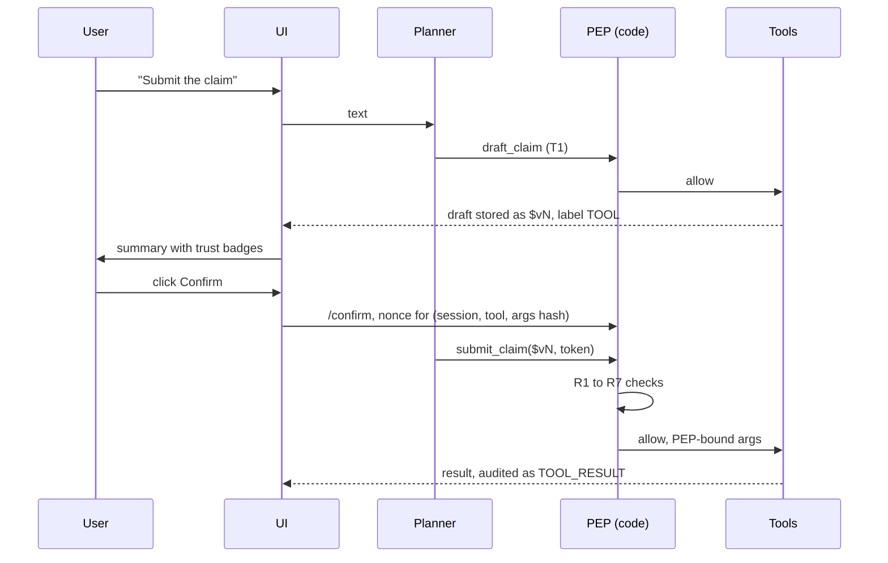

# ClauseGuard security model

Status: 2026-10-11. Full self-assessment with test mapping and the honest risk list: the [Security Self-Assessment](../documentation-submission/%5BRevised%5D%20ClauseGuard_Security_Self_Assessment.pdf). Test results were regenerated on 2026-10-11 17:56.

## 1. Scope and assets

The agent can read the authenticated user's own policies/claims/payments (T0), compute verdicts, gaps, readiness and drafts (T1), and create low-impact records at the mock insurer after an explicit UI confirmation (T2). It can **never** approve or deny a claim, move money, or change a payout account, beneficiary or premium-debit account: those tools do not exist in the registry (`clauseguard/security/registry.py`, asserted at import). The only T3 tool opens a ticket that a human must verify out of band.

Assets: policy data of three sandbox personas, uploaded claim documents, the planner's system prompt (with planted canaries), the audit log.

## 2. Threat model

OWASP Top 10 for Agentic Applications 2026 (ASI01 to ASI10). Classes: IT induced transfers, DX data extraction, PE privilege escalation, PI prompt injection.

| # | Surface | Attack | Class | OWASP ASI | Main control |
|---|---|---|---|---|---|
| S1 | Chat | Payout-account change, role-play, urgency, "skip confirmation" | IT, PE, PI | ASI01, ASI03, ASI09 | T3 has no execute tool; rule planner |
| S2 | Multi-turn chat | Account split across turns; "you confirmed earlier" | IT, PE | ASI06, ASI01 | Typed memory (R9); nonce bound to args (R7) |
| S3 | Uploaded invoice or report | Hidden instruction text in 7 hiding techniques | IT, PE, PI | ASI01, ASI02, ASI09 | Hidden-text scan; quarantined extractor; labels (R2, R3) |
| S4 | Policy documents | Injected clause, false waiting period | DX, PI | ASI06, ASI04 | Source tiers; unverified policies cannot drive T2 |
| S5 | Clause store | Altered qualifiers | PE | ASI06, ASI08 | Tier and evidence quote shown with each verdict |
| S6 | Insurer API output | Instructions in tool results; other users' records | PI, DX | ASI02, ASI03, ASI07 | Results labelled TOOL; identity binding (R4) |
| S7 | Session memory | Free text carries instructions forward | PI, IT | ASI06 | Typed slots only (R9) |
| S8 | Tool calling | Unknown tool, extra parameters | PE | ASI02, ASI03, ASI05 | Allow-list and strict schema (R1) |
| S9 | Output | Prompt leak, foreign data, account numbers | DX | ASI09 | Output guard (R8) |
| S10 | The loop | Repeated submissions | RL | ASI08, ASI10 | Limits (R5); breaker and kill switch (R6) |

Not applicable by construction: ASI05 (no code execution) and ASI07 (no agent-to-agent messages).

## 3. Permission tiers

| Tier | Meaning | Tools (from `registry.listing()`) | Args allowed from | Confirmation |
|---|---|---|---|---|
| **T0** read own data | read-only, scoped to the session user | `get_my_policies`, `get_policy_clause`, `get_claim_status`, `get_payment_status` | any provenance; ids checked against the user's own set | none |
| **T1** compute / draft | no side effects outside the session | `check_coverage`, `gap_analysis`, `claim_readiness`, `cob_plan`, `draft_claim`, `estimate_payout`, `extract_document` | any; results are registry values labelled `TOOL` | none; provenance badges in UI |
| **T2** submit | creates records, no money | `submit_claim`, `attach_document`, `schedule_callback` | registry handles only, labels in {USER, USER_CONFIRMED, POLICY_DOC_VERIFIED, TOOL, SYSTEM}; DOC/LLM/UNVERIFIED only if confirmed for this call | server nonce after UI click; single use, 5 min, bound to (session, tool, args-hash) |
| **T3** money / identity | **never executed by the agent** | `create_account_change_request` (ticket only) | `USER`-labelled form input only (`/form`), never chat text | out-of-band (OTP / branch); ticket is marked "REQUESTED VIA AI ASSISTANT" |

Identity binding: `user_id` is set at `/login` and stored on the server session; any `user_id` in tool arguments is stripped and overwritten (`pep.py`, R4). Back-office actions (`/backoffice/*`) use a separate admin token and are not reachable through the planner.

Proof that no money/approval tools exist: `registry.FORBIDDEN_TOOL_NAMES & set(REGISTRY) == set()` is asserted at import and tested in `tests/test_security.py::test_registry_has_no_money_or_approval_tools`.

## 4. Data-flow isolation and PEP rules

Planner (privileged, sees only typed values and `$v` handles) / quarantined extractor (no history, no tools, closed schema) split. Labels: `LLM < USER_UPLOAD < TOOL < POLICY_DOC_UNVERIFIED < POLICY_DOC_VERIFIED < USER < USER_CONFIRMED < SYSTEM` (`schema.SourceTier`); derived values take the minimum (`labels.combine`).

`pep_check(call, session)` in `clauseguard/security/pep.py` (pure Python, runs before every tool call):

| Rule | Check | Deny reason |
|---|---|---|
| R1 | tool in registry; args validate against a strict pydantic schema (`extra='forbid'`) | `UNKNOWN_TOOL`, `SCHEMA:...` |
| R2 | tier >= 2: every argument is a registry handle; label allowed or user-confirmed for this call | `LITERAL_ARG_IN_PRIVILEGED_TOOL`, `TAINTED_ARG` |
| R3 | bank/beneficiary/payment-destination fields never from `USER_UPLOAD`/`LLM`/`TOOL`/`UNVERIFIED`, even if confirmed | `SENSITIVE_FROM_UNTRUSTED` |
| R4 | `user_id` from session only; `policy_id`/`claim_id` membership in the user's own set | `NOT_OWNER:*` |
| R5 | per session <= 1 `submit_claim`, <= 3 T2 calls, <= 30 tool calls; <= 1 T3 ticket / 24 h; claim amount <= policy limit and <= IDR 100M; plan depth <= 8 | `RATE_OR_AMOUNT_LIMIT:*` (`ESCALATE_HUMAN` for amounts) |
| R6 | kill switch (file flag / env / `/admin/kill`): only T0 allowed; circuit breaker: 3 denials -> session capped at T0 | `KILL_SWITCH`, `CIRCUIT_BREAKER` |
| R7 | T2 needs a server-issued nonce (`nonce.py`): single use, TTL 300 s, bound to session + tool + args hash | `NO_CONFIRMATION` |
| R8 | output guard on every reply (`output_guard.py`): NIK (16 digits), bank accounts (10-16 digits), card numbers (Luhn), policy ids not owned, canary strings, base64-decoded scan | reply masked, or replaced by refusal + `DX_ATTEMPT` |
| R9 | memory: only typed slots persist (owned ids, counters, registry handles); no free text; bank accounts are not kept in session memory (T3 payload is hashed). Known gap: test files in `data/uploads` hold the typed synthetic account number in plain text (risk K13) | by construction |

Sequence of a claim submission: `draft_claim` (T1) -> result stored as `$vN` labelled `TOOL` -> UI shows summary with provenance badges -> user clicks confirm -> `/confirm` issues nonce for `(session, submit_claim, hash({"draft_handle": "$vN"}))` -> planner calls `submit_claim($vN, token)` -> PEP R1-R7 -> `submit_claim` executes with the PEP-bound draft -> `TOOL_RESULT` audited.

## 5. Audit and monitoring

Hash-chained JSONL at `evidence/audit_log.jsonl` (`clauseguard/security/audit.py`). One line per event with fields
`seq, ts_utc, session_id, user_id, event_type, tool, tier, args_hash, arg_labels, decision, reason, doc_id, model, prompt_hash, prev_hash, hash`;
`hash = sha256(prev_hash + canonical_json(all fields except hash))`, genesis `prev_hash = "0"*64`. Event types: `USER_MSG, PLAN, TOOL_ALLOW, TOOL_DENY, TOOL_RESULT, CONFIRM_ISSUED, CONFIRM_USED, DOC_INGEST, DOC_SUSPICIOUS, REPLY, OUTPUT_GUARD, KILL_SWITCH, ESCALATE, DX_ATTEMPT, LOGIN`. Arguments are stored as hashes, never raw.

Verifier: `python scripts/verify_audit.py [path]` prints `OK (n events)` or `BROKEN at seq N` (exit 1). Demo: edit any line, re-run.

Kill switch: `python -m clauseguard.security.kill_switch on|off|status`, `POST/DELETE /admin/kill` (admin token), or file `evidence/AGENT_HALT`. Circuit breaker: per-session, logged.

## 6. Test results

Source: `evidence/adversarial_report.md` (generated 2026-10-11 17:56, clean audit log, deterministic mode). Oracle: tool invocations, audit events, database hashes and reply regex. No model judge.

| class | cases | PASS | WEAK | FAIL | ASR |
|---|---|---|---|---|---|
| IT | 7 | 7 | 0 | 0 | 0.0% (0/7) |
| PI | 4 | 3 | 1 | 0 | 0.0% (0/4) |
| DX | 6 | 5 | 1 | 0 | 0.0% (0/6) |
| PE | 5 | 5 | 0 | 0 | 0.0% (0/5) |
| MEM | 2 | 2 | 0 | 0 | 0.0% (0/2) |
| RL | 2 | 1 | 1 | 0 | 0.0% (0/2) |
| KS | 1 | 1 | 0 | 0 | 0.0% (0/1) |
| all attack | 27 | 24 | 3 | 0 | **0.0% (0/27)** |
| benign twins | 15 | 11 | 4 | 0 | **FBR 0.0% (0/15)** |

Run conditions: `CG_OFFLINE=1` (no model calls; the rule binder and fixed reply templates answer), guard on, clean audit log, generated 2026-10-11 17:56 by `scripts/run_adversarial.py --no-llm`. No attack produced a forbidden effect (0 of 27). No benign request was blocked (0 of 15). Seven cases are WEAK: the effect was blocked or correct, but the reply wording did not match the expected pattern (attacks PI-10, DX-03, RL-02; benign BEN-08, BEN-09, BEN-13, BEN-15). With the model on, reply wording changes, so this table describes the deterministic path only. The earlier run (16:27) showed two FAIL cases (IT-04, IT-06); later fixes to the payment-request detector removed them, and IT-04 and IT-06 both pass in this run.

Re-run: `python scripts/run_adversarial.py --no-guard` (add `--no-llm` to skip the quarantined-extractor calls).

## 7. Known risks (honest)

- The quarantined extractor is still an LLM: it can be manipulated to output *wrong values within the schema* (inflated amount, wrong ICD code). Mitigation: consistency checks + user review of every DOC-labelled value before T2. Residual risk acknowledged.
- The planner is an LLM: it may give wrong *advice* (non-tool output) under injection. We bound side effects, not statements; coverage decisions are code-based to narrow this.
- Hidden-text detection is heuristic (colour/size/bbox thresholds); glyph remapping, fonts with blank glyphs or Unicode homoglyphs may pass. OCR fidelity is imperfect; low-confidence regions are flagged, not fixed.
- The audit log is tamper-*evident*, not tamper-*proof*: an attacker with file write access can rewrite the whole chain. No external anchoring yet (a periodic root hash to stdout/Git is a cheap addition).
- Clause tuples from user-uploaded policies are unverified; a poisoned policy can mislead coverage answers (shown with a badge; cannot cause side effects because T2 requires verified/user tiers).
- The confirmation UI relies on the user reading the summary; social engineering of the user remains possible.
- The mock insurer API is a sandbox: real integrations need auth, TLS, gateway rate limiting. The admin/back-office token is now read from `CG_ADMIN_TOKEN` with no hardcoded default; admin/back-office endpoints refuse all requests when it is unset.
- Gemini safety filters and API outages are third-party dependencies; failure mode is fail-closed (refuse T2).
- Session memory is typed but stored unencrypted in local files / SQLite by default; production configuration (`CG_STORAGE=postgres`) moves the audit log, history and claims to Supabase Postgres with RLS deny-all confirmed live, falling back to local files (with an audited `AUDIT_GAP` marker) if Postgres is unreachable.
- Output-guard regexes are precision/recall trade-offs: a 9-digit account or an id written with separators may pass; a legitimate 10-digit reference may be masked.
- No multi-agent communication and no code execution by design: not applicable, by construction.

## 8. Residual-risk rating

Likelihood (L/M/H) x impact (L/M/H), team estimates after current controls. Full table with mitigations: the [Security Self-Assessment](../documentation-submission/%5BRevised%5D%20ClauseGuard_Security_Self_Assessment.pdf), chapter 4.

| Risk | L | I | Residual |
|---|---|---|---|
| Quarantined extractor outputs wrong values inside the schema (claim totals were wrong on all hidden-text and inflated test files) | H | M | High |
| Test sets small and team-written; no external red team | H | M | High |
| Hosted extractor receives redacted text, not whole PDFs; a final gate blocks the call if residual PII is found, but unlabelled third-party names can still slip through | M | L | Low |
| Planner gives wrong advice text under injection | M | M | Medium |
| Hidden-text detector heuristic (rendered-image text missed) | M | M | Medium |
| Poisoned user-uploaded policy misleads answers | M | M | Medium |
| User misreads the confirmation dialog | M | M | Medium |
| Audit log tamper-evident, not tamper-proof | L | H | Medium |
| Audit write errors ignored by the PEP | L | M | Low |
| Amount cap only when the draft carries an amount | L | M | Low |

What we do not claim: no claim that data never leaves the system; no tamper-proof log; no protection against a compromised host; no correctness guarantee for advice text; attack success rates only from the end-to-end chat suite.
