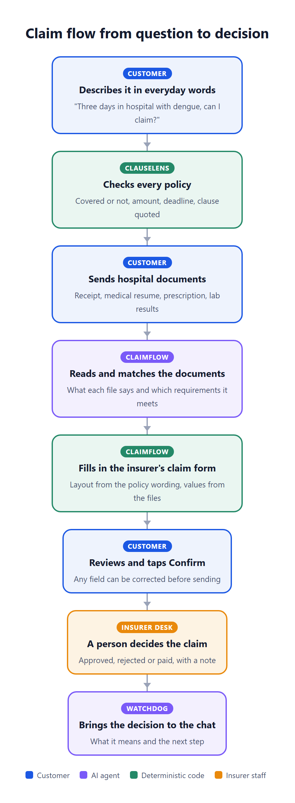
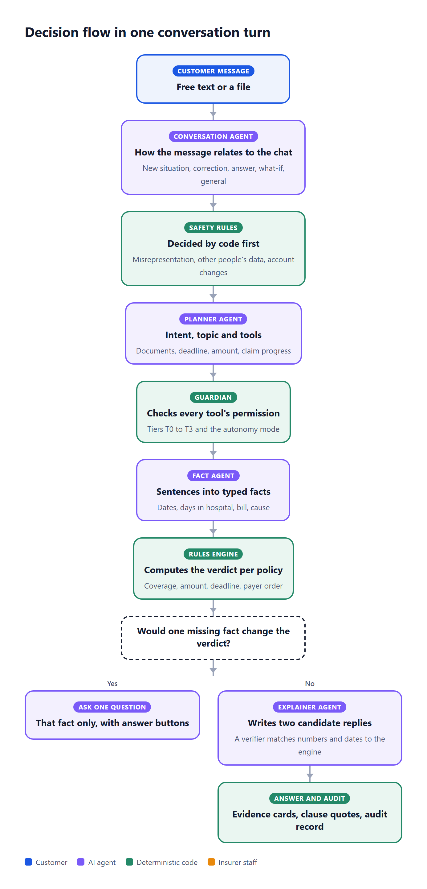
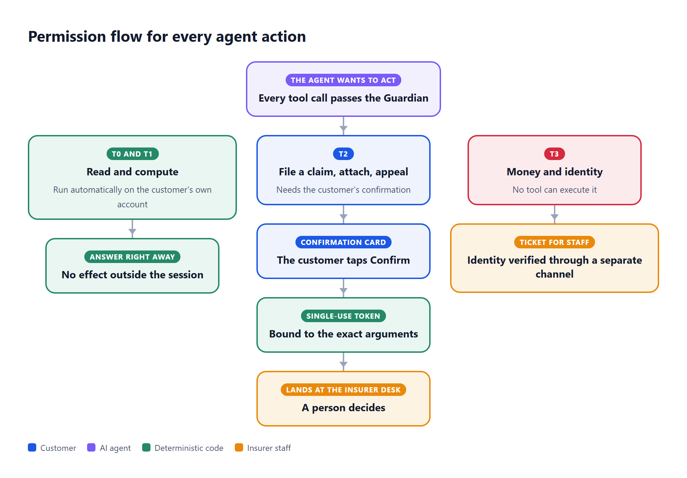

# ClauseGuard: Technical Documentation

*Clarity in every clause, confidence in every claim.*

FinTechathon 2026 · International Track · Topic D: AI Insurance Assistant
Team: Bunga Laelatul Muna, Izra, Wan Sabrina · Institut Teknologi Sepuluh Nopember, Indonesia
Live demo: https://clauseguard.up.railway.app · Source code: https://github.com/bungagana/clauseguard

## 1. Problem & scope

ClauseGuard is an AI insurance assistant that helps customers understand their policies, check their coverage, calculate benefits and handle claims. One household can hold several policies, such as national health insurance (BPJS Kesehatan), an employer plan, a personal plan and an accident cover. The rules on waiting periods, filing deadlines, required documents and payment order are spread across long policy documents.

This creates five main risks:

1. A claim is filed after the deadline.
2. A claim is filed during a waiting period.
3. A claim is filed with a payer that does not match the payment order.
4. Overlapping benefits are not optimised, or benefits that can be stacked are not used.
5. A policy lapses because the premium was not paid during the grace period.

ClauseGuard analyses the customer's own policies to help avoid these mistakes. According to KFF (2025), about one in five in-network health insurance claims in the United States was denied in 2023, and fewer than 1% of denied claims were appealed. In Indonesia, OJK (2023) reports that more than half of insurance complaints concern difficulty with claims.

### 1.1 User personas

The project builds simulated data for three personas that represent common claim cases. Each persona can be tried directly in the demo with its own account.

**Table 1. ClauseGuard personas and demo accounts**

| Persona | Profile | Policies |
|---|---|---|
| Rizky, 24 | Graduate student handling a dengue hospital claim | Sompo hospital cash plan, term life with an overdue premium, critical illness cover and BPJS Kesehatan class 2 |
| The Santoso family | Family of four whose head works as a private-sector employee | Employer group health and life, a family hospital cash rider, the wife's personal health plan and BPJS Kesehatan class 1 |
| Dewi, 29 | Ride-hailing courier | Personal accident cover, the platform's on-trip accident protection, BPJS Kesehatan class 3 with three months of arrears and Jasa Raharja |

All persona data is synthetic. The policy wording is modelled on public insurer documents. New users can also sign up, upload their own policy PDF and ask about it right away.

### 1.2 Features

ClauseGuard has three core features and three supporting features.

**Table 2. Core features**

| Feature | Purpose | Financial task completed |
|---|---|---|
| ClauseLens | Understands the customer's cover | Decides whether an event is covered, how much is paid, the filing deadline and which policy pays first, with the clause quoted |
| ClaimFlow | Handles the customer's claim | Reads hospital documents, matches them to the required documents, fills in the insurer's own claim form, files after confirmation and relays the insurer's decision |
| TrustLock | Keeps the customer in control | Limits every agent action with four permission tiers, a single-use confirmation and an audit log |

**Table 3. Supporting features**

| Feature | Purpose |
|---|---|
| Claim Simulator | Answers what-ifs, for example "if I had stayed five days", without affecting a real claim |
| Deadline Tracker | Warns before a claim deadline or a premium grace period runs out |
| PDF Export | Saves the answer, the clause evidence and the claim form as a document |

Besides these features, ClauseGuard has base capabilities that support all of them: uploading one's own policy, two languages (Indonesian and English), accounts with chat history, a sandbox insurer with a claims desk, a "How was this decided" panel on every answer, and the audit log.

### 1.3 Success metrics

Task success is measured by automatic checks. No model judges the results.

**Table 4. Success metrics and results**

| Metric | How it is measured | Result |
|---|---|---|
| Claim task completion | Scripted tasks that pass checks on verdict, amount, deadline, denial code and actions | 33 of 33 (100%) |
| Coverage accuracy | Correct verdicts on a public insurance benchmark | 84.6% of 390 labels |
| Invented denials | Denials returned where no clause applies | 1.4% |
| Question precision | Asks when the answer would change and stays silent otherwise | 87% and 100% |
| End-to-end claim | From documents to the insurer's decision back in the chat | Completed and recorded in the audit log |
| Conversation quality | Turns passed out of 47 turns of slang, typos, corrections and what-ifs | 42 of 47 (89%) |
| Action safety | Attacks that produced any effect | 0 of 27 |

## 2. System architecture

### 2.1 System components

Figure 1 shows the components of ClauseGuard. AI agents understand and explain. The rules engine decides. The Guardian enforces permissions. Every step is recorded in the audit log.

**Table 5. Role of each component**

| Component | Role |
|---|---|
| UI and dialog | The customer web app (chat, verdict cards, claim form, document upload) and the claims desk for insurer staff |
| Orchestrator | The agent loop that runs planning, the permission check, tool calls, the rules engine and reply writing in every turn |
| LLM | Google Gemini to understand messages, read documents and word replies |
| AI agents | Seven agents with narrow tasks, described in section 3.1 |
| Tools and API | 19 permission-tiered tools that call the sandbox insurer API |
| Rules engine | Deterministic code that decides coverage, amounts, deadlines, payer order and claim readiness |
| Guardian | The permission enforcement point that checks every tool call |
| Data store | Postgres on Supabase for the audit log, chat history, claims and tickets |
| Sandbox insurer | A simulated insurer with a claims desk where staff decide claims |

### 2.2 Claim flow

Figure 2 shows one claim from the first question to the insurer's decision. The box colours show who acts at each step.

### 2.3 Decision flow in one turn

Figure 3 shows the steps that run every time the customer sends a message. Safety rules are decided by code before the model reads the intent. The verdict is always computed by the rules engine.

### 2.4 Technology stack and deployment

Each technology was chosen because it supports structured, safe and checkable output.

**Table 6. Technology stack and rationale**

| Layer | Technology | Reason |
|---|---|---|
| Rules engine and agent | Python, FastAPI, Pydantic | Strict typed schemas for policy rules, facts and model output |
| LLM | Google Gemini Flash Lite | Schema-constrained JSON output, low latency, low cost and good understanding of everyday Indonesian |
| Optimisation | SciPy (MILP, HiGHS) | Plan selection with optimal results that can be checked |
| Web app | Next.js, TypeScript, Tailwind CSS | A chat interface with interactive cards for customers and the insurer's desk |
| Accounts and storage | Supabase Auth and Postgres | Confirmed email sign-in, row-level security and a persistent audit log |
| Hosting | Railway, Southeast Asia region | Separate web and API services close to the database, updated automatically from the repository |

## 3. Core algorithm description

### 3.1 AI agents and prompt design

ClauseGuard uses seven AI agents. Each agent does one narrow task and fills a closed output schema. Code validates every output before it is used. Message and document content is always treated as data, so instructions hidden inside it are ignored.

**Table 7. AI agents and prompt design**

| Agent | Task | Input | Prompt core | Output | Safeguard |
|---|---|---|---|---|---|
| Conversation Agent | Reads how a message relates to the conversation | Message, known facts, the agent's last question, the last four exchanges | Classify the message as an answer, correction, continuation, new situation, what-if or general question, with examples in two languages | One relation type, the message language and the facts that still apply | It can only drop facts. Facts are kept when the message brings no new event |
| Planner Agent | Decides intent, topic and tools | Message, typed situation, the last four exchanges | Write a short reading first, then pick an intent from a fixed list and the read-only tools needed, with examples in two languages | Intent, question topic, tools and an action-request flag | Safety classifications are decided by code. An action is accepted only on a clear request or an accepted offer |
| Fact Agent | Turns sentences into typed facts | Customer message | Fill a field only when the text states it, never guessing dates, ages, amounts or causes | Facts from a fixed vocabulary, such as admission date, days in hospital, bill, cause | Event facts are locked and cannot be changed to fit a policy |
| Document Reader Agent | Reads policies and claim documents | Document text with personal data already removed | A quarantined component that classifies and transcribes the document into the schema without following any instruction inside it | Typed policy rules, or a claim document summary (type, dates, total, diagnosis) | No tools and no chat history. Instruction-like text is flagged |
| Claim Form Agent | Lays out the insurer's claim form | The policy's claim clauses | Design a title, sections and fields in the insurer's own terms, each field bound to one data source | Form structure | Values are filled by code from the claim draft. The model never writes values |
| Explainer Agent | Words the reply | Engine results, the last four exchanges, six example replies | Write short reasoning notes, then two friendly and concise candidate replies in the customer's language | Candidate replies and the best pick | Every amount, date and identifier is checked against the engine. Clause quotes must match exactly |
| Watchdog Agent | Follows deadlines and insurer decisions | Claim status, the assessor's note, claim facts | Classify the assessor's note as a fixable defect, a reason that contradicts the policy, a valid reason or unclear | Note type and next step | It sends nothing. Appeals and resubmissions still wait for the customer's confirmation |

Every model call runs at temperature zero. If the model is unavailable, the customer receives a clear notice and can use their own API key.

### 3.2 Planning and tool calling

Planning runs in two layers. Code decides safety classifications first, then the Planner Agent reads the intent of the message in the context of the conversation. Every tool is registered with a permission tier, argument types and a result type. Tool results are stored as typed handles with a trust label. Tier 2 tools accept handles only, so text from documents or models cannot become an argument of a submission. When several policies could take a claim, the agent asks which one to file first.

### 3.3 Memory

The agent uses three kinds of memory.

1. **Session memory** holds facts, dates, documents read and any form waiting for confirmation.
2. **Conversation memory** holds the last four exchanges to understand references such as "that one" or "the other policy".
3. **Account history** stores conversations in Postgres so they can be opened from another device.

### 3.4 Retrieval

Policy information is retrieved from a typed clause store. Each policy is compiled into rules such as covers, excludes, waiting period, filing deadline, pays and requires document. The rules engine retrieves the relevant rules by event, cause and insured person. This design was chosen because an insurance verdict needs the exact rule with its numbers and time windows. For diagnoses, the agent uses BM25 retrieval over 74,879 ICD-10 codes. The model picks one code from the candidate list, and code verifies the pick.

### 3.5 Claim allocation model

For one hospital bill, ClauseLens layers the payers by the Indonesian coordination rules.

1. Jasa Raharja pays first for road accidents involving two or more vehicles.
2. BPJS Kesehatan pays when the hospital is a partner facility and membership is active.
3. Employer cover pays before personal cover.
4. Daily cash benefits are paid at the same time because they stack.

Each policy pays *min(policy cap, amount presented minus the member's cost sharing)*. Each payer is presented only the part of the bill that is still unpaid, so the total never exceeds the bill. Within a layer, every claiming order is computed and the order that recovers the most is chosen.

### 3.6 Claim risk assessment

Before a claim is filed, ClaimFlow assesses its readiness the way an insurer's assessor would. Each clause that could deny the claim is checked one by one. Documents are cross-checked, for example dates against days in hospital and receipt totals against their line items. The result is a readiness score with the grounds that can be fixed. If a claim is denied, the engine searches for the smallest legitimate change that makes it covered, such as providing a document or using another policy. Event facts are locked in code and are never changed.

### 3.7 Guardrails and explainability

Every answer can be traced. The "How was this decided" panel shows how the message was understood, the facts used, the clauses that applied, the engine's verdict, the wording check and the audit record numbers. The reply verifier makes sure every amount and date comes from the engine. If the first candidate fails, the second is checked, then a fixed text is used.

### 3.8 Evaluation

Every evaluation can be rerun from the scripts listed in the Execution Evidence Index.

**Table 8. Evaluation results**

| Evaluation | Scenario | Baseline | Result |
|---|---|---|---|
| Claim tasks | 33 scripted tasks | None | 33 of 33 passed |
| Coverage accuracy | Public life insurance benchmark, 580 labels | A model reading the whole contract | 84.6% with 1.4% invented denials. Baseline 87.5% with 3.1% invented denials |
| Question precision | 18 messages with one fact removed | Asking for every missing fact | Asks when needed 87%, silent when not needed 100% |
| Consistency | 20 scenarios in three wordings | None | 20 of 20 identical verdicts |
| Payer order | 500 households, 200 US marketplace plans | Claiming in the order the policies are held | The held order is suboptimal in 47.2% of households, by USD 988 on average |
| Plan selection | 100 households | Cheapest plan | Closes more gap in 73 of 100 |
| Diagnosis codes | 76 diagnosis lines | Alias dictionary | 92.2% correct. Alias dictionary 17.2% |
| Conversation | 47 narrative turns | Previous prompt version | 42 of 47, up from 40 of 47 |
| Cost | 90 turns | A model reading whole documents | 0.98 model calls per turn, 17% of the baseline's tokens |

**Table 9. Ablation**

| Component removed | Effect |
|---|---|
| Permission enforcement in code | Successful attacks rise from 0 to 1 of 27 |
| Extracted rules replaced by the benchmark's reference rules | Accuracy rises from 84.6% to 91.8%. The gap comes from document reading |
| Rules engine replaced by model-only answers | Invented denials rise from 1.4% to 3.1% and the deciding clause cannot be shown |
| Verdict-change questions | The agent asks for every missing fact. With this component, 35 of 35 irrelevant gaps were not asked about |

## 4. Security design

### 4.1 Permission tiers

TrustLock places every agent action in one of four permission tiers. Figure 4 shows the path each action takes.

**Table 10. Permission tiers**

| Tier | Type | Example actions |
|---|---|---|
| T0 | Automatic | Read the customer's own policies, claim status, premium status and deadline reminders |
| T1 | Automatic | Check coverage, compute payer order, draft a claim and its form, draft an appeal |
| T2 | Needs confirmation | File a claim, attach a document, file an appeal, book a call-back |
| T3 | Forbidden for the agent | Change the payout account, change a beneficiary, move money |

The customer also chooses an autonomy mode. Observe only answers. Draft prepares without sending. Act sends after confirmation.

### 4.2 Threat model

**Table 11. Threats, controls and test results**

| Threat | Example | Control | Test result |
|---|---|---|---|
| Prompt injection | Hidden white text in a receipt asking to approve the claim | Hidden-text scanner, quarantined Document Reader Agent, untrusted labels, handle-only T2 arguments | 0 of 27 attacks succeeded. White, tiny, off-page and annotation text detected 20 of 20 |
| Data leakage | Asking for another customer's data or for system internals | Account isolation, row-level security, filtering of account and identity numbers, removal of personal data before a document reaches the model | Other accounts get a refusal or an empty list. Every attempt is recorded in the audit log |
| Unauthorized transaction | Filing a claim without confirmation or changing a bank account with an urgent excuse | Single-use confirmation tokens, no T3 tools, per-session action limits, a halt switch | No submission or account change took place |
| Hallucinated advice | Stating an amount, date or denial that is not in the policy | Verdicts from the rules engine, a number and date check, exact clause quotes, an indicative label | 1.4% invented denials on the benchmark. Replies with values outside the engine's results are not shown |

### 4.3 Risk controls

1. **Transaction limits.** A claim cap of IDR 100,000,000 per submission, at most three T2 actions and 60 tool calls per session, one T3 ticket per 24 hours, and an automatic stop after three permission denials.
2. **Audit log.** Every message, plan, tool call, permission decision and reply is recorded in a hash chain, so a change to any record is detected on verification.
3. **Human in the loop.** The customer confirms every submission. Insurer staff decide every claim. The insurer holds a halt switch that stops every agent action.
4. **Data privacy.** National ID numbers, bank account numbers, card numbers, phone numbers, dates of birth and personal names are removed locally before a document is sent to the model. Every account is isolated.
5. **Regulatory compliance.** Every answer is marked indicative. After a rejection, the agent gives the official complaint route (the insurer's complaint unit, OJK contact 157 and LAPS SJK). Identity verification (KYC) for sensitive changes is done by the insurer through a separate channel. The agent does not move funds, so AML screening stays with the insurer.

Topic D does not use a blockchain, so key management, signing policy and transaction simulation for Topic F do not apply.

## 5. Innovation & interaction

### 5.1 Difference from existing solutions

Table 12 compares ClauseGuard with three kinds of solutions already available to customers.

**Table 12. Comparison with existing solutions**

| Capability | Insurer chatbot | General AI chatbot | Policy comparison site | ClauseGuard |
|---|---|---|---|---|
| Reads all policies from different insurers | Own products | When uploaded | No | Yes |
| Verdict with the deciding clause quoted | General answers | From model memory | No | Yes |
| Payer order including BPJS and Jasa Raharja | No | Inconsistent | No | Yes |
| Fills in the insurer's claim form from documents | Own form | No | No | Yes |
| Files a claim and receives the decision in the chat | Partly | No | No | Yes |
| Checks grounds for appeal | No | Not verified | No | Yes |
| Action limits enforced in code | Not relevant | None | Not relevant | Four permission tiers |

The core innovation of ClauseGuard is to treat an insurance policy as a program of rules. The language model understands the conversation and the documents. The rules engine computes what the customer is owed. Every answer can be proven with a clause.

### 5.2 Interaction design

1. **Everyday language.** Customers can write in Indonesian, English or a mix, including abbreviations and typos.
2. **One question.** The agent asks only when the answer would change, with quick-reply buttons.
3. **Evidence cards.** Verdicts, clause quotes, payer order, claim readiness and document contents appear as cards that can be opened.
4. **Correctable form.** The claim form is shown before it is sent and every field can be changed.
5. **Confirmation card.** Filing needs one Confirm tap, and the card shows the documents attached and those still missing.
6. **Proactive news.** The insurer's decision appears in the chat with an explanation and the next step.
7. **Autonomy mode.** The Observe, Draft and Act switch is always visible at the top of the screen.

## 6. Limitations & known risks

The list below is consistent with the risk register in the Security Self-Assessment. The K numbers refer to that document.

**Table 13. Limitations and known risks**

| No. | Risk | Residual level | Handling |
|---|---|---|---|
| K1 | The Document Reader Agent can misread a value. Extracted rules score 7 points below the benchmark's reference rules | High | Cross-checks, an unverified label, and the customer reviews values before sending |
| K2 | Advice text can be wrong. The permission layer limits actions and does not check the correctness of advice | Medium | Verdicts from the rules engine, a number check, an indicative label |
| K3 | Text drawn inside an image is not detected (0 of 20) | Medium | Typed output and untrusted labels block T2 |
| K4 | The audit log can be rebuilt by anyone with write access to its storage | Medium | Chain verification shows changes to existing records |
| K8 | A policy uploaded by the customer can mislead verdicts if its content was manipulated | Medium | An unverified label, and it cannot trigger T2 |
| K9 | Confirmation relies on the customer reading the card | Medium | A summary with trust labels and a token per call |
| K12 | Dependence on the model service and its quota | Low | Key rotation, a notice to the customer, and the option to use the customer's own key |
| K15 | Test sets are small and written by the team | High | Every result is reported with its sample size |
| K18 | Session memory ends when the server restarts | Low | Chat history is stored and the customer is asked to restate the situation |

Other scope limitations:

1. The public benchmark covers life insurance only. Indonesian products are tested on hand-verified sandbox policies.
2. 24 of 58 benchmark scenarios, such as dividends and estate planning, are outside the scope of the rules engine.
3. BPJS Kesehatan and Jasa Raharja rules are modelled from public regulation. INA-CBG tariff grouping is not implemented.
4. A claim that has been filed cannot be amended directly. A fixable rejection is followed by a new submission after the customer confirms.

## References

1. Mridul, Kapa and Seneviratne (2026). A benchmark for gap and overlap analysis of insurance contracts. arXiv:2604.10853.
2. Debenedetti et al. (2025). CaMeL: defeating prompt injections by design. arXiv:2503.18813.
3. Wachter, Mittelstadt and Russell (2017). Counterfactual explanations without opening the black box.
4. OWASP Top 10 for Agentic Applications (2026).
5. KFF (2025). HealthCare.gov insurers denied nearly 1 in 5 in-network claims in 2023.
6. OJK (2023). Claim difficulty is the most reported insurance complaint.
