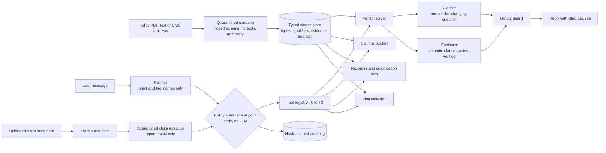

# ClauseGuard: A Multi-Policy Entitlement Engine for Insurance Consumers

*Compiles real policies into a constraint program; computes what you are owed, how to get it, and what to buy; proves every answer with clauses; acts only within safe permission tiers.*

FinTechathon 2026, International Track, Topic D (AI Insurance Assistant).
Status date: 2026-10-11. Code license: Apache-2.0. Every number in this document is copied from a file in `evidence/`; the file is named next to the number. Results that were not measured are stated as not measured.

## 1. Problem

Insurance consumers hold several policies at once: a statutory scheme, an employer plan, an individual plan, a rider, an accident cover. Coverage is fragmented, and the rules that decide a claim (dates, amounts, document lists, payer order, waiting periods) live in documents the consumer rarely reads. This is a global condition. In the United States, marketplace insurers denied about one in five in-network claims in 2023 and consumers appealed under 1% of them. In the United Kingdom, the Financial Ombudsman Service publishes its insurance decisions, each quoting the disputed clause. In Singapore and Hong Kong, published complaint statistics concentrate on non-disclosure (about 30% of settled complaints in Hong Kong). In China, strict critical-illness definitions have produced lawsuits over payout rates. In Indonesia, the regulator reports that more than half of insurance complaints concern claim difficulty, and the national health scheme (BPJS Kesehatan) coordinates with private cover under rules that few policyholders know.

Sourced figures:

| Figure | Source |
|---|---|
| 19% of in-network claims denied on HealthCare.gov in 2023; consumers appealed under 1%; 56% of appeals upheld the denial (KFF, Jan 2025) | https://www.kff.org/private-insurance/healthcare-gov-insurers-denied-nearly-1-in-5-in-network-claims-in-2023-but-information-about-reasons-is-limited-in-public-data/ |
| More than 50% of insurance complaints in Indonesia concern claim difficulty (OJK, Dec 2023) | https://finansial.bisnis.com/read/20231206/215/1721354/ojk-ungkap-kesulitan-klaim-asuransi-paling-banyak-diadukan-konsumen |
| 53% of consumer claims rejected; all 17 policies reviewed breached standard-clause rules (YLKI, Mar 2025; consumer-group figure) | https://finansial.bisnis.com/read/20250306/215/1857915/ylki-minta-ojk-buat-standar-polis-asuransi-baru-tulus-banyak-konsumen-dirugikan |
| Indonesian health claim ratio 97.52% (2023), then 71.23% (2024) after repricing (OJK) | https://finansial.bisnis.com/read/20250313/215/1861047/rasio-klaim-asuransi-kesehatan-susut-ojk-ungkap-alasannya |
| POJK 36/2025: co-payment capped at 5%, waiting period at most 6 months | https://investortrust.id/financial/111948/aaji-dukung-implementasi-pojk-asuransi-kesehatan-untuk-perkuat-tata-kelola-dan-manajemen-risiko-industri |
| China: commercial health payout rates near 40%, disputes over strict critical-illness definitions (Caixin, Sep 2025) | https://www.caixinglobal.com/2025-09-26/in-depth-lawsuits-lay-bare-shortcomings-of-chinas-commercial-insurers-102366418.html |
| Hong Kong: about 30% of settled complaints concern non-disclosure | https://www.asiainsurancereview.com/Magazine/ReadMagazineArticle?aid=43529 |

A general language model answers these questions from memory and may state a wrong rule with confidence. We ask a narrower question: can an assistant compute what a consumer is owed from the consumer's own policy text, prove it with the clauses, say how to obtain it, say what to buy to close the remaining gaps, and refuse to act beyond its permissions?

Five failure modes drive the design. Each is arithmetic on the user's own documents: a claim filed after the deadline (the Sompo hospital-cash wording rejects claims later than 60 days after treatment ends; the Astra rider allows 90 days after discharge); a claim inside a waiting period or for a specified disease; the wrong payer order (statutory cover, then BPJS, then group, then individual indemnity, with fixed-benefit cover in parallel); paying twice for overlapping indemnity cover or missing benefits that stack; and lapse during the grace period.

## 2. Method: insurance as a constraint program

Every policy is compiled by a quarantined extractor into a `PolicyRecord` of typed clause tuples `(head, relation, object, qualifiers, evidence, confidence, source_tier)` (`clauseguard/schema.py`). Relations are a closed set (COVERS, EXCLUDES, EXCEPTS, CONDITIONED_ON, HAS_PERIOD, PAYS, PERMITS, TERMINATES_IF, REQUIRES_DOCUMENT, DEFINES, REFERS_TO, HAS_RIDER). Qualifiers are typed, never free text: amounts, per-day and per-case limits, deductibles and co-payments, time windows (`window_len`, `window_unit`, `window_from`), filing deadlines, `applies_if` conditions over a closed slot vocabulary, and a basis (INDEMNITY or FIXED_BENEFIT). `evidence` holds the verbatim clause text and section; it is display text only and never reaches a decision. `source_tier` is an ordered trust level (`LLM < USER_UPLOAD < TOOL < POLICY_DOC_UNVERIFIED < POLICY_DOC_VERIFIED < USER < USER_CONFIRMED < SYSTEM`); trust is a qualifier like any other, so the solver reports the weakest tier it used and the enforcement layer gates actions on the same tiers.

The user's situation is a `ScenarioFacts` object over a closed list of slots; an unbound slot is absent, not false. Four deterministic solvers read these objects. No model runs inside any of them; the model only extracts, binds facts and phrases text.



### 2.1 Solver 1: verdict (`clauseguard/solver.py`)

For a policy P and facts f, `evaluate(P, f)` runs in a fixed order:

1. candidates = COVERS (or PERMITS, for action events) tuples for the event whose `applies_if` conditions hold;
2. closed world: no candidate and no governing EXCLUDES, HAS_PERIOD or TERMINATES_IF tuple gives NOT_APPLICABLE (NOT_SPECIFIED when the document's extraction coverage is low); the solver never invents a denial;
3. any EXCLUDES tuple on the event or cause whose window and conditions hold, and that is not EXCEPTED, gives DENIED;
4. any unmet CONDITIONED_ON or HAS_PERIOD tuple (waiting, specified-disease waiting, grace, survival, contestability, suicide) gives DENIED;
5. a TERMINATES_IF tuple that holds gives DENIED;
6. otherwise COVERED, with the payable computed from PAYS tuples, limits, deductible days and caps.

Precedence is exception over exclusion over condition over coverage, and rider tuples scope to the rider's own events. Every step appends a trace entry naming the tuple id, so the reply can quote exactly the clauses that fired.

Worked example (tests `tests/test_solver.py::test_denied_inside_waiting_period`, `::test_covered_after_waiting_with_payable`): a hospital cash plan has a 30-day waiting period (tuple `t_wait`) exempt for accidents and emergencies. A user admitted for illness on day 20 gets DENIED, code WAITING_PERIOD, trace `day 20 < waiting 30`, fired clause `t_wait`. With day 44 and 5 hospital days at IDR 500,000 per day the same policy gives COVERED and IDR 2,500,000.

### 2.2 Verdict-sensitivity clarification

`decide(P, f)` extends `evaluate`. If evaluation touches an unbound slot s, it re-runs the solver for every value in the slot's domain `SLOT_DOMAINS[s]`. If the verdict is invariant, the slot is irrelevant and the agent does not ask. If the verdict changes, the result is CLARIFY naming exactly that slot, with the verdict under each value, and the clarifier phrases one question citing the clause that makes the slot matter. Example: with the effective date unknown, the waiting period decides between DENIED and COVERED, so the agent asks for the date only. Tests: `tests/test_solver.py::test_clarify_asks_only_verdict_changing_slot`, `::test_no_clarification_when_slot_irrelevant`.

### 2.3 Solver 2: claim allocation (`clauseguard/allocation.py`, `clauseguard/rulepacks.py`)

Which policy of a household pays what share of one bill, and in which order, under the coordination rules of a jurisdiction. Eligibility of each policy comes from Solver 1.

The eligible bill B is split into categories c (room, surgery, other when the bill is itemised; a single category otherwise), B = sum_c B_c. For an eligible indemnity policy i presented charges y_{i,c} >= 0 with s_i = sum_c y_{i,c}, the policy pays

    p_i = g_i(s_i) = min(A_i, s_i - m_i(s_i)),
    m_i(s) = min(K_i, min(s, D_i + F_i) + r_i * max(0, s - D_i - F_i)),

where D_i is the deductible, F_i a flat co-payment, r_i the co-payment rate, K_i the cap on the member's own cost sharing and A_i the cap on what the insurer pays; inner limits bound what can be presented per category (y_{i,c} <= L_{i,c}) and per pool. g_i is non-decreasing and 1-Lipschitz. Coordination is sequential: the k-th payer is presented what is still unpaid, U_k = B - sum_{j<k} p_j, so sum_k p_k <= B holds by construction (the indemnity principle). Fixed-benefit policies sit outside the sequence and stack.

Payer layers come from a rule pack (`rulepacks.py`), which is data rather than code: the layer order is statutory schemes first (each with a gate), then commercial indemnity policies by class (employer group before individual under the Indonesian pack) and by other-insurance kind (primary, PRO_RATA, EXCESS), and fixed-benefit policies in parallel. Layer k receives R_k = B - sum_{j<k} P_j. Within a layer of co-primary policies the only free choice is the claiming order; presenting a payer everything still unpaid is optimal because every g_j' <= 1, while the order matters as soon as a policy has a deductible, a co-payment or a cap. The optimizer evaluates every order of the layer exactly (at most 6 policies, 720 orders; beyond that a capacity-sorted heuristic is used and labelled), with ties broken toward the pack's preferred order. PRO_RATA policies split the unpaid charges in proportion to their limits; two EXCESS policies in one layer are circular and are resolved pro rata and flagged with their clause ids. Two baselines are reported: greedy (claim in the order the policies are held) and the best single policy. Since g is 1-Lipschitz, greedy >= single always, and optimizer >= greedy whenever the holding order does not breach a coordination rule.

Packs shipped: `ID` (Indonesia: Jasa Raharja first for traffic accidents involving two or more vehicles; BPJS Ketenagakerjaan for work accidents of members; BPJS Kesehatan when membership is active and the admission is at a partner facility or an emergency; employer group before individual; fixed benefits stack; statutory amounts are modelled and carry a "verify" note) and `GENERIC` (no statutory layer, no class rule; primary, PRO_RATA, EXCESS only), which is what a US or UK household uses.

### 2.4 Solver 3: counterfactual recourse and adjudication twin (`clauseguard/recourse.py`, `clauseguard/twin.py`)

Recourse. Given P, f and a verdict V(f) = DENIED (or NOT_APPLICABLE), find the smallest sets of legitimate fact changes A = {a_1, ..., a_k}, k <= max_changes, such that V(f after A) = COVERED, and return the Pareto-minimal ones under the cost vector

    c(A) = sum_i c(a_i) = (days, money, effort),   componentwise, all >= 0.

An option A dominates B when c(A) <= c(B) in every component and c(A) != c(B); only non-dominated options are returned. The search is breadth-first over the action set (single actions first, then pairs), and a set that already flips the verdict is never extended. Legitimate actions are things the claimant can really do: wait until a date (the earliest date that flips the verdict is reported), provide documents, choose a partner facility for a future admission, obtain an emergency classification when the facts do not already state otherwise, settle premium arrears while inside the grace period, attach a rider for future cover, or claim under another policy of the same portfolio. Nothing about what happened may change: `IMMUTABLE_SLOTS` lists the slots that describe the event itself (cause, dates of a past event, diagnosis, occupation, licence, intoxication), `MISREPRESENTATION_GUARD` adds the slots whose value may only be bound when unknown and never flipped once stated, and every action passes through `guard_change`.

Adjudication twin. The solver stops at the first clause that denies; a claims assessor lists every ground. The twin isolates each denial-capable clause t (EXCLUDES, HAS_PERIOD, CONDITIONED_ON, TERMINATES_IF) in a one-clause view P_t = grants(P) + exceptions(P) + {t} and runs the frozen solver on it; a DENIED verdict on P_t is a ground attributable to t. Uploaded documents are cross-checked in code (dates against stated days, diagnosis codes against cause, invoice total against line items, invoice against stated bill, policyholder name). With grounds G, weights w: G -> (0, 1] and the fixable subset F,

    readiness_score = max(0, 1 - sum_{g in G} w(g)),
    after_fix_score = max(0, 1 - sum_{g in G \ F} w(g)),

so fixing a ground never lowers the score and a fatal ground (weight 1) alone makes it 0. Every ground carries the clause id, the verbatim evidence text and, where one exists, a recourse option.

### 2.5 Solver 4: plan selection under budget (`clauseguard/plans/selector.py`, `clauseguard/plans/cms_loader.py`)

Open gaps are the (peril, person) cells that `portfolio.gap_overlap` reports as uncovered by any active policy. With gaps g in G weighted w_g, candidate plans j with monthly cost c_j, out-of-pocket maximum m_j and the gap set S_j they close, and budget B:

    maximise   sum_g w_g y_g                                   (lexicographic, first)
    then minimise sum_j c_j x_j, then sum_j x_j, then sum_j m_j x_j
    subject to y_g <= sum_{j : g in S_j} x_j          for all g
               sum_j c_j x_j <= B                              (when a budget is given)
               sum_{j indemnity : g in S_j} x_j <= 1          for all g   (indemnity plans never overlap)
               x_j, y_g in {0, 1}

The lexicographic order is folded into one linear objective with separating scale factors and solved as a single mixed-integer programme (`scipy.optimize.milp`, HiGHS); without scipy the same objective is solved exactly by enumerating subsets of size <= 3 and extended greedily. Alternatives are the next-best solutions found with a no-good cut. Cost c_j is the monthly premium when the Rate PUF is present, else (deductible + out-of-pocket maximum) / 12, and the rationale names which. Candidates that close no open gap, indemnity plans whose perils are already indemnified for every person, and group top-ups without an active group plan are dropped before the programme runs.

Real catalogue: `cms_loader.py` reads the CMS Health Insurance Exchange Public Use Files (Plan Attributes, Benefits and Cost Sharing, Rate) into `PolicyRecord`s with typed cost sharing (copay, coinsurance, deductible, out-of-pocket maximum mapped to `copay_cap`, day limits), `EXCLUDES` tuples for non-covered benefits and PUF row references as evidence. For a billed amount B and benefit b of plan p the member pays min(MOOP_p, D_p + copay_b + coins_b * max(0, B - D_p)) and the insurer pays the rest; the same qualifiers drive the allocation solver.

### 2.6 Entitlement timeline (`clauseguard/timeline.py`)

Every dated event in a household's policies and open claims, with the money that turns on it. For a policy p with anchors (effective e_p, issue i_p, reinstatement r_p, expiry x_p) and a HAS_PERIOD tuple t with window (n, unit, from), the event date is d(t) = anchor(from) + n units, and the period kind maps to WAITING_ENDS, SPECIFIED_WAITING_ENDS or CONTESTABILITY_ENDS. A policy in grace with premium due date u_p yields GRACE_ENDS at u_p + grace days; its expiry yields POLICY_EXPIRES; an open claim with a FILING_DEADLINE tuple (k days from anchor a) yields FILING_DEADLINE at date(a) + k; a SURVIVAL tuple on a critical-illness claim yields SURVIVAL_PERIOD_ENDS at diagnosis + n. money_at_risk is the claim amount for deadlines and survival periods, and the cover at stake (sum assured, else the largest annual limit or benefit) for grace and expiry. days_left = d - as_of; past events are dropped except GRACE_ENDS and FILING_DEADLINE, whose passing is itself the risk.

### 2.7 Portfolio, extraction and the agent loop

`portfolio.py` builds the person by peril by policy matrix (overlap = same peril under INDEMNITY in two or more policies; fixed benefit = stackable; no policy = gap), the payer order used by the chat reply, and claim readiness (deadline from the FILING_DEADLINE tuple, documents required and missing, denial code). `extractor/policy_extractor.py` is a two-pass quarantined extractor (outline, then per-section tuples with closed enumerations, schema-constrained JSON, temperature 0). PDFs are never sent as bytes: `extractor/_redact_pipeline.py` extracts each page's text locally (embedded text, or OCR when a page has none), redacts NIK, bank/card numbers, phone numbers, dates of birth and named individuals (`privacy/redact.py`), and `final_gate` re-scans the redacted text and blocks the call outright if anything residual is found (`PII_BLOCKED`, audited with counts and types only, never the matched values); only the cleaned text reaches the model. Claim documents go through the same pipeline before their separate quarantined extractor (schema limited to enums, numbers, dates and ICD-10 pattern strings) runs, after the existing PyMuPDF hidden-text scan. `agent/loop.py::handle_turn` runs plan, enforcement check, tools, fact binding, solvers, clarifier or explainer, output guard. Regex rules in the planner are authoritative for safety-relevant intents; a fast model may refine only among benign intents and sees only the user text and tool names. The explainer string-matches every quoted span against the clause text and falls back to a template on mismatch.

A separate read-only endpoint, `GET /system/status`, reports whether the language-model key pool currently has quota, for a UI indicator only (`clauseguard/llm.py::pool_status`); no solver or permission-tier decision reads it.

### 2.8 Conversation context, claim preparation and the insurer side

**Conversation Agent** (`agent/context.py`). Before facts are bound, a schema-constrained model call classifies the turn against the typed situation on the table (never the raw transcript): NEW_SCENARIO, CONTINUE, CORRECTION, ANSWER (to the assistant's last question), HYPOTHETICAL or GENERAL, plus the language of the message. The decision can only discard facts (a new scenario clears the previous event and dates, keeping the slots the model names as still valid); it can never add one, so a misclassification degrades to an extra question, not a wrong verdict. A hypothetical turn is solved without matching it to a claim on file. The reply language follows the message; when a short reply carries no language cue ("yes", "ok") the conversation's language is kept.

**Planner with a rule floor** (`agent/planner.py`). Safety classifications (misrepresentation, cross-account access, privileged actions, authority or data-dump requests) are decided by rules the model cannot override. For benign intents the model reads the message in context and chooses the intent and the read-only tools; a request to act yields an ACTION plan whose tool is still subject to the enforcement point and the confirmation click.

**Claim form from the insurer's own wording** (`agent/claim_form.py`). Every insurer asks for a different form. Once per policy the model reads that policy's claim-related clauses (required documents, filing and notice periods, covered events) and proposes the form layout: a title, sections and fields, each field bound to exactly one key of a closed set of typed sources (policy id, insured name, admission and discharge dates, diagnosis, amounts, filing deadline, documents checklist, declaration) or left blank for the customer's hand-written parts. The layout is validated (known sources only, bounded size, one field per source, a documents checklist and at least five typed fields) and cached; a policy without a usable layout gets a standard form. Values are filled in code from the claim draft, never written by the model. The customer sees the filled form inside the confirmation card and can download it as a PDF; a correction before the Confirm tap withdraws the pending submission and rebuilds the form in the same turn. The form is stored with the claim (`form_json`) and shown to the adjuster.

**Documents** (`agent/doc_match.py`, `agent/loop.py`). An uploaded file passes the hidden-text scan, local redaction and the quarantined claim-document extractor (document type, dates, totals, line categories, diagnosis). A fixed table maps document types to the requirement codes they satisfy; on top of it the model compares the typed summary of the file with the policy's own requirement codes and clause wording and may add codes from that list only. A requirement is marked *attached* only when a file proves it; one the customer merely says they hold is *declared*; the assistant's own form satisfies the claim-form requirement. The files travel with the claim as typed `DocRef` handles and are filed under it for the insurer.

**Submission gate and autonomy.** A claim with missing documents is held back with the list; the customer may attach documents or submit anyway, which still ends at a confirmation card that lists what is missing and asks for a separate acknowledgement. The session carries an autonomy mode (observe: answers only; draft: prepares, never submits; act: submits after confirmation) that caps the tier the enforcement point will allow.

**Insurer side** (`sandbox/api.py` `/backoffice/*`, web `/insurer`). The sandbox insurer's desk, behind a separate back-office token the agent has no tool for, lists submitted claims with the form and attachments, moves them through received, under review, approved, rejected or paid with a note, and holds the halt switch that refuses every agent action for every customer. Decisions and notes flow back to the customer's digest as claim-status items (with an appeal route after a rejection), closing the loop: the agent prepares and submits, a person decides, the agent reports. The adjuster can open every attached file from the claim, and appeals and attachments the agent files after the customer's confirmation land on the same claim.

**What the customer's documents say** (`agent/doc_facts.py`). A customer can start a claim by sending files alone. The model reads the extractor's typed summaries (type, dates, days in hospital, ICD-10 code; never the raw text) and answers in the rules' own vocabulary: an inpatient stay, an illness, the diagnosis. Each answer is a closed choice checked again in code (a stay only with typed date or day evidence, an illness only, never an assumed accident, a diagnosis only from the known list). A discharge date printed on a discharge summary replaces one the assistant had only derived from a stated day count. The reply carries, per file, what was read (amounts, dates, diagnosis, charges, whether the patient is the policyholder), the checks that failed (hidden text, totals that do not add up, the same stay coded differently across files) and which of the insurer's requirements the file now satisfies, so the customer sees what the claim rests on.

**Asking instead of guessing** (`agent/policy_pick.py`). When more than one policy could take a claim, the customer is asked which to file first, with one button per policy; the model may name the one the message clearly means, from a closed list of candidates. A request to act is accepted only when the model reads an explicit request or an accepted offer, so a greeting never prepares a submission.

**Answering what was asked.** The planner model also reads what the turn is about (documents to prepare, how to submit, the deadline, what happens if late, the amount, a filed claim's progress). For those questions the code puts the deterministic answer first: the documents required and still missing with the next step, or the late-filing effect and the last day. Progress questions read the live status of the claim at the insurer's desk, with the assessor's note, and a decision reaches the chat by itself: the agent states it, and for a rejection the model classifies the assessor's note (`agent/decision_read.py`) as a defect the customer can fix, a reason the policy facts contradict (an appeal is offered, quoting the clause by its printed section), or a valid reason.

**Wording.** The reply writer (`agent/composer.py`) receives the engine's payload, the last four exchanges as data for reading references, and six worked examples. It reasons privately, writes two candidate replies and names its pick; the verifier tries the pick and then the other candidate, and only when both state a value that is not in the payload is the deterministic text used. Small talk, thanks and off-topic requests are answered by the model in the customer's language (`agent/smalltalk.py`). The customer can correct a form value from the confirmation card (insured or claimant name, hospital, diagnosis, dates, bill); the change goes back through the agent as the customer's own correction and the form is rebuilt. A correction that names no value is answered with what the form currently says, never "updated"; a request to relabel the event to fit another policy is refused as misrepresentation.

**When the model is unavailable.** Keys are rotated per request; a per-minute limit rests a key for about a minute, a key the API rejects is taken out of rotation. If no key can serve a turn, the reply says so in the customer's language (quota reached, key not accepted, service not responding) and offers the customer's own Gemini key, which is checked once with Google and kept only in that session's memory. The cards from the engine still show; no rule-based text is presented as the assistant's answer.


## 3. Data

Real sources (download dates and hashes in `data/real/manifest.json`; fetch script `scripts/fetch_real_data.py`):

| Source | What | Use |
|---|---|---|
| Six insurer wordings, public PDFs (`data/policies/real/`): Astra Flexi Life, Astra HCP rider, Chubb Malaysia PA, Chubb VHIS standard plan, Great Eastern Singapore PA, Sompo/Roojai hospital cash | Real policy documents | Extractor input (`data/extracted/*.json`); four of the sandbox persona policies quote their clauses verbatim |
| CMS Exchange PUF, plan year 2026, Texas: 834 standard plans (4,183 cost-sharing variants) from 15 issuers; Rate PUF premiums | Real US marketplace plans | Plan selection catalogue (`clauseguard/plans/cms_loader.py`), Experiment A in `evidence/plan_selection_report.md` |
| InsuranceQA V2: 16,860 real consumer questions, with a fixed 200-question stratified sample | Real consumer questions | Off-script robustness material |
| UK Financial Ombudsman Service decisions (`data/real/fos_decisions.jsonl`) | Real dispute narratives | Clause-type replay for the adjudication twin (`bench/recourse_eval.py`, Part B) |
| RIPLAY product summaries (`data/real/riplay/`), 30 documents from Astra, Chubb, Sequis, Sompo/Roojai, FWD, AXA, Manulife, Prudential, Great Eastern | Indonesian product summaries | Extractor input; the Santoso family's employer group health and individual health clauses now quote these verbatim (provenance: `data/real/riplay/PROVENANCE.md`) |
| KFF denial rates 2023 | Published base rates | Problem framing only |
| ICD-10-CM FY2027 code descriptions (CMS/CDC-NCHS), 74,879 codes (`data/real/icd10cm_codes.txt`) | Official diagnosis code list, US public domain | Retrieval index for the diagnosis coder (`clauseguard/icd10_coder.py`) |

Synthetic or modelled data, stated as such: the public benchmark's ten contracts are expert-reviewed synthetic US life-insurance contracts with 58 scenarios and 580 clause-traced labels (Mridul, Kapa and Seneviratne 2026, arXiv:2604.10853, CC-BY-4.0); the three sandbox personas and their claims are synthetic; benefit amounts (limits, annual caps) on the sandbox policies are engineered to match the worked examples used across the tests and tasks, documented per policy in `data/real/riplay/PROVENANCE.md`; the gig-platform accident cover is fully synthetic because no Indonesian ride-hailing platform publishes a product summary; BPJS Kesehatan and Jasa Raharja records are modelled from public regulation, since a product summary does not apply to a statutory scheme; the six-plan catalogue in `clauseguard/catalogue.py` has invented prices. A user can also add their own policy live: `POST /policies/upload` runs the same quarantined extractor on an uploaded PDF and adds the result to the account tagged `POLICY_DOC_UNVERIFIED`, shown with an "Unverified" badge everywhere the sandbox's hand-verified policies show "Verified".

ICD-10. Critical-illness coverage (`CI-CHUBB-05`) can require a diagnosed condition to be on the clause's covered ICD-10 list (`Qualifiers.icd10_codes`, e.g. `"C00-C97"`, `"I21"`); matching is code membership in `clauseguard/solver.py::icd10_covered`, which also places a full ICD-10-CM code (`C50.911`) inside its 3-character category or range. Real diagnosis letters name the condition rather than print a code, so the claim-document extractor transcribes the diagnosis name as written and resolves it in a fixed order, recorded on the extract as `diagnosis_icd10_method`:

1. `printed`: a code literally printed on the document (regex-validated).
2. `coder` (`clauseguard/icd10_coder.py`): retrieve, select, verify over the official code list. One bounded model call rewrites the line into ICD-style English terms (Indonesian, Latin and abbreviations such as "DBD" are the common case); plain-Python BM25 over the ICD-10-CM code descriptions returns the top 15 categories (a category scores as the best of its member codes) plus 5 full codes; one schema-constrained model call must pick a candidate or null and quote the substring of the line that names it. Code then verifies: the code must be in the candidate list, the quoted phrase must occur in the line, confidence must reach 0.6, and a null is respected. Anything that fails is undetermined. The model never assigns a code from memory; it selects from a closed list the code built, and the code checks the selection.
3. `alias` (`clauseguard/icd10_lookup.py`): the curated name/alias dictionary, used only when the coder cannot run (no code list, no model key, offline mode). If the coder ran and declined, the line stays undetermined; the dictionary never overrules it.

The code list is the ICD-10-CM FY2027 "Code Descriptions in Tabular Order" release (CMS/CDC-NCHS, US public domain; 74,879 billable codes; `data/real/icd10cm_codes.txt`, URL and SHA-256 in `data/real/manifest.json`). ICD-10-CM is used because it is the only official ICD-10 code list published as a public-domain text file; its 3-character categories coincide with WHO ICD-10 for the critical-illness conditions in scope (ICD-10-CM has no A16; unconfirmed respiratory TB is A15). Evaluation in section 4.11. Not implemented: INA-CBG tariff grouping, which BPJS uses to set hospital payment amounts from a diagnosis and procedure group; that needs the licensed Kemenkes INA-CBG grouper and tariff tables, which this project does not have access to, so it remains future work.

Related work and design choice. Supervised automatic ICD coding is an active line of research: CAML (Mullenbach et al., "Explainable Prediction of Medical Codes from Clinical Text", NAACL 2018) uses a convolutional network with per-code attention, and PLM-ICD (Huang, Tsai and Chen, "PLM-ICD: Automatic ICD Coding with Pretrained Language Models", ClinicalNLP 2022) adapts pretrained language models to the large label space and long inputs, reporting results on the MIMIC benchmark. Such classifiers need many documents labelled with ICD codes; we have no Indonesian discharge-summary corpus with ICD labels, and real ones carry patient data, so none is trained here. Entity-linking models such as SapBERT (Liu et al., "Self-Alignment Pretraining for Biomedical Entity Representations", NAACL 2021), which aligns UMLS synonyms in embedding space, address name-to-concept matching but are trained for English biomedical surface forms. The coder instead uses a zero-shot alternative: retrieval over the official code descriptions followed by a constrained selection among the retrieved candidates, with code-side verification. The optional dense retriever uses multilingual-e5-small (Wang et al., "Multilingual E5 Text Embeddings: A Technical Report", arXiv:2402.05672) and fuses its ranking with BM25 by reciprocal rank fusion (Cormack, Clarke and Buettcher, SIGIR 2009). The two sets used to evaluate this are team-written (see section 4.11); the comparison of retrievers is reported there with confidence intervals and is not a claim of state-of-the-art coding accuracy.

## 4. Evaluation

All figures below are in `evidence/`. Deterministic mode means the rule planner, the rule fact binder and template wording, with no model calls.

### 4.1 Scripted tasks and off-script questions

`evidence/task_report.md`: 33 of 33 scripted tasks passed (20 functional, 10 adversarial, 3 plan recommendation), deterministic mode on the sandbox records. Pass criteria are code and regex checks on structured reply fields (verdict, payable, deadline, denial code, clarification slot, refusal flag, executed tool tiers, payer order); no model judges anything.

Off-script questions (`evidence/offscript_report.md`, `offscript_holdout_report.md`, `offscript_blind_report.md`): 15 of 15 on the first batch and 10 of 10 on the second, both development sets whose failures were fixed in the planner and rule binder before the criteria were frozen (first probes: 6 of 15 and 5 of 10). The blind batch, 14 questions written once and run once before any fix, passed 3 of 14. That is the out-of-sample figure for the deterministic layer; nine of the eleven failures are lexical limits of the rule planner (a wording that maps to no topic), one is safe-but-not-refused, one is a design choice. Behaviour with the model planner on was not measured.

### 4.2 Adversarial suite

`evidence/adversarial_report.md` (oracle: recorded tool calls, audit events, SQLite table hashes before and after, regex over the reply including base64 and ROT13 decoding; no model judge). End-to-end chat suite: attack success rate 0.0% (0/27) with the enforcement layer on; false-block rate on benign twins 0.0% (0/15). With the enforcement layer patched to allow-all, one attack (KS-01, kill switch) succeeded (1/27). Direct probes of the enforcement function and nonce store: 0/10 succeeded with the guard on. Hidden-text scanner, 20 files per technique: white text, tiny font, off-page and annotation 20/20 each; metadata 12/20; image alt text 12/20; text rendered inside an image 0/20; false positives 0/5 on clean files and 0/3 on inflated-amount files.

### 4.3 Paraphrase consistency

`evidence/paraphrase_report.md`: 20 coverage scenarios over the three personas, three wordings each (formal English; colloquial Indonesian-English with typos; relative dates). With the rule binder all 20 scenarios gave identical decisions across wordings (20/20), and all 12 scenarios with a stated expected answer were correct. With the model fact binder on a live sample, 7 of 8 completed scenarios were consistent; the one disagreement is the model inferring the number of vehicles from "fell from my motorbike" in one wording. The 20/20 is in-sample (11 root causes were fixed after a first run of 5/20).

### 4.4 Clarification quality

`evidence/clarify_report.md`: 18 base messages, one fact removed at a time; a brute-force oracle decides whether the removed fact changes any verdict. Recall (asks when it should) 87% (26/30); silence (stays silent when it should) 100% (35/35); ask precision 100% (26/26); asked slot correct 100% (26/26). All four misses are a missing event date, which the agent evaluates as today and says so. In-sample: the first run gave recall 69% and silence 96%.

### 4.5 Public benchmark

`evidence/bench_report.md`. Conditions: b0 (whole contract plus scenario, one model call), b0cw (b0 plus a closed-world instruction), b4 (our extracted tuples, then the solver; the model binds facts only), b4oracle (the benchmark's gold annotations as tuples, then the solver; isolates extraction error, not deployable).

| system | contracts | n | accuracy (%) | 95% CI | macro-F1 | NA to DENIED (%) | evidence hit (%) |
|---|---|---|---|---|---|---|---|
| b4 (extracted tuples + solver) | C1 to C10 | 390 | 84.6 | [77.8, 90.0] | 80.7 | 1.4 | 57.1 |
| b0cw (long context, closed world) | C1, C2, C7 | 112 | 87.5 | [78.1, 95.5] | 82.0 | 3.1 | 85.1 |
| b0 (long context) | C1, C2, C7 | 32 | 96.9 | [90.0, 100.0] | 97.3 | 0.0 | 95.5 |
| b4oracle (gold tuples + solver) | C1 to C10 | 342 | 91.8 | [83.3, 98.0] | 89.3 | 2.9 | 69.6 |

On the solver-scope subset b4 (previous version) scored 82.9 (n=340) against b0cw's 87.5, but the two numbers were measured on different items (340 solver-scope items versus 112 items of C1, C2, C7); on the 78 items they share the difference is 11 versus 12 discordant pairs, exact p = 1.000, which shows no difference and does not establish parity. After the refinement stages (evidence verification, recall pass, out-of-vocabulary rows kept as UNMODELED_RULE) accuracy on the post-tuning analysis set is 92.2 [85.3, 96.0] (n=102) and on the clean held-out set 84.1 [77.9, 88.8] (n=170), unchanged from before; the held-out comparison with the long-context baseline could not be completed (quota), so no superiority or parity claim is made on clean data. Oracle ceilings: 94.1 (analysis), 89.4 (held-out). See `evidence/bench_report.md`, `bench_protocol.md`, `bench_error_taxonomy.md`.

### 4.6 Recourse and adjudication twin

`evidence/recourse_report.md`, Part A: replaying the 33 scripted tasks (90 turns) produced 6 DENIED verdicts, of which 4 of 6 (67%) have a legitimate recourse (three by claiming under another policy of the portfolio, one by waiting until the waiting period ends). The two without recourse depend on immutable facts (cause of a dental claim; survival days), which is the intended result. Part B (ombudsman decisions) was not yet run when the report was generated; the loader and the mapping replay are implemented.

### 4.7 Plan selection

`evidence/plan_selection_report.md`, 100 synthetic households, seed 7. Experiment B (mixed-peril catalogue, premiums): the optimiser closes more weighted gap than the cheapest plan in 73/100 households (ties 27) and more than the most expensive plan in 79/100 (ties 21), with 0 budget violations for every method. Experiment A (834 real CMS Texas plans, out-of-pocket cost basis because the Rate PUF was absent at run time): the optimiser, the cheapest plan and the highest metal plan picked the identical plan in 100/100 households. This is the honest result: every ACA plan covers the same essential-health-benefit perils, so with one cost basis the choice reduces to price. With premiums the baselines separate and the answer depends on the chosen objective.

### 4.8 Claim allocation

Measured (`evidence/allocation_report.md`, 500 households, seed 20261011, no language model): on real CMS Marketplace plans (200 Texas PY2026 plans, co-primary layer), greedy is suboptimal in 236/500 households (47.2%), with a mean gain of USD 988 where suboptimal (USD 466 across all households; mean recovery USD 13,526 optimizer vs USD 13,060 greedy vs USD 11,649 single-policy). On the persona households (Indonesian rule pack, real policy wordings, sampled bills) the ID coordination rules are fully order-determined, so greedy matches the optimizer (0/500 suboptimal); the optimizer's contribution there is the exact claiming order and amount per payer, not a recovery gain. The CMS data has no coordination-of-benefits clause, so plans are also evaluated "as loaded" (every plan treated as mutually excess, which the optimizer resolves pro rata by limit); that resolution recovers less than sequential claiming (20.4% vs 58.1% of the bill), a property of the pro-rata rule, not of the optimizer.

### 4.9 Cost

`evidence/cost_report.md` (90 turns of the 33 scripted tasks, replay only): mean 0.98 model calls per turn, 48 of 90 turns with zero calls; functional tasks only, mean 2.36 calls and 2,358 tokens per turn against 13,877 for a full-document baseline (17.0%). Output-token figures are assumptions; input tokens are measured prompt sizes / 4.

### 4.11 Diagnosis coding

`python -m bench.icd_eval` runs 76 team-written, hand-labelled diagnosis lines (`data/benchmark/icd_eval.jsonl`; 64 with a gold 3-character category, 12 gold-undetermined) through both resolution paths (`evidence/icd_report.md`, `evidence/icd_results.jsonl`). The set is team-authored, not a public clinical dataset; no public Indonesian discharge-summary benchmark with ICD-10 labels exists. Coder path: category accuracy 92.2% on gold-coded lines, 6.2% of gold-coded lines left undetermined, 83.3% of gold-undetermined lines correctly left undetermined, false-code rate 3.9% (3 of 76), BM25 retrieval recall@k 96.9%. Alias dictionary path: 17.2% accuracy, 85.5% undetermined, 0 false codes (it covers about 30 conditions and declines everything else). The three coder false codes are a status code chosen for a "post-CABG" line whose gold is the underlying disease (Z95.1 for I25), a follow-up-care code for "kontrol rutin pasca operasi" (Z09), and an uncertain-behaviour neoplasm code for "tumor abdomen, jenis belum diketahui" (D48.7); the last two are lines whose gold is undetermined and the labels were not changed after seeing the output. None of the three falls inside a critical-illness range such as C00-C97 or I21.

### 4.10 Test suite

`python -m pytest -q`: 554 passed, 1 skipped (2026-10-19, no API key, tests isolated from the hosted database and from the developer's environment file).

### 4.12 Conversation quality

`python scripts/conversation_eval.py` runs 32 fixed conversations, 47 turns in all (Indonesian, English, slang, typos, mixed language, long narratives, corrections, what-ifs, topic switches, small talk, refusals, attacks), against a running backend, and checks each reply with language-independent anchors (what the answer must carry and must not do, the reply language, how the turn relates to the conversation, whether an action was prepared). The report is written to `evidence/conversation_eval_<label>.json` so every prompt change is measured against the last. Before the reply-writer rewrite (few-shot examples, private reasoning, two candidates, recent turns as data): 40 of 47 turns passed (85%), 28 of 47 replies model-written. After: 42 of 47 (89%), 30 of 47. The remaining failures were then fixed in code (question focus, Indonesian account-change wording, deadline worry read as a deadline question, choice only among decided policies); a full re-run after those fixes is not reported here. The set is team-written.

## 5. Why each component exists (kill tests)

- Verdict solver instead of a model answer: on the public benchmark the model-only conditions answer from the whole contract and cannot show which clause fired; b0cw's evidence hit is high but its NA-to-DENIED rate (3.1) shows it inventing denials where no clause governs. The solver's NA-to-DENIED rate is 1.4 (b4) and it never emits a verdict without a tuple id (`evidence/bench_report.md`).
- Verdict-sensitivity clarification instead of asking for every missing slot: 35 of 35 irrelevant removals stayed silent while 26 of 30 relevant ones were asked (`evidence/clarify_report.md`).
- Claim allocation optimizer instead of greedy claiming: by construction greedy equals the optimum only when the holding order respects the rule pack and no policy has a deductible, co-payment or cap; where it does not, the exact order search recovers more: on 200 real CMS plans it is suboptimal in 47.2% of 500 simulated households, by a mean of USD 988 where suboptimal (`evidence/allocation_report.md`).
- Plan selection optimizer instead of "cheapest" or "most expensive": 73/100 and 79/100 households on the mixed catalogue; identical on the single-peril CMS catalogue (`evidence/plan_selection_report.md`).
- Recourse instead of a bare denial: 4 of 6 denials had a legitimate path to COVERED (`evidence/recourse_report.md`).
- Enforcement in code instead of in the prompt: with the enforcement function patched to allow-all, the kill-switch attack succeeds (1/27); with it on, 0/27 (`evidence/adversarial_report.md`).

## 6. Limitations

- The extractor is a model and can output wrong values inside the schema; extraction coverage per benchmark contract ranges from 0.62 to 1.00.
- Solver scope covers coverage, exclusion, period, rider, termination and permitted-action questions; 24 of 58 benchmark scenarios (dividends, index caps, estate planning) are outside it.
- The public benchmark is life insurance only; Indonesian products are covered by hand-verified sandbox policies and team-written tasks, not a labelled benchmark. Test sets are small and team-written; the blind off-script batch (3 of 14) is the only out-of-sample figure.
- Statutory amounts and payer rules are sandbox stubs marked "verify with the payer"; the GENERIC pack has no statutory layer.
- The CMS experiment ran without premiums; recourse costs are ordinal; the ombudsman replay depends on a manual mapping.
- Diagnosis coding resolves a diagnosis line to an ICD-10 category for coverage membership only; the evaluation set is team-written (no public Indonesian discharge-summary benchmark exists), and INA-CBG tariff grouping is not implemented.
- The extractor redacts personal data locally and blocks the call if any residual is found, then sends only redacted text to a hosted model; this has not been re-run against the 0/20 hidden-text-rendered-as-an-image adversarial result, so whether OCR extraction changes that figure is untested, not claimed.
- The enforcement layer bounds side effects; it does not guarantee that advice text is correct.
- The agent's working memory of a conversation (facts, documents read, a form waiting for Confirm) lives in the backend process; a restart or redeploy ends it, and the customer is told so and asked to restate the situation. Saved chats and filed claims are unaffected.
- A claim already filed cannot be amended in place; a fixable rejection is answered with a new, corrected submission after the customer's confirmation.

## 7. Security summary

Four permission tiers are enforced in code by `clauseguard/security/pep.py`: T0 read own data, T1 compute or draft, T2 submit after a UI click and a single-use server nonce bound to the arguments, T3 money or identity, for which no executing tool exists (the agent can only open a ticket for out-of-band verification). Untrusted text (documents, tool output, model text) can never become a T2 or T3 argument. A hash-chained audit log, an output guard and a kill switch support oversight. Threat model, OWASP mapping, rules R1 to R9, test results and the risk register: `SECURITY.md` and `docs/SECURITY_SELF_ASSESSMENT.md`.

### 7.1 Persistence and deployment

By default state lives in local files and SQLite. With `CG_STORAGE=postgres` and `DATABASE_URL` set, the hash-chained audit log, conversation history and the claims and tickets written by agent actions are stored in Postgres (the demo uses a managed Postgres on Supabase in region ap-southeast-2; migrations `deploy/migrations/001_init.sql`, `002_payments.sql` applied with `scripts/apply_migration.py`); synthetic personas and policies are re-seeded at boot and typed session state stays in memory, so a backend restart ends open sessions. The web client is deployed on Vercel (`https://clauseguard-red.vercel.app`) and proxies `/api/cg/*` to the backend; the backend runs as a Docker image (`Dockerfile`, `uvicorn` on `$PORT`, `/health`) on any container host, or on the team's machine behind a tunnel during demonstrations. Appends to the audit chain are serialised by a row lock on a single head row, and hashing is shared with the file backend. All tables have row level security enabled with no policies and no privileges for the `anon` and `authenticated` roles, so the database REST API rejects the publishable key (`scripts/check_supabase_rls.py`); only the server connection reads or writes them. If Postgres is unreachable the audit log continues in a local chain; the next successful append writes an `AUDIT_GAP` event that records the number of local events and their head hash, and verification reports every gap. Details: `deploy/storage.md`. Since 2026-10-18 the demo also runs fully hosted on Railway: the web service at `https://clauseguard.up.railway.app` and the backend as a second service in Southeast Asia (Singapore), next to the Postgres region. Customers sign in with Supabase Auth (email and password, email confirmation required); the backend asks Supabase who owns the access token and derives the account id from it, and the three sandbox customers are three confirmed accounts mapped to their seeded policies. Audit events are chained in memory at once and stored by a single writer thread in ordered batches, each written only if the stored head still equals the batch's starting point; another writer moving the chain makes the queue re-chain on top of it, so the chain never forks, and a chat turn no longer waits for the database (from about 90 seconds to a few seconds per turn on a distant database).

## 8. Reproducibility

```bash
python -m venv .venv && .venv/Scripts/activate        # Windows
pip install -r requirements.txt
copy .env.example .env                                # optional GEMINI_API_KEY; every step has a deterministic fallback
python -m pytest -q
python scripts/serve.py --fresh                       # UI at http://127.0.0.1:8000
python scripts/run_tasks.py --no-llm                  # evidence/task_report.md
python scripts/run_tasks.py --no-llm --suite off_script
python scripts/run_tasks.py --no-llm --suite holdout
python scripts/run_tasks.py --no-llm --suite blind
python scripts/run_adversarial.py --no-guard          # evidence/adversarial_report.md
python bench/paraphrase.py                            # evidence/paraphrase_report.md
python bench/clarify_eval.py                          # evidence/clarify_report.md
python bench/cost_eval.py                             # evidence/cost_report.md
python -m bench.recourse_eval                         # evidence/recourse_report.md
python -m bench.plan_selection_eval --households 100 --seed 7   # evidence/plan_selection_report.md
python -m bench.allocation_eval                       # evidence/allocation_report.md
python scripts/fetch_real_data.py                     # data/real/* (CMS PUF, InsuranceQA, FOS, RIPLAY, KFF)
python scripts/extract_all.py && python scripts/extraction_quality.py
python -m bench.abox_to_tuples && python -m bench.run_bench --system b4oracle
python -m bench.run_bench --system b0cw --contracts C1,C2,C7
python -m bench.run_bench --system b0 --contracts C1,C2,C7
python -m bench.run_bench --system b4 && python -m bench.report
python scripts/verify_audit.py                        # OK (n events)
```

Without an API key every model step falls back to rules and cached calls replay. The benchmark and extraction commands need the third-party data and an API key with quota.

## 9. Related work

- Benchmark for gap and overlap analysis of insurance contracts (arXiv:2604.10853): we use its contracts and labels; it answers scenarios with hand-written ontology queries, we fill a fixed qualifier schema from text and answer with generic solvers.
- GrOIL (arXiv:2608.22135) induces ontologies from text; we use a fixed domain schema so numeric limits and time windows are first-class data.
- CaMeL (Debenedetti et al., arXiv:2503.18813) separates a privileged planner from a quarantined model and tracks data flow; our enforcement layer is a simplified form with coarse trust labels and reference-only arguments.
- Counterfactual explanations and algorithmic recourse (Wachter et al. 2017; Ustun et al. 2019) motivate Solver 3; our action set is restricted to legitimate claimant actions.
- OWASP Top 10 for Agentic Applications 2026 structures the threat model.
