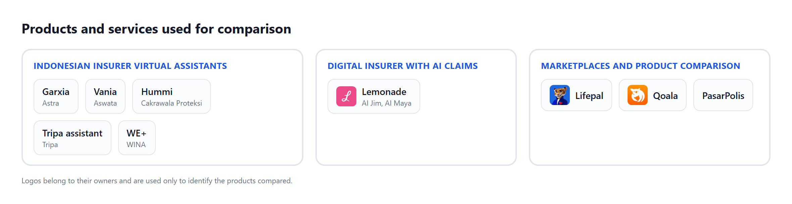

# ClauseGuard: Technical Documentation

*Clarity in every clause, confidence in every claim.*

FinTechathon 2026 · International Track · Topic D: AI Insurance Assistant
Team: Bunga Laelatul Muna, Izra, Wan Sabrina · Institut Teknologi Sepuluh Nopember, Indonesia
Live demo: https://clauseguard.up.railway.app · Source code: https://github.com/bungagana/clauseguard

## 1. Problem & scope

ClauseGuard is an AI insurance assistant that helps customers understand their policies, check their coverage, calculate benefits and handle claims. One household can hold several policies, such as national health insurance (BPJS Kesehatan), an employer plan, a personal plan and an accident cover. The rules on waiting periods, filing deadlines, required documents and payment order are spread across long policy documents.

This creates five main risks:

1. A claim is filed after the deadline.
2. A claim is filed during a waiting period.
3. A claim is filed with a payer that does not match the payment order.
4. Overlapping benefits are not optimised, or benefits that can be stacked are not used.
5. A policy lapses because the premium was not paid during the grace period.

ClauseGuard analyses the customer's own policies to help avoid these mistakes. According to KFF (2025), about one in five in-network health insurance claims in the United States was denied in 2023, and fewer than 1% of denied claims were appealed. In Indonesia, OJK (2023) reports that more than half of insurance complaints concern difficulty with claims.

### 1.1 User personas

The project builds simulated data for three personas that represent common claim cases. Each persona can be tried directly in the demo with its own account.

**Table 1. ClauseGuard personas and demo accounts**

| Persona | Profile | Policies |
|---|---|---|
| Rizky, 24 | Graduate student handling a dengue hospital claim | Sompo hospital cash plan, term life with an overdue premium, critical illness cover and BPJS Kesehatan class 2 |
| The Santoso family | Family of four whose head works as a private-sector employee | Employer group health and life, a family hospital cash rider, the wife's personal health plan and BPJS Kesehatan class 1 |
| Dewi, 29 | Ride-hailing courier | Personal accident cover, the platform's on-trip accident protection, BPJS Kesehatan class 3 with three months of arrears and Jasa Raharja |

All persona data is synthetic. The policy wording is modelled on public insurer documents. New users can also sign up, upload their own policy PDF and ask about it right away.

### 1.2 Features

ClauseGuard has three core features and three supporting features.

**Table 2. Core features**

| Feature | Purpose | Financial task completed |
|---|---|---|
| ClauseLens | Understands the customer's cover | Decides whether an event is covered, how much is paid, the filing deadline and which policy pays first, with the clause quoted |
| ClaimFlow | Handles the customer's claim | Reads hospital documents, matches them to the required documents, fills in the insurer's own claim form, files after confirmation and relays the insurer's decision |
| TrustLock | Keeps the customer in control | Limits every agent action with four permission tiers, a single-use confirmation and an audit log |

**Table 3. Supporting features**

| Feature | Purpose |
|---|---|
| Claim Simulator | Answers what-ifs, for example "if I had stayed five days", without affecting a real claim |
| Deadline Tracker | Warns before a claim deadline or a premium grace period runs out |
| PDF Export | Saves the answer, the clause evidence and the claim form as a document |

Besides these features, ClauseGuard has base capabilities that support all of them: uploading one's own policy, two languages (Indonesian and English), accounts with chat history, a sandbox insurer with a claims desk, a "How was this decided" panel on every answer, and the audit log.

### 1.3 Success metrics

Task success is measured by automatic checks. No model judges the results.

**Table 4. Success metrics and results**

| Metric | How it is measured | Result |
|---|---|---|
| Claim task completion | Scripted tasks that pass checks on verdict, amount, deadline, denial code and actions | 33 of 33 (100%) |
| Coverage accuracy | Correct verdicts on a public insurance benchmark | 84.6% of 390 labels |
| Invented denials | Denials returned where no clause applies | 1.4% |
| Question precision | Asks when the answer would change and stays silent otherwise | 87% and 100% |
| End-to-end claim | From documents to the insurer's decision back in the chat | Completed and recorded in the audit log |
| Conversation quality | Turns passed out of 47 turns of slang, typos, corrections and what-ifs | 42 of 47 (89%) |
| Action safety | Attacks that produced any effect | 0 of 27 |

### 1.4 Analysis of existing products

ClauseGuard is built for a real case: Indonesian households that hold several policies from different insurers. The same customers already know insurer virtual assistants, digital insurers and product comparison sites. Figure 1 shows the products we reviewed and Table 5 compares their capabilities.

The comparison uses public information we found, with the year of each source. We did not test these products ourselves. A cell that says "Not found" means the sources we checked do not mention the capability.



**Table 5. Capability comparison with existing products**

| Capability | Insurer virtual assistants | Lemonade | Insurance marketplaces | ClauseGuard |
|---|---|---|---|---|
| Service focus | Round-the-clock answers, premium simulation and claims by message or app (2017 to 2020) | Takes the first notice of loss and builds policies through conversation. According to its CEO, AI Jim takes the first notice of loss in 96% of cases (2023) | Compares and sells products. PasarPolis stresses microinsurance from purchase to claim | Understands the policies a customer already holds and handles the claim through to the decision |
| Policies read | The insurer's own products | Lemonade's own products | Products to be bought | Policies from many insurers that the customer already holds, including BPJS Kesehatan and Jasa Raharja |
| Verdict with the deciding clause quoted | Not found | Not found | Not found | Yes, every verdict quotes its clause |
| Payer order across policies | Not found | Not found | Not found | Yes, including BPJS Kesehatan and Jasa Raharja |
| Claim form filling | WE+ provides claim forms. Garxia and Tripa take claims by message or app | Takes the first notice of loss | Not found | Fills in the insurer's form from hospital documents and waits for the customer to Confirm |
| Decision returned to the conversation | Not found | According to its CEO, claims finished without human involvement reach the 40s in percent (2023) | Not found | Yes, the officer's decision appears in the chat with an explanation and the next step |
| Limits on agent actions | Not found | Not found | Not relevant | Four permission tiers enforced in code |

Table 6 compares ClauseGuard with four publicly documented AI insurance products. A cell that says "Not stated" means the sources we checked do not mention it.

**Table 6. Comparison with publicly documented AI insurance products**

| Capability | ClauseGuard | Travelers AI Claim Assistant (2026) | Allianz Insurance Copilot (2024 and 2025) | Lemonade AI Jim (2023) | Qoala smartphone video claims (2020) |
|---|---|---|---|---|---|
| Primary user | Policyholders and the insurer claims desk (sandbox) | Policyholders filing auto property damage claims | Claims handlers | Policyholders | Policyholders |
| Role of AI | Language understanding and drafting. Decisions are made by the rules engine | Voice assistant that answers policy questions, collects claim details and submits claims | Summarises claim and contract data, compares claims with policy terms and flags critical factors that could be missed | Chatbot that assesses the claim, checks policy conditions, runs anti-fraud checks and triggers payment | Assesses smartphone damage from a video the customer submits |
| Interprets policy wording into executable rules | Yes | Not stated | Partial, compares claims with policy terms | Partial, checks policy conditions | Not stated |
| Cites the governing clause for each answer | Yes | Not stated | Not stated | Not stated | Not stated |
| Coordinates payment across multiple policies | Yes | Not stated | Not stated | Not stated | Not stated |
| Pre-submission readiness check | Yes, against policy rules | Not stated | Not stated. Flags factors for the claims handler | Not stated | Not stated |
| Decides and pays claims without a human | No, the insurer officer decides | Not stated | Not stated. A tool that supports claims handlers | Yes for claims the chatbot approves (company reported) | Partial, an eligibility result within minutes |
| Policyholder confirms before submission | Yes, one tap on the Confirm card | Not stated | Not applicable because the tool is for handlers | Not stated | Not stated |
| Permission tiers and audit log for agent actions | Yes | Not stated | Not stated | Not stated | Not stated |
| Reported outcome | 84.6% coverage decision accuracy on 390 labels of a public benchmark (small test set) | 85 to 90% of customers complete filing through the AI (company reported) | No figures found | Almost half of claims handled with AI (company reported). One UK claim settled in two seconds (2023) | Not stated |
| Scope | Life, health, accident, critical illness and public coordination programs (case study) | Auto property damage | Motor claims in Austria. Property is planned | Not stated | Smartphone damage |

The comparison shows the gap ClauseGuard fills. Existing products serve one insurer or help customers buy a new policy. In the sources we checked, none reads every policy a household holds, decides the payer order and handles the claim with action limits enforced in code.

## 2. System architecture

### 2.1 System components

Figure 2 shows the components of ClauseGuard. AI agents understand and explain. The rules engine decides. The Guardian enforces permissions. Every step is recorded in the audit log.


**Table 7. Role of each component**

| Component | Role |
|---|---|
| UI and dialog | The customer web app (chat, verdict cards, claim form, document upload) and the claims desk for insurer staff |
| Orchestrator | The agent loop that runs planning, the permission check, tool calls, the rules engine and reply writing in every turn |
| LLM | Google Gemini to understand messages, read documents and word replies |
| AI agents | Five agents with narrow tasks, described in section 3.1 |
| Tools and API | 19 permission-tiered tools that call the sandbox insurer API |
| Rules engine | Deterministic code that decides coverage, amounts, deadlines, payer order and claim readiness |
| Guardian | The permission enforcement point that checks every tool call |
| Data store | Postgres on Supabase for the audit log, chat history, claims and tickets |
| Sandbox insurer | A simulated insurer with a claims desk where staff decide claims |

### 2.2 Claim flow

Figure 3 shows one claim from the first question to the insurer's decision. The box colours show who acts at each step.


### 2.3 Decision flow in one turn

Figure 4 shows the steps that run every time the customer sends a message. Safety rules are decided by code before the model reads the intent. The verdict is always computed by the rules engine.


### 2.4 Technology stack and deployment

Each technology was chosen because it supports structured, safe and checkable output.

**Table 8. Technology stack and rationale**

| Layer | Technology | Reason |
|---|---|---|
| Rules engine and agent | Python, FastAPI, Pydantic | Strict typed schemas for policy rules, facts and model output |
| LLM | Google Gemini Flash Lite | Schema-constrained JSON output, low latency, low cost and good understanding of everyday Indonesian |
| Optimisation | SciPy (MILP, HiGHS) | Plan selection with optimal results that can be checked |
| Web app | Next.js, TypeScript, Tailwind CSS | A chat interface with interactive cards for customers and the insurer's desk |
| Accounts and storage | Supabase Auth and Postgres | Confirmed email sign-in, row-level security and a persistent audit log |
| Hosting | Railway, Southeast Asia region | Separate web and API services close to the database, updated automatically from the repository |

### 2.5 API

The ClauseGuard sandbox exposes 52 JSON endpoints built with FastAPI. The customer's browser calls them through the `/api/cg` path of the web app, which forwards requests to the API. Customer endpoints need the `X-Session-Token` header obtained from `POST /login`. Insurer desk endpoints need the `X-Admin-Token` header. Errors return an HTTP status code and a `detail` body. Table 9 summarises the endpoints by group.

**Table 9. API endpoint groups**

| Group | Endpoints | Access |
|---|---|---|
| Account and session | `POST /login`, `GET /session`, `POST /session/reset`, `POST /session/autonomy`, `POST /session/clock`, `POST` and `DELETE /session/api-key`, `GET /personas`, `GET /health`, `GET /system/status` | `/login`, `/personas`, `/health` and `/system/status` are open. The rest need a session |
| Conversation | `POST /chat`, `POST /chat/confirm`, `GET /chat/pending`, `POST /confirm`, `POST /form` | Session |
| Policies and documents | `GET /policies`, `GET /portfolio`, `POST /policies/upload`, `POST /upload`, `GET /uploads/{doc_id}` | Session |
| Entitlement analysis | `GET /entitlement/plans`, `/allocation`, `/timeline`, `/digest`, `/twin`, `/recourse`, `POST /entitlement/whatif`, `POST /export/pdf` | Session |
| Claims and history | `GET /claims/{claim_id}`, `GET /history`, `GET`, `PUT`, `PATCH` and `DELETE /history/{conversation_id}`, `DELETE /history` | Session |
| Agent tools and security | `GET /tools`, `POST /tools/{name}`, `GET /audit`, `GET /audit/verify`, `GET /security/status`, `GET /demo/attacks`, `POST /demo/attack`, `POST /demo/audit_tamper` | `/tools` and `/audit/verify` are open. The rest need a session |
| Insurer desk and admin | `GET /backoffice/claims`, `GET /backoffice/claims/{claim_id}`, `POST /backoffice/claims/{claim_id}/decide`, `GET /backoffice/documents/{doc_id}`, `GET /backoffice/tickets`, `GET`, `POST` and `DELETE /admin/kill`, `POST /system/add-key` | Admin token |

Every endpoint that touches customer data resolves the session first and filters the data by that account. A request that names another account's claim is recorded as `IDOR_ATTEMPT` in the audit log.

### 2.6 Third-party services

ClauseGuard uses several third-party services and data sources. Table 10 lists what each is used for and what data is sent to it.

**Table 10. Third-party services and data sources**

| Service | Used for | Data sent | Notes |
|---|---|---|---|
| Google Gemini API | Reading policies and claim documents, understanding messages, writing replies and diagnosis code embeddings | Customer messages and document text with personal data already removed | Several keys rotate when a quota runs out. Customers can use their own key |
| Supabase Auth | Sign-in with a confirmed email | Account email and password | The backend verifies the account token on every login |
| Supabase Postgres | Audit log, conversation history, claims and tickets | The account's application data | Row level security is on with no public policy. The backend uses a dedicated connection |
| Railway, Southeast Asia region | Runs the web and API services | All application traffic | Updated automatically from the repository |
| Google Fonts through Next.js | Inter and Sora typefaces | No customer data | Downloaded at build time |
| ICD-10-CM code list from CMS and NCHS | Basis for diagnosis code search | None | Public domain. Stored in the repository |
| Multilingual e5 small embedding model (ONNX) | Local diagnosis code search | None | Optional and runs on CPU |
| Public data from KFF, CMS marketplace and the arXiv 2604.10853 benchmark | Evaluation and plan selection | None | Offline testing only |

The open-source libraries include FastAPI, Pydantic, SciPy, PyMuPDF, ReportLab, Next.js, React and Tailwind CSS.

### 2.7 Database

The backend chooses its storage through the `CG_STORAGE` variable. Mode `local` uses SQLite and JSONL files for development and tests. Mode `postgres` uses Supabase Postgres and runs on the hosted service. Table 11 lists what each part holds.

**Table 11. Database tables by function**

| Part | Tables | Function |
|---|---|---|
| Evidence and history (Postgres) | `audit_events`, `audit_head`, `conversations`, `claims_log`, `tickets_log`, `claim_payments_log`, `schema_migrations` | Hash-chained audit log, conversation history, claims and tickets written by the agent or the insurer desk, and the schema version |
| Insurer sandbox (SQLite, reseeded at server start) | `customers`, `policies`, `coverages`, `riders`, `exclusions`, `claim_rules`, `other_insurance_clauses`, `claims`, `claim_payments`, `payments`, `beneficiaries`, `documents`, `facilities`, `tickets`, `audit_log` | Data for the three personas, policies and their benefits, claims, premium payments, documents, partner hospitals and tickets |
| Tariff reference | `tariffs_ina_cbg` | Reference tariffs in the sandbox. The rules engine does not yet use them for INA-CBG grouping |
| Clause store | `clause_policies`, `clause_tuples`, `clause_embeddings`, `clause_owners` | Extracted policy clauses and their owners |

Every Postgres table has row level security on with no policies, and all privileges are revoked from `anon` and `authenticated`, so the public key cannot read data. The `audit_events` table also has a trigger that rejects UPDATE and DELETE. User sessions are kept in the memory of one process, and after a server restart the web app signs in again automatically. A shared session store for several instances is part of future work.

### 2.8 Insurer sandbox

The sandbox is a simulated insurer that stands in for a real insurer's systems. It provides data for the three personas, policies with their benefits, partner hospitals and claim intake. Insurer staff work at the insurer desk at the `/insurer` address. There they open a claim with its documents, decide it with a note and handle appeal or call-back tickets. The officer's decision returns to the customer's conversation. The agent cannot approve or deny a claim because the tool does not exist. The sandbox also has a halt switch that stops every agent action. All sandbox data is synthetic.

### 2.9 Environment configuration and judge access

The example below comes from the `.env.example` files. Secret values are replaced with placeholders.

```
# Backend (clauseguard/.env)
GEMINI_API_KEY=<Gemini key>
GEMINI_API_KEYS=<extra keys separated by commas, optional>
CG_MODEL_EXTRACT=gemini-3.6-flash
CG_MODEL_FAST=gemini-3.5-flash-lite
CG_MODEL_CLAIM_DOC=gemini-3.5-flash-lite
CG_MODEL_EMBED=gemini-embedding-001
CG_CLAIM_AMOUNT_CAP_IDR=100000000
CG_ADMIN_TOKEN=<random token for the insurer desk>
CG_AUTH=supabase
SUPABASE_URL=https://<project-ref>.supabase.co
SUPABASE_PUBLISHABLE_KEY=<Supabase publishable key>
CG_DEMO_ACCOUNTS=rizky@demo.clauseguard.id=rizky,santoso@demo.clauseguard.id=santoso,dewi@demo.clauseguard.id=dewi
CG_STORAGE=postgres
DATABASE_URL=postgresql://<user>:<password>@<host>:5432/postgres

# Web (clauseguard-web/.env.local)
BACKEND_URL=https://<api-address>
NEXT_PUBLIC_APP_MODE=demo
NEXT_PUBLIC_SUPABASE_URL=https://<project-ref>.supabase.co
NEXT_PUBLIC_SUPABASE_ANON_KEY=<Supabase publishable key>
```

Table 12 shows how judges can try the sandbox.

**Table 12. Judge access**

| Need | How |
|---|---|
| Customer app | https://clauseguard.up.railway.app |
| Demo accounts | rizky, santoso and dewi at the demo.clauseguard.id domain. Each account holds its persona's policies and claims |
| Demo account passwords | Provided in the registration form |
| Insurer desk | The `/insurer` address of the same app. Staff enter the admin token below |
| Admin token | `{{ADMIN_TOKEN}}` |

Steps to try the sandbox:

1. Sign in as rizky and file a claim through the chat up to the Confirm card.
2. Open `/insurer` with the admin token and decide that claim.
3. Return to the customer chat and read the decision explanation and the next step.

## 3. Core algorithm description

### 3.1 AI agents and prompt design

ClauseGuard uses five AI agents. Each agent has one narrow responsibility and fills a closed output schema. Two agents carry out two model steps, which their rows describe. Code validates every output before it is used. Message and document content is always treated as data, so instructions hidden inside it are ignored.

**Table 13. AI agents and prompt design**

| Agent | Task | Input | Prompt core | Output | Safeguard |
|---|---|---|---|---|---|
| Conversation Agent | Reads how a message relates to the conversation, then decides intent, topic and tools | Message, known facts, the agent's last question, typed situation, the last four exchanges | Two steps with examples in two languages. First classify the message as an answer, correction, continuation, new situation, what-if or general question. Then write a short reading and pick an intent from a fixed list with the read-only tools needed | Relation type, message language, facts that still apply, intent, question topic, tools and an action-request flag | It can only drop facts. Safety classifications are decided by code. An action is accepted only on a clear request or an accepted offer |
| Fact Agent | Turns sentences into typed facts | Customer message | Fill a field only when the text states it, never guessing dates, ages, amounts or causes | Facts from a fixed vocabulary, such as admission date, days in hospital, bill, cause | Event facts are locked and cannot be changed to fit a policy |
| Document Reader Agent | Reads policies and claim documents and lays out the insurer's claim form | Document text with personal data already removed, and the policy's claim clauses | Reading runs in quarantine: classify and transcribe the document into the schema without following any instruction inside it. Layout designs a title, sections and fields in the insurer's own terms, each field bound to one data source | Typed policy rules, a claim document summary (type, dates, total, diagnosis) or the form structure | No tools and no chat history. Instruction-like text is flagged. Form values are filled by code from the claim draft and the model never writes values |
| Explainer Agent | Words the reply | Engine results, the last four exchanges, six example replies | Write short reasoning notes, then two friendly and concise candidate replies in the customer's language | Candidate replies and the best pick | Every amount, date and identifier is checked against the engine. Clause quotes must match exactly |
| Watchdog Agent | Follows deadlines and insurer decisions | Claim status, the assessor's note, claim facts | Classify the assessor's note as a fixable defect, a reason that contradicts the policy, a valid reason or unclear | Note type and next step | It sends nothing. Appeals and resubmissions still wait for the customer's confirmation |

Every model call runs at temperature zero. If the model is unavailable, the customer receives a clear notice and can use their own API key.

### 3.2 Planning and tool calling

Planning runs in two layers. Code decides safety classifications first, then the Conversation Agent reads the intent of the message in the context of the conversation. Every tool is registered with a permission tier, argument types and a result type. Tool results are stored as typed handles with a trust label. Tier 2 tools accept handles only, so text from documents or models cannot become an argument of a submission. When several policies could take a claim, the agent asks which one to file first.

### 3.3 Memory

The agent uses three kinds of memory.

1. **Session memory** holds facts, dates, documents read and any form waiting for confirmation.
2. **Conversation memory** holds the last four exchanges to understand references such as "that one" or "the other policy".
3. **Account history** stores conversations in Postgres so they can be opened from another device.

### 3.4 Retrieval

Policy information is retrieved from a typed clause store. Each policy is compiled into rules such as covers, excludes, waiting period, filing deadline, pays and requires document. The rules engine retrieves the relevant rules by event, cause and insured person. This design was chosen because an insurance verdict needs the exact rule with its numbers and time windows. For diagnoses, the agent uses BM25 retrieval over 74,879 ICD-10 codes. The model picks one code from the candidate list, and code verifies the pick.

### 3.5 Claim allocation model

For one hospital bill, ClauseLens layers the payers by the Indonesian coordination rules.

1. Jasa Raharja pays first for road accidents involving two or more vehicles.
2. BPJS Kesehatan pays when the hospital is a partner facility and membership is active.
3. Employer cover pays before personal cover.
4. Daily cash benefits are paid at the same time because they stack.

Each policy pays *min(policy cap, amount presented minus the member's cost sharing)*. Each payer is presented only the part of the bill that is still unpaid, so the total never exceeds the bill. Within a layer, every claiming order is computed and the order that recovers the most is chosen.

### 3.6 Claim risk assessment

Before a claim is filed, ClaimFlow assesses its readiness the way an insurer's assessor would. Each clause that could deny the claim is checked one by one. Documents are cross-checked, for example dates against days in hospital and receipt totals against their line items. The result is a readiness score with the grounds that can be fixed. If a claim is denied, the engine searches for the smallest legitimate change that makes it covered, such as providing a document or using another policy. Event facts are locked in code and are never changed.

### 3.7 Guardrails and explainability

Every answer can be traced. The "How was this decided" panel shows how the message was understood, the facts used, the clauses that applied, the engine's verdict, the wording check and the audit record numbers. The reply verifier makes sure every amount and date comes from the engine. If the first candidate fails, the second is checked, then a fixed text is used.

### 3.8 Evaluation

Every evaluation can be rerun from the scripts listed in the Execution Evidence Index.

**Table 14. Evaluation results**

| Evaluation | Scenario | Baseline | Result |
|---|---|---|---|
| Claim tasks | 33 scripted tasks | None | 33 of 33 passed |
| Coverage accuracy | Public life insurance benchmark, 390 of 580 labels | A model reading the whole contract | 84.6% with 1.4% invented denials. Baseline 87.5% with 3.1% invented denials |
| Question precision | 18 messages with one fact removed | Asking for every missing fact | Asks when needed 87%, silent when not needed 100% |
| Consistency | 20 scenarios in three wordings | None | 20 of 20 identical verdicts |
| Payer order | 500 households, 200 US marketplace plans | Claiming in the order the policies are held | The held order is suboptimal in 47.2% of households, by USD 988 on average |
| Plan selection | 100 households | Cheapest plan | Closes more gap in 73 of 100 |
| Diagnosis codes | Development set of 76 lines, 64 with a gold code. The held-out set was not measured | Alias dictionary | 59 of 64 correct (92.2%). Alias dictionary 11 of 64 (17.2%) |
| Conversation | 47 narrative turns | Previous prompt version | 42 of 47, up from 40 of 47 |
| Cost | 90 turns | A model reading whole documents | 0.98 model calls per turn, 17% of the baseline's tokens |

**Table 15. Ablation**

| Component removed | Effect |
|---|---|
| Permission enforcement in code | Successful attacks rise from 0 to 1 of 27 |
| Extracted rules replaced by the benchmark's reference rules | Accuracy rises from 84.6% to 91.8%. The gap comes from document reading |
| Rules engine replaced by model-only answers | Invented denials rise from 1.4% to 3.1% and the deciding clause cannot be shown |
| Verdict-change questions | The agent asks for every missing fact. With this component, 35 of 35 irrelevant gaps were not asked about |

## 4. Security design

### 4.1 Permission tiers

TrustLock places every agent action in one of four permission tiers. Figure 5 shows the path each action takes.


**Table 16. Permission tiers**

| Tier | Type | Example actions |
|---|---|---|
| T0 | Automatic | Read the customer's own policies, claim status, premium status and deadline reminders |
| T1 | Automatic | Check coverage, compute payer order, draft a claim and its form, draft an appeal |
| T2 | Needs confirmation | File a claim, attach a document, file an appeal, book a call-back |
| T3 | Forbidden for the agent | Change the payout account, change a beneficiary, move money |

The customer also chooses an autonomy mode. Observe only answers. Draft prepares without sending. Act sends after confirmation.

### 4.2 Threat model

**Table 17. Threats, controls and test results**

| Threat | Example | Control | Test result |
|---|---|---|---|
| Prompt injection | Hidden white text in a receipt asking to approve the claim | Hidden-text scanner, quarantined Document Reader Agent, untrusted labels, handle-only T2 arguments | 0 of 27 attacks succeeded. White, tiny, off-page and annotation text detected 20 of 20 |
| Data leakage | Asking for another customer's data or for system internals | Account isolation, row-level security, filtering of account and identity numbers, removal of personal data before a document reaches the model | Other accounts get a refusal or an empty list. Every attempt is recorded in the audit log |
| Unauthorized transaction | Filing a claim without confirmation or changing a bank account with an urgent excuse | Single-use confirmation tokens, no T3 tools, per-session action limits, a halt switch | No submission or account change took place |
| Hallucinated advice | Stating an amount, date or denial that is not in the policy | Verdicts from the rules engine, a number and date check, exact clause quotes, an indicative label | 1.4% invented denials on the benchmark. Replies with values outside the engine's results are not shown |

### 4.3 Risk controls

1. **Transaction limits.** A claim cap of IDR 100,000,000 per submission, at most three T2 actions and 60 tool calls per session, one T3 ticket per 24 hours, and an automatic stop after three permission denials.
2. **Audit log.** Every message, plan, tool call, permission decision and reply is recorded in a hash chain, so a change to any record is detected on verification.
3. **Human in the loop.** The customer confirms every submission. Insurer staff decide every claim. The insurer holds a halt switch that stops every agent action.
4. **Data privacy.** National ID numbers, bank account numbers, card numbers, phone numbers, dates of birth and personal names are removed locally before a document is sent to the model. Every account is isolated.
5. **Regulatory compliance.** Every answer is marked indicative. After a rejection, the agent gives the official complaint route (the insurer's complaint unit, OJK contact 157 and LAPS SJK). Identity verification (KYC) for sensitive changes is done by the insurer through a separate channel. The agent does not move funds, so AML screening stays with the insurer.

Topic D does not use a blockchain, so key management, signing policy and transaction simulation for Topic F do not apply.

## 5. Innovation & interaction

### 5.1 Difference from existing solutions

Section 1.4 already compares ClauseGuard with the available products. The difference lies in the core method. ClauseGuard treats an insurance policy as a program of rules. The language model understands the conversation and the documents. The rules engine computes what the customer is owed. Every answer can be proven with a clause.

Table 18 compares the architecture of research published between 2022 and 2026. Two more general works are included because ClauseGuard builds on them. They are CaMeL (2025), which is designed for agents in general and not for insurance, and counterfactual explanations by Wachter and colleagues (2017).

**Table 18. Methodological comparison with prior work**

| Work | Task and data | Architecture | Decision authority and grounding | Reported evaluation |
|---|---|---|---|---|
| Na et al. (2022) | Single-turn Korean cancer insurance QA. 2,295 filtered pairs, 892 manual pairs and 817 FAQ pairs | Intent detection and slot filling (KoELECTRA) with FAQ retrieval using Sentence-BERT | Answers only, grounded in FAQ entries | Intent micro-F1 0.71, slot micro-F1 0.95 and FAQ accuracy 70% |
| InsQABench (2025) | Chinese insurance QA over structured databases and documents | SQL-ReAct for structured data and RAG-ReAct for documents | Answers only, grounded in retrieved text | Benchmark. The text we read has no numeric scores |
| INSEva (2025) | 38,704 Chinese examples from authoritative materials | Benchmark for eight LLMs with LLM-judged faithfulness and completeness | Not a system | Best average score 82.74. Logical reasoning is weakest with a best score of 73.66 |
| Beauchemin and Khoury (2026) | Quebec insurance, 807 multiple-choice questions from certification handbooks (a private benchmark), 51 LLMs | Closed-book LLMs compared with RAG (top-5 chunks and context compression) | Answers only, grounded in retrieved chunks | Highest score 78.68% with RAG by o3. RAG lifted models with weak knowledge by more than 35 points, and one model fell from 74.65% to 14.06% |
| Pokharel et al. (2026) | CPT code coverage in plan documents. About 1.84 million labeled pairs and 814 evaluation codes | Fine-tuned Longformer retriever, an LLM that writes Boolean attributes and rules, and the PyKnow rule engine | Supports human reviewers with auditable rationales | Accuracy 0.87 and F1 0.93, against 0.82 and 0.89 for GPT-4.1 on full documents. Cost about USD 22 against USD 38,720 for about 11,000 codes |
| Mridul et al. (2026) | Life insurance, ten contracts, 58 scenarios | Ontology (TBox) and knowledge base (ABox) queried with SPARQL, with a text-only LLM baseline | Scenario outcomes with clause-level evidence | Better consistency and diagnosis than the baseline. The abstract has no numeric metrics |
| Debenedetti et al. (2025) | General agent tasks outside insurance (AgentDojo benchmark) | Separation of control flow from data flow, capabilities attached to data and policy checks at each tool call | Not applicable | 77% of tasks solved with provable security, against 84% for the undefended system |
| ClauseGuard (this work) | Policy-to-rule compilation, synthetic personas and a sandbox insurer | Five narrow LLM agents for language only, a deterministic rules engine, the Guardian tier gate and typed handles | The insurer officer decides and the rules engine computes coverage and payment | 84.6% on 390 labels, 0 of 27 attacks succeeded, sample sizes disclosed |

To our reading of the sources in Table 18, the following points have not been found combined in one system.

1. **Decisions by code and language by model.** Coverage, amounts, deadlines and payment order are computed by a deterministic rules engine. In the works in Table 18, the model answers directly or writes the rules. The closest work, by Pokharel and colleagues, supports human reviewers and covers CPT codes. Payment order across policies is not addressed.
2. **Payment order across several policies.** None of the works in Table 18 models coordination of benefits across several policies for one event (section 3.5).
3. **Typed handles keep untrusted text from actions.** Tier T2 tools accept only typed handles (section 4.1). This applies the control-flow and data-flow separation of CaMeL to claim submission.
4. **Readiness with the smallest legitimate fix.** The system checks a claim against the clauses that could deny it, then searches for the smallest legitimate change that makes the claim payable (section 3.6).
5. **Clause-cited answers with a tamper-evident audit trail.** Each answer links to the clause that produced it and each step is recorded in a hash chain (sections 3.7 and 4.3).

The limits of this comparison need to be noted. The works in Table 18 differ in task, data and metric, so their numbers cannot be compared directly with each other or with ClauseGuard. The ClauseGuard evaluation uses a small test set and is reported with its sample sizes (risk K15).

### 5.2 Interaction design

1. **Everyday language.** Customers can write in Indonesian, English or a mix, including abbreviations and typos.
2. **One question.** The agent asks only when the answer would change, with quick-reply buttons.
3. **Evidence cards.** Verdicts, clause quotes, payer order, claim readiness and document contents appear as cards that can be opened.
4. **Correctable form.** The claim form is shown before it is sent and every field can be changed.
5. **Confirmation card.** Filing needs one Confirm tap, and the card shows the documents attached and those still missing.
6. **Proactive news.** The insurer's decision appears in the chat with an explanation and the next step.
7. **Autonomy mode.** The Observe, Draft and Act switch is always visible at the top of the screen.

### 5.3 Interface design and visual hierarchy

The interface uses one blue palette with three status colours, and every colour has a light and a dark version. Table 19 lists the colours.

**Table 19. Colour palette**

| Role | Light mode | Dark mode | Use |
|---|---|---|---|
| Primary | #1C58E3 | #649AF7 | Main buttons, links and focus |
| Page background | #FBFCFD | #0E0D1C | Main background |
| Card | #FFFFFF | #161528 | Cards and replies |
| Main text | #141A29 | #ECECF4 | Headings and body |
| Supporting text | #677083 | #9C9CB4 | Captions and small labels |
| Soft accent | #E7ECF9 | #24233E | Background highlights |
| Border | #E1E4EA | #2C2B40 | Card dividers |
| Success | #248967 | #39C697 | Positive status, for example covered |
| Warning | #E9890C | #F6A831 | Needs attention, for example a near deadline |
| Danger | #D62940 | #E75569 | Negative status, for example rejected |
| Navy | #0E182F | #080812 | Brand icon background |

Body text uses Inter. Headings use Sora at weights 600 to 800. Cards have 1 rem rounded corners and a light shadow. Table 20 shows the order of importance of the elements on the chat screen from top to bottom.

**Table 20. Interface hierarchy**

| Level | Part | Content | Reason |
|---|---|---|---|
| 1 | Top bar and session controls | Autonomy mode, theme, persona switch, AI status and history | Always visible so the customer knows what the agent may do |
| 2 | Proactive news | Claim stage strip, deadline card and alert banner | Urgent items appear before the conversation |
| 3 | Conversation | Message bubbles and reply text | The main path of interaction |
| 4 | Evidence cards | Verdict, clause quote, payer order, timeline, claim readiness, plan cards and what-if | Evidence can be opened without filling the screen |
| 5 | Action cards | Claim form preview, Confirm card and document reads | Actions with consequences need full attention |
| 6 | Further explanation | The "How was this decided" panel and the evidence chain | Available for those who want to check |
| 7 | Support panels | History, policy list and insurer desk | Opened when needed |

The message box sits at the bottom with a single paperclip icon for attaching files. A file appears as an attachment card and is sent only when the customer presses Send.

## 6. Limitations & known risks

The list below is consistent with the risk register in the Security Self-Assessment. The K numbers refer to that document.

**Table 21. Limitations and known risks**

| No. | Risk | Residual level | Handling |
|---|---|---|---|
| K1 | The Document Reader Agent can misread a value. Extracted rules score 7 points below the benchmark's reference rules | High | Cross-checks, an unverified label, and the customer reviews values before sending |
| K2 | Advice text can be wrong. The permission layer limits actions and does not check the correctness of advice | Medium | Verdicts from the rules engine, a number check, an indicative label |
| K3 | Text drawn inside an image is not detected (0 of 20) | Medium | Typed output and untrusted labels block T2 |
| K4 | The audit log can be rebuilt by anyone with write access to its storage | Medium | Chain verification shows changes to existing records |
| K8 | A policy uploaded by the customer can mislead verdicts if its content was manipulated | Medium | An unverified label, and it cannot trigger T2 |
| K9 | Confirmation relies on the customer reading the card | Medium | A summary with trust labels and a token per call |
| K12 | Dependence on the model service and its quota | Low | Key rotation, a notice to the customer, and the option to use the customer's own key |
| K15 | Test sets are small and written by the team | High | Every result is reported with its sample size |
| K18 | Session memory ends when the server restarts | Low | Chat history is stored and the customer is asked to restate the situation |

Other scope limitations:

1. The public benchmark covers life insurance only. Indonesian products are tested on hand-verified sandbox policies.
2. 24 of 58 benchmark scenarios, such as dividends and estate planning, are outside the scope of the rules engine.
3. BPJS Kesehatan and Jasa Raharja rules are modelled from public regulation. INA-CBG tariff grouping is not implemented.
4. A claim that has been filed cannot be amended directly. A fixable rejection is followed by a new submission after the customer confirms.

## 7. Summary of results

Table 22 summarises the main results. Details and the way to rerun each test are in section 3.8 and in the Execution Evidence Index.

**Table 22. Summary of results**

| Aspect | Result | Note |
|---|---|---|
| Claim task completion | 33 of 33 tasks passed | Automatic checks on verdict, amount, deadline, denial code and actions |
| Coverage accuracy | 84.6% on 390 labels of a public benchmark | Invented denials 1.4% |
| Diagnosis code accuracy | 92.2% (59 of 64 coded lines of the 76-line development set) | The alias dictionary alone reaches 17.2%. The held-out set was not measured |
| Action safety | 0 of 27 attacks succeeded | Includes injection through documents |
| Conversation quality | 42 of 47 turns passed | Everyday language, typos, corrections and what-ifs |
| Model cost | 0.98 calls per turn | About 17% of the tokens of the baseline that reads whole documents |
| Speed without the model | Median 0.18 s, p90 0.30 s | 20 turns, measured locally on the rules engine path |
| Speed with the model | Median 8.59 s, p90 12.74 s | 5 turns, measured locally. The longest was 40.51 s when keys rotated because of a quota |

Speed with the model depends on the Gemini service and its quota. This measurement is small and was taken on one machine.

## References

1. Mridul, Kapa and Seneviratne (2026). A benchmark for gap and overlap analysis as a test of KG task readiness. arXiv:2604.10853.
2. Debenedetti et al. (2025). CaMeL: defeating prompt injections by design. arXiv:2503.18813.
3. Wachter, Mittelstadt and Russell (2017). Counterfactual explanations without opening the black box.
4. OWASP Top 10 for Agentic Applications (2026).
5. KFF (2025). HealthCare.gov insurers denied nearly 1 in 5 in-network claims in 2023.
6. OJK (2023). Claim difficulty is the most reported insurance complaint.
7. Kontan (2019). Asuransi Cakrawala Proteksi Indonesia launches the Hummi chat virtual assistant. keuangan.kontan.co.id.
8. Bisnis.com (2017). Aswata's digital strategy launches a virtual assistant. finansial.bisnis.com/read/20171208/215/716475.
9. Bisnis.com (2020). Asuransi Tripa completes its digital services with a virtual assistant. finansial.bisnis.com/read/20200603/215/1247720.
10. Detik Oto (2018). A short message is enough, vehicle insurance can pay out right away. oto.detik.com/berita/d-4209016.
11. PYMNTS (2023). Lemonade CEO says insurance platform built for AI since day one. pymnts.com.
12. CB Insights. Company profiles of PasarPolis, Qoala and Lifepal. cbinsights.com.
13. Business Wire (2026). Travelers launches industry leading agentic AI Claim Assistant developed with OpenAI. businesswire.com.
14. Allianz (2025). Smarter claims management, smoother settlements. allianz.com.
15. Na, Kim and Cho (2022). Insurance question answering via single-turn dialogue modeling. ACL Anthology 2022.cai-1.5.
16. InsQABench (2025). arXiv:2501.10943.
17. INSEva (2025). A comprehensive Chinese benchmark for large language models in insurance. arXiv:2509.04455.
18. Beauchemin and Khoury (2026). Benchmarking large language models for Quebec insurance. arXiv:2603.07825.
19. Pokharel, Hassanzadeh and Agrawal (2026). From policy to logic for efficient and interpretable coverage assessment. arXiv:2601.01266.
20. Indotelko (2020). Qoala and Kata.AI ready to support the National Artificial Intelligence Strategy. indotelko.com/read/1597203181/qoala-kataai.
21. AIMagazine (2023). Lemonade sets world record with 2-second AI insurance claim. aimagazine.com.
