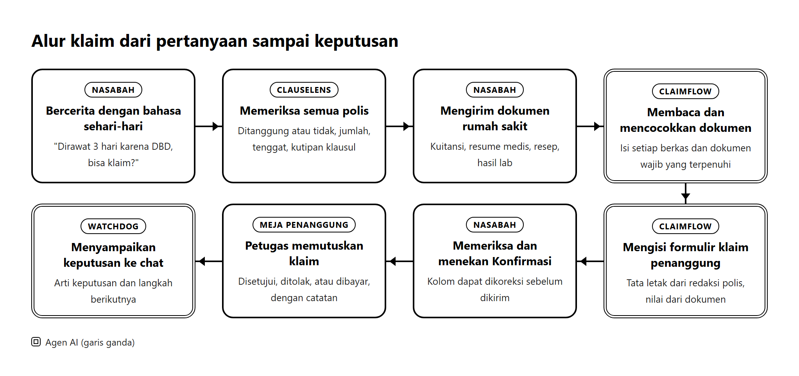
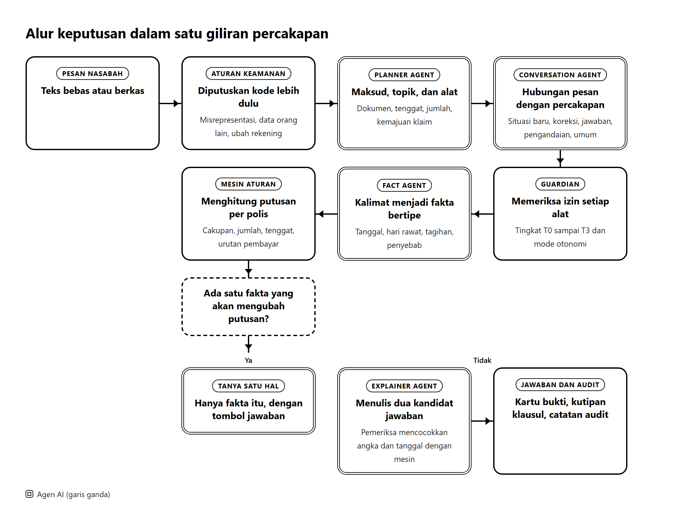

# ClauseGuard: Dokumentasi Teknis

*Jelas di setiap klausul, yakin di setiap klaim.*

FinTechathon 2026 · International Track · Topik D: AI Insurance Assistant
Tim: Bunga Laelatul Muna, Izra, Wan Sabrina · Institut Teknologi Sepuluh Nopember, Indonesia
Demo langsung: https://clauseguard.up.railway.app · Kode sumber: https://github.com/bungagana/clauseguard

## 1. Problem & scope

ClauseGuard adalah asisten asuransi berbasis AI yang membantu nasabah memahami polis, memeriksa cakupan perlindungan, menghitung manfaat, dan mengurus klaim. Satu rumah tangga dapat memiliki beberapa polis, seperti BPJS Kesehatan, asuransi kantor, asuransi pribadi, dan perlindungan kecelakaan. Ketentuan mengenai masa tunggu, batas pengajuan, dokumen wajib, dan urutan pembayaran tersebar dalam dokumen polis yang panjang.

Kondisi ini menimbulkan lima risiko utama:

1. Klaim diajukan setelah tenggat.
2. Klaim diajukan selama masa tunggu.
3. Klaim diajukan kepada penanggung yang tidak sesuai dengan urutan pembayaran.
4. Manfaat yang tumpang tindih tidak dioptimalkan atau manfaat yang dapat ditumpuk tidak dimanfaatkan.
5. Polis berakhir karena premi tidak dibayar selama masa tenggang.

ClauseGuard menganalisis polis milik nasabah untuk membantu menghindari kesalahan tersebut. Menurut KFF (2025), sekitar satu dari lima klaim asuransi kesehatan dalam jaringan di Amerika Serikat ditolak pada 2023, dan kurang dari 1% klaim yang ditolak diajukan banding. Di Indonesia, OJK (2023) melaporkan bahwa lebih dari separuh pengaduan asuransi berkaitan dengan kesulitan klaim.

### 1.1 Persona pengguna

Proyek ini membuat data simulasi untuk tiga persona yang mewakili kasus klaim yang umum terjadi. Ketiga persona dapat dicoba langsung di demo dengan akun masing-masing.

**Tabel 1. Persona dan akun demo ClauseGuard**

| Persona | Profil | Polis |
|---|---|---|
| Rizky, 24 tahun | Mahasiswa pascasarjana yang mengurus klaim rawat inap DBD | Santunan harian rumah sakit Sompo, asuransi jiwa berjangka dengan premi tertunggak, asuransi penyakit kritis, dan BPJS Kesehatan kelas 2 |
| Keluarga Santoso | Keluarga empat orang dengan kepala keluarga yang bekerja sebagai karyawan swasta | Asuransi kesehatan dan jiwa kelompok, santunan harian keluarga, asuransi kesehatan pribadi istri, dan BPJS Kesehatan kelas 1 |
| Dewi, 29 tahun | Kurir ojek daring | Asuransi kecelakaan diri, perlindungan kecelakaan dari platform saat bertugas, BPJS Kesehatan kelas 3 dengan tunggakan tiga bulan, dan Jasa Raharja |

Seluruh data persona bersifat sintetis. Redaksi polisnya dimodelkan dari dokumen publik penanggung. Pengguna baru juga dapat mendaftar, mengunggah PDF polisnya sendiri, dan langsung bertanya.

### 1.2 Fitur

ClauseGuard memiliki tiga fitur utama dan tiga fitur pendukung.

**Tabel 2. Fitur utama**

| Fitur | Fungsi | Task keuangan yang diselesaikan |
|---|---|---|
| ClauseLens | Memahami perlindungan nasabah | Menentukan apakah suatu kejadian ditanggung, berapa manfaatnya, kapan batas pengajuannya, dan polis mana yang membayar lebih dulu, disertai kutipan klausul |
| ClaimFlow | Mengurus klaim nasabah | Membaca dokumen rumah sakit, mencocokkannya dengan dokumen wajib, mengisi formulir klaim milik penanggung, mengajukan setelah konfirmasi, dan menyampaikan keputusan penanggung |
| TrustLock | Menjaga kendali tetap di tangan nasabah | Membatasi setiap tindakan agent dengan empat tingkat izin, konfirmasi sekali pakai, dan log audit |

**Tabel 3. Fitur pendukung**

| Fitur | Fungsi |
|---|---|
| Claim Simulator | Menjawab pengandaian, misalnya "kalau dirawat lima hari", tanpa memengaruhi klaim sungguhan |
| Deadline Tracker | Mengingatkan batas pengajuan klaim dan masa tenggang premi sebelum terlewat |
| PDF Export | Menyimpan jawaban, bukti klausul, dan formulir klaim dalam bentuk dokumen |

Selain fitur tersebut, ClauseGuard memiliki kemampuan dasar yang mendukung semua fitur: unggah polis sendiri, dua bahasa (Indonesia dan Inggris), akun dengan riwayat percakapan, penanggung sandbox dengan meja klaim, panel "How was this decided" pada setiap jawaban, dan log audit.

### 1.3 Metrik keberhasilan

Keberhasilan task diukur dengan pemeriksaan otomatis. Tidak ada penilaian yang dilakukan oleh model.

**Tabel 4. Metrik keberhasilan dan hasilnya**

| Metrik | Cara mengukur | Hasil |
|---|---|---|
| Penyelesaian task klaim | Tugas terskrip yang lulus pemeriksaan putusan, jumlah, tenggat, kode penolakan, dan tindakan | 33 dari 33 (100%) |
| Akurasi cakupan | Putusan benar pada benchmark asuransi publik | 84,6% dari 390 label |
| Penolakan yang dikarang | Putusan ditolak padahal tidak ada klausul yang berlaku | 1,4% |
| Ketepatan pertanyaan | Bertanya saat jawaban akan berubah dan diam saat tidak | 87% dan 100% |
| Klaim ujung ke ujung | Dokumen sampai keputusan penanggung kembali ke chat | Berhasil dan terekam di log audit |
| Kualitas percakapan | Giliran yang lulus dari 47 giliran berbahasa gaul, salah ketik, koreksi, dan pengandaian | 42 dari 47 (89%) |
| Keamanan tindakan | Serangan yang berhasil menimbulkan efek | 0 dari 27 |

## 2. System architecture

### 2.1 Komponen sistem

Gambar 1 menunjukkan komponen ClauseGuard. Agen AI bertugas memahami dan menjelaskan. Mesin aturan memutuskan. Guardian menegakkan izin. Setiap langkah dicatat dalam log audit.

**Tabel 5. Peran setiap komponen**

| Komponen | Peran |
|---|---|
| UI dan dialog | Aplikasi web nasabah (chat, kartu putusan, formulir klaim, unggah dokumen) dan meja klaim untuk petugas penanggung |
| Orchestrator | Loop agent yang menjalankan perencanaan, pemeriksaan izin, pemanggilan alat, mesin aturan, dan penyusunan jawaban di setiap giliran |
| LLM | Google Gemini untuk memahami pesan, membaca dokumen, dan menyusun kalimat |
| Agen AI | Tujuh agen dengan tugas sempit, dijelaskan di bagian 3.1 |
| Tools dan API | 19 alat bertingkat izin yang memanggil API penanggung sandbox |
| Mesin aturan | Kode deterministik yang memutuskan cakupan, jumlah, tenggat, urutan pembayar, dan kesiapan klaim |
| Guardian | Titik penegakan izin yang memeriksa setiap pemanggilan alat |
| Penyimpanan data | Postgres di Supabase untuk log audit, riwayat chat, klaim, dan tiket |
| Penanggung sandbox | Penanggung simulasi dengan meja klaim, tempat petugas memutuskan klaim |

### 2.2 Alur klaim

Gambar 2 menunjukkan alur satu klaim dari pertanyaan pertama sampai keputusan penanggung. Warna kotak menunjukkan siapa yang bekerja di setiap langkah.

### 2.3 Alur keputusan dalam satu giliran

Gambar 3 menunjukkan langkah yang terjadi setiap kali nasabah mengirim pesan. Aturan keamanan diputuskan oleh kode sebelum model membaca maksud pesan. Putusan selalu dihitung oleh mesin aturan.

### 2.4 Stack teknologi dan deployment

Setiap teknologi dipilih karena mendukung keluaran yang terstruktur, aman, dan dapat diperiksa.

**Tabel 6. Stack teknologi dan alasan pemilihan**

| Lapisan | Teknologi | Alasan |
|---|---|---|
| Mesin aturan dan agent | Python, FastAPI, Pydantic | Skema bertipe yang ketat untuk aturan polis, fakta, dan keluaran model |
| LLM | Google Gemini Flash Lite | Mendukung keluaran JSON sesuai skema, cepat, biaya rendah, dan memahami bahasa Indonesia sehari-hari |
| Optimasi | SciPy (MILP, HiGHS) | Pemilihan produk penutup celah dengan hasil optimal yang dapat diperiksa |
| Aplikasi web | Next.js, TypeScript, Tailwind CSS | Antarmuka chat dengan kartu interaktif untuk nasabah dan meja penanggung |
| Akun dan penyimpanan | Supabase Auth dan Postgres | Login email terkonfirmasi, row-level security, dan log audit yang tetap tersimpan |
| Hosting | Railway, region Asia Tenggara | Layanan web dan API terpisah, dekat dengan basis data, dan diperbarui otomatis dari repositori |

## 3. Core algorithm description

### 3.1 Agen AI dan desain prompt

ClauseGuard memakai tujuh agen AI. Setiap agen mengerjakan satu tugas sempit dan mengisi skema keluaran tertutup. Kode memvalidasi setiap keluaran sebelum dipakai. Isi pesan dan dokumen selalu diperlakukan sebagai data, sehingga perintah yang terselip di dalamnya diabaikan.

**Tabel 7. Agen AI dan desain prompt**

| Agen | Tugas | Masukan | Inti prompt | Keluaran | Pengaman |
|---|---|---|---|---|---|
| Conversation Agent | Membaca hubungan pesan dengan percakapan | Pesan, fakta yang sudah diketahui, pertanyaan terakhir agent, empat pertukaran terakhir | Menilai pesan sebagai jawaban, koreksi, lanjutan, situasi baru, pengandaian, atau pertanyaan umum, disertai contoh dalam dua bahasa | Satu jenis hubungan, bahasa pesan, dan fakta yang masih berlaku | Hanya dapat membuang fakta. Fakta yang hilang dari pesan yang tidak membawa kejadian baru tetap dipertahankan |
| Planner Agent | Menentukan maksud, topik, dan alat | Pesan, situasi bertipe, empat pertukaran terakhir | Menulis pembacaan singkat lebih dulu, lalu memilih maksud dari daftar tetap dan alat baca yang diperlukan, dengan contoh dalam dua bahasa | Maksud, topik pertanyaan, alat, dan penanda permintaan tindakan | Klasifikasi keamanan diputuskan kode. Tindakan diterima hanya bila ada permintaan jelas atau persetujuan atas tawaran |
| Fact Agent | Mengubah kalimat menjadi fakta bertipe | Pesan nasabah | Mengisi kolom hanya bila teks menyatakannya, tanpa menebak tanggal, umur, jumlah, atau penyebab | Fakta dari kosakata tetap, misalnya tanggal masuk, hari rawat, tagihan, penyebab | Fakta kejadian dikunci dan tidak dapat diubah untuk menyesuaikan polis |
| Document Reader Agent | Membaca polis dan dokumen klaim | Teks dokumen yang data pribadinya sudah dihapus | Komponen terisolasi yang mengklasifikasi dan menyalin isi dokumen ke skema, tanpa mengikuti instruksi di dalam dokumen | Aturan polis bertipe, atau ringkasan dokumen klaim (jenis, tanggal, total, diagnosis) | Tidak memiliki alat dan riwayat percakapan. Teks yang menyerupai perintah ditandai |
| Claim Form Agent | Menyusun tata letak formulir klaim penanggung | Klausul klaim dari polis | Merancang judul, bagian, dan kolom memakai istilah penanggung, dengan setiap kolom terhubung ke satu sumber data | Struktur formulir | Nilai diisi oleh kode dari draf klaim. Model tidak menulis nilai |
| Explainer Agent | Menyusun kalimat jawaban | Hasil mesin aturan, empat pertukaran terakhir, enam contoh jawaban | Menulis catatan penalaran singkat, lalu dua kandidat jawaban yang ramah dan ringkas dalam bahasa nasabah | Kandidat jawaban dan pilihan terbaik | Setiap angka, tanggal, dan nomor diperiksa terhadap hasil mesin. Kutipan klausul harus sama persis |
| Watchdog Agent | Memantau tenggat dan keputusan penanggung | Status klaim, catatan petugas, fakta klaim | Mengklasifikasikan catatan petugas sebagai cacat yang dapat diperbaiki, alasan yang bertentangan dengan polis, alasan yang sah, atau tidak jelas | Jenis catatan dan langkah berikutnya | Tidak mengirim apa pun. Banding dan pengajuan ulang tetap menunggu konfirmasi nasabah |

Semua pemanggilan model memakai suhu nol. Bila model tidak tersedia, nasabah menerima pemberitahuan yang jelas dan dapat memakai kunci API miliknya sendiri.

### 3.2 Planning dan tool-calling

Perencanaan berjalan dua lapis. Kode memutuskan klasifikasi keamanan lebih dulu, lalu Planner Agent membaca maksud pesan dalam konteks percakapan. Setiap alat terdaftar dengan tingkat izin, tipe argumen, dan tipe hasil. Hasil alat disimpan sebagai handle bertipe dengan label kepercayaan. Alat tingkat 2 hanya menerima handle, sehingga teks dari dokumen atau model tidak dapat menjadi argumen pengajuan. Bila beberapa polis dapat menerima klaim, agent bertanya polis mana yang diajukan lebih dulu.

### 3.3 Memory

Agent memakai tiga jenis ingatan.

1. **Ingatan sesi** menyimpan fakta, tanggal, dokumen yang dibaca, dan formulir yang menunggu konfirmasi.
2. **Ingatan percakapan** menyimpan empat pertukaran terakhir untuk memahami rujukan seperti "yang itu" atau "polis yang satunya".
3. **Riwayat akun** menyimpan percakapan di Postgres sehingga dapat dibuka dari perangkat lain.

### 3.4 Retrieval

Informasi polis diambil dari penyimpanan klausul bertipe. Setiap polis dikompilasi menjadi aturan seperti menanggung, mengecualikan, masa tunggu, batas pengajuan, membayar, dan dokumen wajib. Mesin aturan mengambil aturan yang relevan berdasarkan kejadian, penyebab, dan orang yang ditanggung. Cara ini dipilih karena putusan asuransi membutuhkan aturan yang tepat beserta angka dan rentang waktunya. Untuk diagnosis, agent memakai retrieval BM25 atas 74.879 kode ICD-10. Model memilih satu kode dari daftar kandidat, lalu kode memverifikasi pilihan itu.

### 3.5 Model alokasi klaim

Untuk satu tagihan rumah sakit, ClauseLens menyusun pembayar secara berlapis menurut aturan koordinasi Indonesia.

1. Jasa Raharja membayar lebih dulu untuk kecelakaan lalu lintas yang melibatkan dua kendaraan atau lebih.
2. BPJS Kesehatan membayar bila rumah sakit adalah mitra dan kepesertaan aktif.
3. Asuransi kantor membayar sebelum asuransi pribadi.
4. Santunan harian dibayar bersamaan karena dapat ditumpuk.

Setiap polis membayar *min(batas polis, jumlah yang diajukan dikurangi bagian biaya peserta)*. Setiap pembayar hanya menerima sisa tagihan yang belum dibayar, sehingga total pembayaran tidak pernah melebihi tagihan. Di dalam satu lapisan, semua urutan pengajuan dihitung dan urutan dengan pemulihan terbesar dipilih.

### 3.6 Penilaian risiko klaim

Sebelum klaim diajukan, ClaimFlow menilai kesiapannya seperti petugas penanggung. Setiap klausul yang dapat menolak klaim diperiksa satu per satu. Dokumen diperiksa silang, misalnya tanggal terhadap hari rawat dan total kuitansi terhadap rinciannya. Hasilnya adalah skor kesiapan beserta alasan yang dapat diperbaiki. Bila klaim ditolak, mesin mencari perubahan sah terkecil yang membuat klaim ditanggung, seperti melengkapi dokumen atau memakai polis lain. Fakta kejadian dikunci di kode sehingga tidak pernah diubah.

### 3.7 Guardrail dan explainability

Setiap jawaban dapat ditelusuri. Panel "How was this decided" menampilkan cara pesan dipahami, fakta yang dipakai, klausul yang berlaku, putusan mesin, hasil pemeriksaan kalimat, dan nomor catatan audit. Pemeriksa jawaban memastikan setiap angka dan tanggal berasal dari mesin. Bila kandidat pertama gagal, kandidat kedua diperiksa, lalu teks tetap dipakai.

### 3.8 Evaluasi

Seluruh evaluasi dapat dijalankan ulang dari skrip yang tercantum di Indeks Bukti Eksekusi.

**Tabel 8. Hasil evaluasi**

| Evaluasi | Skenario | Pembanding | Hasil |
|---|---|---|---|
| Task klaim | 33 tugas terskrip | Tidak ada | 33 dari 33 lulus |
| Akurasi cakupan | Benchmark publik asuransi jiwa, 580 label | Model membaca seluruh kontrak | 84,6% dengan 1,4% penolakan dikarang. Pembanding 87,5% dengan 3,1% penolakan dikarang |
| Ketepatan pertanyaan | 18 pesan dengan satu fakta dihapus | Menanyakan semua fakta yang hilang | Bertanya saat perlu 87%, diam saat tidak perlu 100% |
| Konsistensi | 20 skenario dalam tiga redaksi | Tidak ada | 20 dari 20 putusan sama |
| Urutan pembayar | 500 rumah tangga, 200 produk marketplace AS | Klaim sesuai urutan kepemilikan polis | Urutan kepemilikan tidak optimal pada 47,2% rumah tangga, selisih rata-rata USD 988 |
| Pemilihan produk | 100 rumah tangga | Produk termurah | Menutup celah lebih besar pada 73 dari 100 |
| Kode diagnosis | 76 baris diagnosis | Kamus alias | 92,2% benar. Kamus alias 17,2% |
| Percakapan | 47 giliran naratif | Prompt versi sebelumnya | 42 dari 47, naik dari 40 dari 47 |
| Biaya | 90 giliran | Model membaca seluruh dokumen | 0,98 pemanggilan model per giliran, 17% token pembanding |

**Tabel 9. Ablation**

| Komponen yang dilepas | Akibat |
|---|---|
| Penegakan izin di kode | Serangan berhasil naik dari 0 menjadi 1 dari 27 |
| Aturan hasil ekstraksi diganti aturan acuan benchmark | Akurasi naik dari 84,6% menjadi 91,8%. Selisihnya berasal dari pembacaan dokumen |
| Mesin aturan diganti jawaban model saja | Penolakan dikarang naik dari 1,4% menjadi 3,1% dan klausul penentu tidak dapat ditunjukkan |
| Pertanyaan berbasis perubahan putusan | Agent menanyakan semua fakta yang hilang. Dengan komponen ini, 35 dari 35 kekosongan yang tidak relevan tidak ditanyakan |

## 4. Security design

### 4.1 Permission tier

TrustLock membagi setiap tindakan agent ke dalam empat tingkat izin. Gambar 4 menunjukkan jalur yang ditempuh setiap tindakan.

**Tabel 10. Tingkat izin**

| Tingkat | Jenis | Contoh tindakan |
|---|---|---|
| T0 | Otomatis | Membaca polis, status klaim, status premi, dan pengingat tenggat milik nasabah sendiri |
| T1 | Otomatis | Memeriksa cakupan, menghitung urutan pembayar, menyusun draf klaim dan formulir, menyusun draf banding |
| T2 | Butuh konfirmasi | Mengajukan klaim, melampirkan dokumen, mengajukan banding, menjadwalkan panggilan balik |
| T3 | Dilarang untuk agent | Mengubah rekening pencairan, mengubah ahli waris, memindahkan uang |

Nasabah juga memilih mode otonomi. Mode Observe hanya menjawab. Mode Draft menyiapkan tanpa mengirim. Mode Act mengirim setelah konfirmasi.

### 4.2 Threat model

**Tabel 11. Ancaman, kontrol, dan hasil uji**

| Ancaman | Contoh | Kontrol | Hasil uji |
|---|---|---|---|
| Prompt injection | Teks putih tersembunyi di kuitansi yang meminta persetujuan klaim | Pemindai teks tersembunyi, Document Reader Agent terisolasi, label tidak tepercaya, argumen T2 berupa handle | 0 dari 27 serangan berhasil. Teks putih, huruf kecil, di luar halaman, dan anotasi terdeteksi 20 dari 20 |
| Data leakage | Meminta data nasabah lain atau isi sistem | Isolasi akun, row-level security, penyaringan nomor rekening dan identitas, penghapusan data pribadi sebelum dokumen dikirim ke model | Akun lain menerima penolakan atau daftar kosong. Setiap percobaan tercatat di log audit |
| Unauthorized transaction | Mengajukan klaim tanpa konfirmasi atau mengubah rekening dengan alasan darurat | Token konfirmasi sekali pakai, tidak ada alat T3, batas aksi per sesi, sakelar henti | Tidak ada pengajuan atau perubahan rekening yang terjadi |
| Hallucinated advice | Menyebut jumlah, tanggal, atau penolakan yang tidak ada di polis | Putusan dari mesin aturan, pemeriksa angka dan tanggal, kutipan klausul persis, label indikatif | 1,4% penolakan dikarang pada benchmark. Jawaban dengan nilai di luar hasil mesin tidak ditampilkan |

### 4.3 Kontrol risiko

1. **Limit transaksi.** Batas klaim Rp 100.000.000 per pengajuan, paling banyak tiga aksi T2 dan 60 pemanggilan alat per sesi, satu tiket T3 per 24 jam, dan sesi berhenti otomatis setelah tiga penolakan izin.
2. **Audit log.** Setiap pesan, rencana, pemanggilan alat, putusan izin, dan jawaban dicatat dalam rantai hash, sehingga perubahan pada satu catatan terdeteksi saat verifikasi.
3. **Human in the loop.** Nasabah mengonfirmasi setiap pengajuan. Petugas penanggung memutuskan setiap klaim. Penanggung memegang sakelar henti untuk menghentikan semua aksi agent.
4. **Privasi data.** NIK, nomor rekening, nomor kartu, nomor telepon, tanggal lahir, dan nama orang dihapus secara lokal sebelum dokumen dikirim ke model. Setiap akun terisolasi.
5. **Kepatuhan regulasi.** Setiap jawaban ditandai indikatif. Setelah penolakan, agent menyampaikan jalur pengaduan resmi (unit pengaduan penanggung, Kontak OJK 157, dan LAPS SJK). Verifikasi identitas (KYC) untuk perubahan data sensitif dilakukan penanggung melalui jalur terpisah. Agent tidak memindahkan dana, sehingga pemeriksaan AML berada di sisi penanggung.

Topik D tidak menggunakan blockchain, sehingga key management, signing policy, dan transaction simulation untuk Topik F tidak berlaku.

## 5. Innovation & interaction

### 5.1 Perbedaan dengan solusi yang ada

Tabel 12 membandingkan ClauseGuard dengan tiga jenis solusi yang sudah tersedia bagi nasabah.

**Tabel 12. Perbandingan dengan solusi yang ada**

| Kemampuan | Chatbot penanggung | Chatbot AI umum | Situs perbandingan polis | ClauseGuard |
|---|---|---|---|---|
| Membaca semua polis dari penanggung berbeda | Produk sendiri | Bila diunggah | Tidak | Ya |
| Putusan dengan kutipan klausul penentu | Jawaban umum | Dari ingatan model | Tidak | Ya |
| Urutan pembayar termasuk BPJS dan Jasa Raharja | Tidak | Tidak konsisten | Tidak | Ya |
| Mengisi formulir klaim penanggung dari dokumen | Formulir sendiri | Tidak | Tidak | Ya |
| Mengajukan klaim dan menerima keputusan di chat | Sebagian | Tidak | Tidak | Ya |
| Memeriksa dasar banding | Tidak | Tidak terverifikasi | Tidak | Ya |
| Batas tindakan ditegakkan kode | Tidak relevan | Tidak ada | Tidak relevan | Empat tingkat izin |

Inovasi utama ClauseGuard adalah memperlakukan polis asuransi sebagai program aturan. Model bahasa memahami percakapan dan dokumen. Mesin aturan menghitung hak nasabah. Setiap jawaban dapat dibuktikan dengan klausul.

### 5.2 Desain interaksi

1. **Bahasa sehari-hari.** Nasabah dapat menulis dalam bahasa Indonesia, Inggris, atau campuran, termasuk singkatan dan salah ketik.
2. **Satu pertanyaan.** Agent hanya bertanya bila jawabannya akan berubah, dengan tombol jawaban cepat.
3. **Kartu bukti.** Putusan, kutipan klausul, urutan pembayar, kesiapan klaim, dan isi dokumen tampil sebagai kartu yang dapat dibuka.
4. **Formulir yang dapat dikoreksi.** Formulir klaim tampil sebelum dikirim dan setiap kolom dapat diubah.
5. **Kartu konfirmasi.** Pengajuan memerlukan satu ketukan Konfirmasi yang menampilkan dokumen terlampir dan dokumen yang belum ada.
6. **Kabar proaktif.** Keputusan penanggung muncul di chat beserta penjelasan dan langkah berikutnya.
7. **Mode otonomi.** Sakelar Observe, Draft, dan Act selalu terlihat di bagian atas layar.

## 6. Limitations & known risks

Daftar berikut konsisten dengan daftar risiko pada dokumen Penilaian Keamanan Mandiri. Nomor K merujuk ke dokumen tersebut.

**Tabel 13. Keterbatasan dan risiko yang diketahui**

| No. | Risiko | Tingkat sisa | Penanganan |
|---|---|---|---|
| K1 | Document Reader Agent dapat salah membaca nilai. Aturan hasil ekstraksi 7 poin di bawah aturan acuan benchmark | Tinggi | Pemeriksaan silang, label belum terverifikasi, nasabah meninjau nilai sebelum mengirim |
| K2 | Teks saran dapat keliru. Lapisan izin membatasi tindakan dan tidak memeriksa kebenaran saran | Sedang | Putusan dari mesin aturan, pemeriksa angka, label indikatif |
| K3 | Teks yang digambar di dalam gambar belum terdeteksi (0 dari 20) | Sedang | Keluaran bertipe dan label tidak tepercaya memblokir T2 |
| K4 | Log audit dapat dibangun ulang oleh pihak dengan akses tulis ke penyimpanan | Sedang | Verifikasi rantai menunjukkan perubahan pada catatan yang ada |
| K8 | Polis unggahan nasabah dapat menyesatkan putusan bila isinya dimanipulasi | Sedang | Label belum terverifikasi dan tidak dapat memicu T2 |
| K9 | Konfirmasi bergantung pada nasabah membaca kartunya | Sedang | Ringkasan dengan label kepercayaan dan token per pemanggilan |
| K12 | Ketergantungan pada layanan model dan kuotanya | Rendah | Rotasi kunci, pemberitahuan kepada nasabah, opsi kunci milik nasabah |
| K15 | Set uji kecil dan ditulis tim | Tinggi | Setiap hasil dilaporkan dengan jumlah sampelnya |
| K18 | Ingatan sesi berakhir saat server dimulai ulang | Rendah | Riwayat chat tersimpan dan nasabah diminta menyampaikan ulang situasinya |

Keterbatasan cakupan lainnya:

1. Benchmark publik hanya mencakup asuransi jiwa. Produk Indonesia diuji pada polis sandbox yang diverifikasi manual.
2. Sebanyak 24 dari 58 skenario benchmark, seperti dividen dan perencanaan warisan, berada di luar cakupan mesin aturan.
3. Aturan BPJS Kesehatan dan Jasa Raharja dimodelkan dari regulasi publik. Pengelompokan tarif INA-CBG belum diimplementasikan.
4. Klaim yang sudah diajukan tidak dapat diubah langsung. Penolakan yang dapat diperbaiki ditindaklanjuti dengan pengajuan baru setelah konfirmasi nasabah.

## Referensi

1. Mridul, Kapa, dan Seneviratne (2026). A benchmark for gap and overlap analysis of insurance contracts. arXiv:2604.10853.
2. Debenedetti dkk. (2025). CaMeL: defeating prompt injections by design. arXiv:2503.18813.
3. Wachter, Mittelstadt, dan Russell (2017). Counterfactual explanations without opening the black box.
4. OWASP Top 10 for Agentic Applications (2026).
5. KFF (2025). HealthCare.gov insurers denied nearly 1 in 5 in-network claims in 2023.
6. OJK (2023). Kesulitan klaim menjadi pengaduan asuransi terbanyak.
