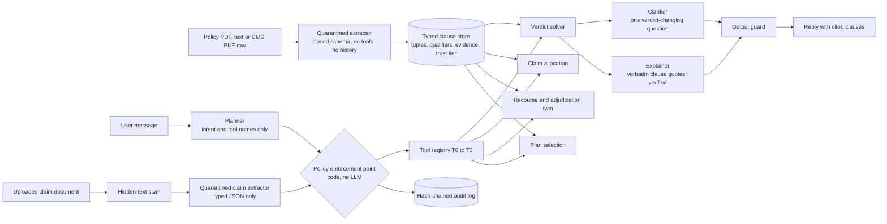

# ClauseGuard: Mesin Hak Banyak Polis untuk Konsumen Asuransi

*Mengompilasi polis nyata menjadi program kendala; menghitung apa yang menjadi hak Anda, cara mendapatkannya, dan apa yang harus dibeli; membuktikan setiap jawaban dengan klausul; bertindak hanya dalam tingkat izin yang aman.*

FinTechathon 2026, International Track, Topic D (AI Insurance Assistant).
Status date: 2026-10-11. Code license: Apache-2.0. Every number in this document is copied from a file in `evidence/`; the file is named next to the number. Results that were not measured are stated as not measured.
## 1. Masalah

Konsumen asuransi memiliki beberapa polis sekaligus: skema wajib, program pemberi kerja, program individu, rider, dan perlindungan kecelakaan. Cakupan terfragmentasi, dan aturan yang menentukan klaim (tanggal, jumlah, daftar dokumen, urutan pembayar, masa tunggu) terdapat dalam dokumen yang jarang dibaca oleh konsumen. Ini adalah kondisi global. Di Amerika Serikat, perusahaan asuransi pasar menolak sekitar satu dari lima klaim dalam jaringan pada tahun 2023 dan konsumen mengajukan banding kurang dari 1% di antaranya. Di Inggris, Financial Ombudsman Service memublikasikan keputusan asuransinya, masing-masing mengutip klausul yang disengketakan. Di Singapura dan Hong Kong, statistik keluhan yang dipublikasikan berfokus pada non-disclosure (sekitar 30% dari keluhan yang diselesaikan di Hong Kong). Di Tiongkok, definisi penyakit kritis yang ketat telah memicu tuntutan hukum terkait tingkat pembayaran. Di Indonesia, regulator melaporkan bahwa lebih dari separuh keluhan asuransi berkaitan dengan kesulitan klaim, dan skema kesehatan nasional (BPJS Kesehatan) berkoordinasi dengan perlindungan swasta berdasarkan aturan yang hanya diketahui oleh sedikit pemegang polis.

Angka yang bersumber:

| Angka | Sumber |
|---|---|
| 19% klaim dalam jaringan ditolak di HealthCare.gov pada 2023; konsumen mengajukan banding kurang dari 1%; 56% banding menguatkan penolakan (KFF, Jan 2025) | https://www.kff.org/private-insurance/healthcare-gov-insurers-denied-nearly-1-in-5-in-network-claims-in-2023-but-information-about-reasons-is-limited-in-public-data/ |
| Lebih dari 50% keluhan asuransi di Indonesia berkaitan dengan kesulitan klaim (OJK, Des 2023) | https://finansial.bisnis.com/read/20231206/215/1721354/ojk-ungkap-kesulitan-klaim-asuransi-paling-banyak-diadukan-konsumen |
| 53% klaim konsumen ditolak; ke-17 polis yang ditinjau melanggar aturan klausul standar (YLKI, Mar 2025; angka kelompok konsumen) | https://finansial.bisnis.com/read/20250306/215/1857915/ylki-minta-ojk-buat-standar-polis-asuransi-baru-tulus-banyak-konsumen-dirugikan |
| Rasio klaim kesehatan Indonesia 97,52% (2023), kemudian 71,23% (2024) setelah penyesuaian harga (OJK) | https://finansial.bisnis.com/read/20250313/215/1861047/rasio-klaim-asuransi-kesehatan-susut-ojk-ungkap-alasannya |
| POJK 36/2025: ko-pembayaran dibatasi maksimal 5%, masa tunggu maksimal 6 bulan | https://investortrust.id/financial/111948/aaji-dukung-implementasi-pojk-asuransi-kesehatan-untuk-perkuat-tata-kelola-dan-manajemen-risiko-industri |
| Tiongkok: tingkat pembayaran kesehatan komersial mendekati 40%, sengketa mengenai definisi penyakit kritis yang ketat (Caixin, Sep 2025) | https://www.caixinglobal.com/2025-09-26/in-depth-lawsuits-lay-bare-shortcomings-of-chinas-commercial-insurers-102366418.html |
| Hong Kong: sekitar 30% keluhan yang diselesaikan berkaitan dengan non-disclosure | https://www.asiainsurancereview.com/Magazine/ReadMagazineArticle?aid=43529 |

Model bahasa umum menjawab pertanyaan-pertanyaan ini dari ingatan dan mungkin menyatakan aturan yang salah dengan penuh keyakinan. Kami mengajukan pertanyaan yang lebih sempit: dapatkah asisten menghitung apa yang menjadi hak konsumen dari teks polis konsumen itu sendiri, membuktikannya dengan klausul, mengatakan cara memperolehnya, mengatakan apa yang harus dibeli untuk menutup kesenjangan yang tersisa, dan menolak untuk bertindak di luar izinnya?

Lima mode kegagalan mendorong desain ini. Masing-masing merupakan aritmetika pada dokumen pengguna sendiri: klaim yang diajukan setelah tenggat (redaksi Sompo hospital-cash menolak klaim lebih dari 60 hari setelah perawatan berakhir; rider Astra mengizinkan 90 hari setelah keluar rumah sakit); klaim di dalam masa tunggu atau untuk penyakit tertentu; urutan pembayar yang salah (perlindungan wajib, kemudian BPJS, kemudian grup, kemudian ganti rugi individu, dengan perlindungan manfaat tetap secara paralel); membayar dua kali untuk perlindungan ganti rugi yang tumpang tindih atau melewatkan manfaat yang dapat diakumulasi; dan lapse selama masa tenggang.
## 2. Metode: asuransi sebagai program kendala

Setiap polis dikompilasi oleh ekstraktor terkuarantina menjadi `PolicyRecord` yang berisi tupel klausul bertipe `(head, relation, object, qualifiers, evidence, confidence, source_tier)` (`clauseguard/schema.py`). Relasi merupakan set tertutup (COVERS, EXCLUDES, EXCEPTS, CONDITIONED_ON, HAS_PERIOD, PAYS, PERMITS, TERMINATES_IF, REQUIRES_DOCUMENT, DEFINES, REFERS_TO, HAS_RIDER). Kualifikator bersifat bertipe, bukan teks bebas: jumlah, batas per hari dan per kasus, deduktibel dan ko-pembayaran, jendela waktu (`window_len`, `window_unit`, `window_from`), tenggat pengajuan, kondisi `applies_if` atas kosakata slot tertutup, dan basis (INDEMNITY atau FIXED_BENEFIT). `evidence` menyimpan teks klausul verbatim dan bagian; ini hanya teks tampilan dan tidak pernah mencapai keputusan. `source_tier` adalah tingkat kepercayaan terurut (`LLM < USER_UPLOAD < TOOL < POLICY_DOC_UNVERIFIED < POLICY_DOC_VERIFIED < USER < USER_CONFIRMED < SYSTEM`); kepercayaan adalah kualifikator seperti yang lainnya, sehingga solver melaporkan tingkat terlemah yang digunakannya dan lapisan penegakan membatasi tindakan pada tingkat yang sama.

Situasi pengguna adalah objek `ScenarioFacts` atas daftar slot tertutup; slot yang tidak terikat dianggap absen, bukan salah. Empat solver deterministik membaca objek-objek ini. Tidak ada model yang berjalan di dalam salah satunya; model hanya mengekstraksi, mengikat fakta, dan menyusun teks.


### 2.1 Solver 1: verdict (`clauseguard/solver.py`)

Untuk polis P dan fakta f, `evaluate(P, f)` berjalan dalam urutan tetap:

1. candidates = tupel COVERS (atau PERMITS, untuk peristiwa tindakan) bagi peristiwa yang kondisi `applies_if`-nya terpenuhi;
2. closed world: tidak ada kandidat dan tidak ada tupel EXCLUDES, HAS_PERIOD, atau TERMINATES_IF yang mengatur memberikan NOT_APPLICABLE (NOT_SPECIFIED ketika cakupan ekstraksi dokumen rendah); solver tidak pernah menciptakan penolakan;
3. tupel EXCLUDES apa pun pada peristiwa atau penyebab yang jendela dan kondisinya terpenuhi, dan yang tidak EXCEPTED, memberikan DENIED;
4. tupel CONDITIONED_ON atau HAS_PERIOD apa pun yang tidak terpenuhi (masa tunggu, masa tunggu penyakit tertentu, masa tenggang, kelangsungan hidup, kontestabilitas, bunuh diri) memberikan DENIED;
5. tupel TERMINATES_IF yang terpenuhi memberikan DENIED;
6. jika tidak, COVERED, dengan jumlah yang harus dibayar dihitung dari tupel PAYS, limit, hari deduktibel, dan batas atas.

Prioritas adalah pengecualian (exception) di atas eksklusi (exclusion) di atas kondisi di atas cakupan, dan tupel rider mencakup peristiwa rider itu sendiri. Setiap langkah menambahkan entri jejak yang menyebutkan id tupel, sehingga balasan dapat mengutip secara tepat klausul yang terpicu.

Contoh pengerjaan (pengujian `tests/test_solver.py::test_denied_inside_waiting_period`, `::test_covered_after_waiting_with_payable`): sebuah rencana santunan tunai rumah sakit memiliki masa tunggu 30 hari (tupel `t_wait`) yang dikecualikan untuk kecelakaan dan keadaan darurat. Pengguna yang dirawat karena penyakit pada hari ke-20 mendapatkan DENIED, kode WAITING_PERIOD, jejak `day 20 < waiting 30`, klausul yang terpicu `t_wait`. Dengan hari ke-44 dan 5 hari rawat inap sebesar IDR 500,000 per hari, polis yang sama memberikan COVERED dan IDR 2,500,000.
### 2.2 Klarifikasi sensitivitas-putusan

`decide(P, f)` memperluas `evaluate`. Jika evaluasi menyentuh slot yang tidak terikat s, fungsi ini menjalankan ulang *solver* untuk setiap nilai dalam domain slot `SLOT_DOMAINS[s]`. Jika putusannya tidak berubah, slot tersebut tidak relevan dan agen tidak akan bertanya. Jika putusannya berubah, hasilnya adalah CLARIFY yang menyebutkan secara persis slot tersebut, dengan putusan di bawah setiap nilai, dan penjelas meng формулируatkan satu pertanyaan yang merujuk pada klausul yang membuat slot tersebut penting. Contoh: dengan tanggal efektif yang tidak diketahui, masa tunggu menentukan antara DENIED danCOVERED, sehingga agen hanya meminta tanggal tersebut. Pengujian: `tests/test_solver.py::test_clarify_asks_only_verdict_changing_slot`, `::test_no_clarification_when_slot_irrelevant`.

### 2.3 Solver 2: alokasi klaim (`clauseguard/allocation.py`, `clauseguard/rulepacks.py`)

Polis mana dari suatu rumah tangga yang membayar bagian tagihan tertentu, dan dalam urutan apa, berdasarkan aturan koordinasi suatu yurisdiksi. Kelayakan setiap polis berasal dari Solver 1.

Tagihan B yang memenuhi syarat dibagi menjadi kategori c (kamar, bedah, lainnya jika tagihan dirinci; atau satu kategori jika tidak), B = sum_c B_c. Untuk polis ganti rugi yang memenuhi syarat i dengan biaya yang diajukan y_{i,c} >= 0 dengan s_i = sum_c y_{i,c}, polis tersebut membayar

    p_i = g_i(s_i) = min(A_i, s_i - m_i(s_i)),
    m_i(s) = min(K_i, min(s, D_i + F_i) + r_i * max(0, s - D_i - F_i)),

di mana D_i adalah deduktibel, F_i adalah ko-pembayaran tetap, r_i adalah tingkat ko-pembayaran, K_i adalah batas atas pembagian biaya anggota sendiri, dan A_i adalah batas atas pembayaran penanggung; batas internal membatasi apa yang dapat diajukan per kategori (y_{i,c} <= L_{i,c}) dan per kumpulan. g_i bersifat tidak menurun dan 1-Lipschitz. Koordinasi dilakukan secara sekuensial: pembayar ke-k diberikan sisa tagihan yang belum dibayar, U_k = B - sum_{j<k} p_j, sehingga sum_k p_k <= B terpenuhi berdasarkan konstruksi (prinsip ganti rugi). Polis manfaat tetap berada di luar urutan dan bersifat menumpuk.

Lapisan pembayar berasal dari paket aturan (`rulepacks.py`), yang merupakan data, bukan kode: urutan lapisan dimulai dari skema wajib (masing-masing dengan gerbang), kemudian polis ganti rugi komersial berdasarkan kelas (kelompok pemberi kerja sebelum individu di bawah paket Indonesia) dan berdasarkan jenis asuransi lain (primer, PRO_RATA, EXCESS), serta polis manfaat tetap secara paralel. Lapisan k menerima R_k = B - sum_{j<k} P_j. Dalam satu lapisan polis ko-primer, satu-satunya pilihan bebas adalah urutan pengajuan klaim; memberikan semua sisa tagihan yang belum dibayar kepada pembayar adalah optimal karena setiap g_j' <= 1, sementara urutan menjadi penting segera setelah suatu polis memiliki deduktibel, ko-pembayaran, atau batas atas. Pengoptimal mengevaluasi setiap urutan lapisan secara tepat (maksimal 6 polis, 720 urutan; di atas itu, heuristik yang diurutkan berdasarkan kapasitas digunakan dan diberi label), dengan hasil seri dipecahkan berdasarkan urutan yang disukai paket. Polis PRO_RATA membagi biaya yang belum dibayar secara proporsional dengan batasnya; dua polis EXCESS dalam satu lapisan bersifat sirkular dan diselesaikan secara pro rata serta ditandai dengan id klausulnya. Dua garis dasar dilaporkan: greedy (klaim sesuai urutan polis dimiliki) dan polis tunggal terbaik. Karena g bersifat 1-Lipschitz, greedy >= tunggal selalu berlaku, dan pengoptimal >= greedy kapan pun urutan kepemilikan tidak melanggar aturan koordinasi.

Paket yang disertakan: `ID` (Indonesia: Jasa Raharja didahulukan untuk kecelakaan lalu lintas yang melibatkan dua kendaraan atau lebih; BPJS Ketenagakerjaan untuk kecelakaan kerja anggota; BPJS Kesehatan jika keanggotaan aktif dan rawat inap dilakukan di fasilitas mitra atau darurat; kelompok pemberi kerja sebelum individu; manfaat tetap menumpuk; jumlah wajib dimodelkan dan membawa catatan "verifikasi") dan `GENERIC` (tanpa lapisan wajib, tanpa aturan kelas; hanya primer, PRO_RATA, EXCESS), yang digunakan oleh rumah tangga di AS atau Inggris.
### 2.4 Solver 3: counterfactual recourse dan adjudication twin (`clauseguard/recourse.py`, `clauseguard/twin.py`)

Recourse. Diberikan P, f dan putusan V(f) = DENIED (atau NOT_APPLICABLE), temukan himpunan terkecil dari perubahan fakta yang sah A = {a_1, ..., a_k}, k <= max_changes, sedemikian sehingga V(f setelah A) = COVERED, dan kembalikan opsi yang Pareto-minimal berdasarkan vektor biaya

    c(A) = sum_i c(a_i) = (days, money, effort),   berdasarkan komponen, semua >= 0.

Sebuah opsi A mendominasi B ketika c(A) <= c(B) di setiap komponen dan c(A) != c(B); hanya opsi yang tidak didominasi yang dikembalikan. Pencarian dilakukan secara breadth-first atas himpunan tindakan (tindakan tunggal terlebih dahulu, kemudian pasangan), dan himpunan yang sudah mengubah putusan tidak akan diperluas lagi. Tindakan yang sah adalah hal-hal yang benar-benar dapat dilakukan oleh pemohon: menunggu hingga tanggal tertentu (tanggal paling awal yang mengubah putusan akan dilaporkan), menyediakan dokumen, memilih fasilitas mitra untuk penerimaan di masa mendatang, memperoleh klasifikasi darurat ketika fakta tidak menyatakan sebaliknya, melunasi tunggakan premi selama dalam masa tenggang, melampirkan rider untuk perlindungan di masa mendatang, atau mengajukan klaim berdasarkan polis lain dalam portofolio yang sama. Tidak ada hal mengenai apa yang telah terjadi yang boleh berubah: `IMMUTABLE_SLOTS` mencantumkan slot yang mendeskripsikan peristiwa itu sendiri (penyebab, tanggal peristiwa masa lalu, diagnosis, pekerjaan, lisensi, intoksikasi), `MISREPRESENTATION_GUARD` menambahkan slot yang nilainya hanya boleh diikat saat tidak diketahui dan tidak boleh diubah setelah dinyatakan, dan setiap tindakan melewati `guard_change`.

Adjudication twin. Solver berhenti pada klausul pertama yang menolak; penilai klaim mencantumkan setiap dasar penolakan. Twin mengisolasi setiap klausul yang dapat menolak t (EXCLUDES, HAS_PERIOD, CONDITIONED_ON, TERMINATES_IF) dalam tampilan satu klausul P_t = grants(P) + exceptions(P) + {t} dan menjalankan solver yang dibekukan di atasnya; putusan DENIED pada P_t adalah dasar yang dapat diatribusikan ke t. Dokumen yang diunggah diperiksa silang dalam kode (tanggal terhadap hari yang dinyatakan, kode diagnosis terhadap penyebab, total faktur terhadap item baris, faktur terhadap tagihan yang dinyatakan, nama pemegang polis). Dengan dasar G, bobot w: G -> (0, 1] dan subset yang dapat diperbaiki F,

    readiness_score = max(0, 1 - sum_{g in G} w(g)),
    after_fix_score = max(0, 1 - sum_{g in G \ F} w(g)),

sehingga memperbaiki suatu dasar tidak akan pernah menurunkan skor dan dasar fatal (bobot 1) saja akan membuatnya menjadi 0. Setiap dasar membawa id klausul, teks bukti verbatim, dan, jika ada, opsi recourse.
### 2.5 Solver 4: pemilihan rencana berdasarkan anggaran (`clauseguard/plans/selector.py`, `clauseguard/plans/cms_loader.py`)

Celah terbuka (open gaps) adalah sel (risiko, orang) yang dilaporkan oleh `portfolio.gap_overlap` sebagai sel yang tidak ditanggung oleh polis aktif mana pun. Dengan celah g dalam G yang dibobot w_g, rencana kandidat j dengan biaya bulanan c_j, batas maksimum biaya mandiri (out-of-pocket maximum) m_j, dan set celah S_j yang ditutupnya, serta anggaran B:

    maximise   sum_g w_g y_g                                   (leksikografis, pertama)
    then minimise sum_j c_j x_j, then sum_j x_j, then sum_j m_j x_j
    subject to y_g <= sum_{j : g in S_j} x_j          for all g
               sum_j c_j x_j <= B                              (ketika anggaran diberikan)
               sum_{j indemnity : g in S_j} x_j <= 1          for all g   (rencana ganti rugi tidak pernah tumpang tindih)
               x_j, y_g in {0, 1}

Urutan leksikografis digabungkan menjadi satu objektif linear dengan faktor skala pemisah dan diselesaikan sebagai satu program bilangan bulat campuran (mixed-integer programme) (`scipy.optimize.milp`, HiGHS); tanpa scipy, objektif yang sama diselesaikan secara eksak dengan menghitung subset berukuran <= 3 dan diperluas secara greedy. Alternatifnya adalah solusi terbaik berikutnya yang ditemukan dengan no-good cut. Biaya c_j adalah premi bulanan jika Rate PUF tersedia, jika tidak maka (deductible + out-of-pocket maximum) / 12, dan rasionalnya menyebutkan mana yang digunakan. Kandidat yang tidak menutup celah terbuka, rencana ganti rugi yang risikonya sudah ditanggung untuk setiap orang, dan top-up grup tanpa rencana grup aktif akan dihapus sebelum program dijalankan.

Katalog nyata: `cms_loader.py` membaca CMS Health Insurance Exchange Public Use Files (Atribut Rencana, Manfaat dan Pembagian Biaya, Tarif) ke dalam `PolicyRecord` dengan pembagian biaya bertipe (copay, coinsurance, deductible, out-of-pocket maximum yang dipetakan ke `copay_cap`, batas hari), tupel `EXCLUDES` untuk manfaat yang tidak ditanggung, dan referensi baris PUF sebagai bukti. Untuk jumlah tagihan B dan manfaat b dari rencana p, anggota membayar min(MOOP_p, D_p + copay_b + coins_b * max(0, B - D_p)) dan penanggung membayar sisanya; kualifikasi yang sama mendorong solver alokasi.
### 2.6 Linimasa hak (`clauseguard/timeline.py`)

Setiap peristiwa bertanggal dalam polis dan klaim terbuka rumah tangga, beserta nilai uang yang bergantung padanya. Untuk polis p dengan jangkar (efektif e_p, penerbitan i_p, pemulihan r_p, kedaluwarsa x_p) dan tupel HAS_PERIOD t dengan jendela (n, unit, dari), tanggal peristiwa adalah d(t) = jangkar(dari) + n unit, dan jenis periode dipetakan ke WAITING_ENDS, SPECIFIED_WAITING_ENDS, atau CONTESTABILITY_ENDS. Polis dalam masa tenggang dengan tanggal jatuh tempo premi u_p menghasilkan GRACE_ENDS pada u_p + hari tenggang; kedaluwarsanya menghasilkan POLICY_EXPIRES; klaim terbuka dengan tupel FILING_DEADLINE (k hari dari jangkar a) menghasilkan FILING_DEADLINE pada tanggal(a) + k; tupel SURVIVAL pada klaim penyakit kritis menghasilkan SURVIVAL_PERIOD_ENDS pada diagnosis + n. money_at_risk adalah jumlah klaim untuk tenggat waktu dan periode kelangsungan hidup, serta pertanggungan yang dipertaruhkan (uang pertanggungan, atau jika tidak ada, batas tahunan atau manfaat terbesar) untuk masa tenggang dan kedaluwarsa. days_left = d - as_of; peristiwa masa lalu dihapus kecuali GRACE_ENDS dan FILING_DEADLINE, yang pelewatannya itu sendiri merupakan risiko.
### 2.7 Portofolio, ekstraksi, dan loop agen

`portfolio.py` membangun matriks orang per risiko per polis (tumpang tindih = risiko yang sama di bawah INDEMNITY dalam dua polis atau lebih; manfaat tetap = dapat ditumpuk; tanpa polis = celah), urutan pembayar yang digunakan oleh balasan obrolan, dan kesiapan klaim (tenggat dari tupel FILING_DEADLINE, dokumen yang diperlukan dan hilang, kode penolakan). `extractor/policy_extractor.py` adalah ekstraktor terkarantina dua tahap (kerangka, kemudian tupel per bagian dengan enumerasi tertutup, JSON yang dibatasi skema, suhu 0). PDF tidak pernah dikirim sebagai byte: `extractor/_redact_pipeline.py` mengekstrak teks setiap halaman secara lokal (teks tersemat, atau OCR jika halaman tidak memilikinya), menyunting NIK, nomor bank/kartu, nomor telepon, tanggal lahir, dan individu bernama (`privacy/redact.py`), dan `final_gate` memindai ulang teks yang telah disunting dan memblokir panggilan secara langsung jika ditemukan sisa data (`PII_BLOCKED`, diaudit hanya dengan jumlah dan jenis, tidak pernah dengan nilai yang cocok); hanya teks yang telah dibersihkan yang mencapai model. Dokumen klaim melalui alur yang sama sebelum ekstraktor terkarantina terpisah (skema dibatasi pada enum, angka, tanggal, dan string pola ICD-10) dijalankan, setelah pemindaian teks tersembunyi PyMuPDF yang ada. `agent/loop.py::handle_turn` menjalankan rencana, pemeriksaan penegakan, alat, pengikatan fakta, pemecah masalah, klarifikator atau penjelas, dan penjaga output. Aturan Regex dalam perencana bersifat otoritatif untuk maksud yang relevan dengan keamanan; model cepat mungkin hanya menyempurnakan di antara maksud yang tidak berbahaya dan hanya melihat teks pengguna serta nama alat. Penjelas mencocokkan string setiap rentang yang dikutip dengan teks klausul dan kembali ke templat jika terjadi ketidakcocokan.

Titik akhir baca-saja terpisah, `GET /system/status`, melaporkan apakah kumpulan kunci model bahasa saat ini memiliki kuota, hanya untuk indikator UI (`clauseguard/llm.py::pool_status`); tidak ada pemecah masalah atau keputusan tingkat izin yang membacanya, dan agen secara otomatis kembali ke templat deterministik dan penguraian berbasis aturan terlepas dari apa yang dilaporkannya.
### 2.8 Konteks percakapan, persiapan klaim, dan pihak penanggung

**Agen Percakapan** (`agent/context.py`). Sebelum fakta diikat, pemanggilan model yang dibatasi skema mengklasifikasikan giliran percakapan (*turn*) terhadap situasi berketik di atas meja (bukan transkrip mentah): NEW_SCENARIO, CONTINUE, CORRECTION, ANSWER (terhadap pertanyaan terakhir dari asisten), HYPOTHETICAL, atau GENERAL, ditambah bahasa pesan tersebut. Keputusan tersebut hanya dapat membuang fakta (skenario baru menghapus kejadian dan tanggal sebelumnya, dengan mempertahankan slot yang disebutkan oleh model sebagai yang masih valid); keputusan tersebut tidak pernah dapat menambahkan fakta, sehingga salah klasifikasi akan menurunkan kualitas menjadi pertanyaan tambahan, bukan vonis yang salah. Giliran hipotetis diselesaikan tanpa mencocokkannya dengan klaim yang ada di dalam berkas. Bahasa balasan mengikuti pesan; ketika balasan singkat tidak membawa petunjuk bahasa ("yes", "ok"), bahasa percakapan yang digunakan akan dipertahankan.

**Perencana dengan batas aturan** (`agent/planner.py`). Klasifikasi keamanan (salah representasi, akses lintas akun, tindakan istimewa, permintaan otoritas atau *data-dump*) diputuskan oleh aturan yang tidak dapat ditimpa oleh model. Untuk niat yang jinak, model membaca pesan dalam konteks dan memilih niat serta *tools* baca-saja; permintaan untuk bertindak menghasilkan rencana ACTION yang *tool*-nya tetap tunduk pada titik penegakan dan klik konfirmasi.

**Formulir klaim dari rumusan penanggung sendiri** (`agent/claim_form.py`). Setiap penanggung meminta formulir yang berbeda. Sekali per polis, model membaca klausul terkait klaim pada polis tersebut (dokumen yang wajib disertakan, periode pengajuan dan pemberitahuan, peristiwa yang dijamin) dan mengusulkan tata letak formulir: judul, bagian, dan ruas (*field*), di mana setiap ruas terikat pada tepat satu kunci dari kumpulan tertutup sumber bertipe (id polis, nama tertanggung, tanggal masuk dan keluar rumah sakit, diagnosis, jumlah nilai, tenggat pengajuan, daftar periksa dokumen, pernyataan) atau dibiarkan kosong untuk bagian yang diisi sendiri oleh pelanggan. Tata letak divalidasi (hanya sumber yang diketahui, ukuran terbatas, satu ruas per sumber, daftar periksa dokumen, dan setidaknya lima ruas bertipe) dan di-cache; polis tanpa tata letak yang dapat digunakan akan mendapatkan formulir standar. Nilai diisi dalam kode dari draf klaim, tidak pernah ditulis oleh model. Pelanggan melihat formulir yang telah terisi di dalam kartu konfirmasi dan dapat mengunduhnya sebagai PDF; koreksi sebelum tombol Confirm ditekan akan menarik kembali pengiriman yang tertunda dan membangun ulang formulir pada giliran yang sama. Formulir disimpan bersama klaim (`form_json`) dan ditampilkan kepada penyesuai klaim (*adjuster*).

**Dokumen** (`agent/doc_match.py`, `agent/loop.py`). Berkas yang diunggah melewati pemindaian teks tersembunyi, penyuntingan lokal (*redaction*), dan ekstraktor dokumen klaim yang dikarantina (jenis dokumen, tanggal, total, kategori baris, diagnosis). Tabel tetap memetakan jenis dokumen ke kode persyaratan yang dipenuhinya; di atasnya, model membandingkan ringkasan bertipe dari berkas dengan kode persyaratan dan rumusan klausul milik polis, dan hanya dapat menambahkan kode dari daftar tersebut. Persyaratan ditandai *attached* (dilampirkan) hanya ketika sebuah berkas membuktikannya; persyaratan yang hanya dikatakan dimiliki oleh pelanggan berstatus *declared* (dideklarasikan); formulir dari asisten sendiri memenuhi persyaratan formulir klaim. Berkas-berkas tersebut berjalan bersama klaim sebagai penangan `DocRef` bertipe dan diajukan di bawahnya untuk pihak penanggung.

**Gerbang pengiriman dan otonomi.** Klaim dengan dokumen yang hilang ditahan bersama daftarnya; pelanggan dapat melampirkan dokumen atau tetap mengirimkannya, yang pada akhirnya tetap berakhir pada kartu konfirmasi yang mencantumkan apa yang kurang dan meminta persetujuan terpisah. Sesi ini membawa mode otonomi (observe: hanya menjawab; draft: menyiapkan, tidak pernah mengirimkan; act: mengirimkan setelah konfirmasi) yang membatasi tingkat yang diizinkan oleh titik penegakan.

**Pihak penanggung** (`sandbox/api.py` `/backoffice/*`, web `/insurer`). Meja penanggung di sandbox, di balik token *back-office* terpisah yang tidak memiliki *tool* untuk agen, mencantumkan klaim yang dikirimkan beserta formulir dan lampirannya, memindahkannya melalui status *received* (diterima), *under review* (dalam peninjauan), *approved* (disetujui), *rejected* (ditolak), atau *paid* (dibayar) dengan catatan, serta menahan tombol henti (*halt switch*) yang menolak setiap tindakan agen untuk setiap pelanggan. Keputusan dan catatan mengalir kembali ke ringkasan pelanggan sebagai item status klaim (dengan jalur banding setelah penolakan), menutup siklus: agen menyiapkan dan mengirimkan, seseorang memutuskan, agen melaporkan.
**Apa yang dinyatakan dokumen nasabah** (`agent/doc_facts.py`). Nasabah dapat memulai klaim hanya dengan mengirim berkas. Model membaca ringkasan bertipe dari ekstraktor (jenis, tanggal, hari rawat, kode ICD-10; tidak pernah teks mentah) dan menjawab dalam kosakata aturan: rawat inap, penyakit, diagnosis. Setiap jawaban adalah pilihan tertutup yang diperiksa ulang oleh kode (rawat inap hanya dengan bukti tanggal atau hari bertipe, hanya penyakit, kecelakaan tidak pernah diasumsikan, diagnosis hanya dari daftar yang dikenal). Tanggal pulang yang tercetak di resume medis menggantikan tanggal yang sebelumnya hanya diturunkan dari jumlah hari. Balasan memuat, per berkas, apa yang terbaca (jumlah, tanggal, diagnosis, rincian biaya, apakah pasien adalah pemegang polis), pemeriksaan yang gagal (teks tersembunyi, total yang tidak cocok, rawat inap yang sama dengan kode berbeda antarberkas) dan persyaratan penanggung mana yang kini dipenuhi berkas itu, sehingga nasabah melihat dasar klaimnya.

**Bertanya alih-alih menebak** (`agent/policy_pick.py`). Bila lebih dari satu polis dapat menerima klaim, nasabah ditanya polis mana yang diajukan lebih dulu, dengan satu tombol per polis; model boleh menyebut polis yang jelas dimaksud pesan, dari daftar kandidat tertutup. Permintaan bertindak hanya diterima bila model membaca permintaan eksplisit atau penerimaan atas tawaran, sehingga sapaan tidak pernah menyiapkan pengajuan.

**Menjawab yang ditanyakan.** Model perencana juga membaca topik giliran itu (dokumen yang perlu disiapkan, cara mengajukan, tenggat, akibat terlambat, jumlah, kemajuan klaim yang sudah diajukan). Untuk pertanyaan tersebut kode menaruh jawaban deterministik di depan: dokumen yang diwajibkan dan yang masih kurang beserta langkah berikutnya, atau akibat pengajuan terlambat dan hari terakhirnya. Pertanyaan kemajuan membaca status hidup klaim di meja penanggung beserta catatan petugas, dan keputusan sampai ke chat dengan sendirinya: agen menyampaikannya, dan untuk penolakan model mengklasifikasikan catatan petugas (`agent/decision_read.py`) sebagai cacat yang bisa diperbaiki nasabah, alasan yang bertentangan dengan fakta polis (banding ditawarkan, mengutip pasal menurut nomor bagian yang tercetak), atau alasan yang sah.

**Penulisan.** Penyusun jawaban (`agent/composer.py`) menerima payload mesin, empat pertukaran terakhir sebagai data untuk membaca rujukan, dan enam contoh. Model bernalar secara privat, menulis dua kandidat jawaban, dan menyebut pilihannya; pemeriksa mencoba pilihan itu lalu kandidat lainnya, dan hanya bila keduanya menyebut nilai yang tidak ada di payload teks deterministik dipakai. Obrolan ringan, ucapan terima kasih, dan permintaan di luar topik dijawab model dalam bahasa nasabah (`agent/smalltalk.py`). Nasabah dapat mengoreksi nilai formulir dari kartu konfirmasi (nama tertanggung atau pengaju, rumah sakit, diagnosis, tanggal, tagihan); perubahan kembali melalui agen sebagai koreksi nasabah sendiri dan formulir dibangun ulang. Koreksi yang tidak menyebut nilai dijawab dengan isi formulir saat ini, tidak pernah "diperbarui"; permintaan melabel ulang kejadian agar cocok dengan polis lain ditolak sebagai misrepresentasi.

**Saat model tidak tersedia.** Kunci dirotasi per permintaan; batas per menit mengistirahatkan kunci sekitar satu menit, kunci yang ditolak API dikeluarkan dari rotasi. Bila tidak ada kunci yang dapat melayani suatu giliran, balasan menyatakannya dalam bahasa nasabah (kuota tercapai, kunci tidak diterima, layanan tidak merespons) dan menawarkan kunci Gemini milik nasabah, yang diperiksa sekali ke Google dan hanya disimpan di memori sesi itu. Kartu dari mesin tetap tampil; tidak ada teks berbasis aturan yang disajikan sebagai jawaban asisten.

## 3. Data

Sumber nyata (tanggal unduh dan hash di `data/real/manifest.json`; skrip unduh `scripts/fetch_real_data.py`):

| Sumber | Apa | Penggunaan |
|---|---|---|
| Enam redaksional penanggung, PDF publik (`data/policies/real/`): Astra Flexi Life, rider Astra HCP, Chubb Malaysia PA, rencana standar Chubb VHIS, Great Eastern Singapore PA, santunan rumah sakit Sompo/Roojai | Dokumen polis nyata | Masukan extractor (`data/extracted/*.json`); empat polis persona sandbox mengutip klausulnya secara persis |
| CMS Exchange PUF, tahun polis 2026, Texas: 834 rencana standar (4.183 varian pembagian biaya) dari 15 penerbit; premi Rate PUF | Rencana pasar AS nyata | Katalog pemilihan rencana (`clauseguard/plans/cms_loader.py`), Eksperimen A dalam `evidence/plan_selection_report.md` |
| InsuranceQA V2: 16.860 pertanyaan konsumen nyata, dengan sampel stratifikasi 200 pertanyaan tetap | Pertanyaan konsumen nyata | Bahan ketahanan di luar skrip |
| Keputusan UK Financial Ombudsman Service (`data/real/fos_decisions.jsonl`) | Narasi sengketa nyata | Putar ulang tipe klausul untuk kembaran adjudikasi (`bench/recourse_eval.py`, Bagian B) |
| Ringkasan produk RIPLAY (`data/real/riplay/`), 30 dokumen dari Astra, Chubb, Sequis, Sompo/Roojai, FWD, AXA, Manulife, Prudential, Great Eastern | Ringkasan produk Indonesia | Masukan extractor; klausul kesehatan kelompok pemberi kerja dan kesehatan individu keluarga Santoso sekarang mengutip ini secara persis (provenans: `data/real/riplay/PROVENANCE.md`) |
| Tingkat penolakan KFF 2023 | Tingkat dasar yang dipublikasikan | Pembingkaian masalah saja |
| Deskripsi kode ICD-10-CM FY2027 (CMS/CDC-NCHS), 74.879 kode (`data/real/icd10cm_codes.txt`) | Daftar kode diagnosis resmi, domain publik AS | Indeks pengambilan untuk koder diagnosis (`clauseguard/icd10_coder.py`) |

Data sintetis atau dimodelkan, dinyatakan demikian: sepuluh kontrak tolok ukur publik adalah kontrak asuransi jiwa AS sintetis yang ditinjau oleh ahli dengan 58 skenario dan 580 label yang ditelusuri klausulnya (Mridul, Kapa dan Seneviratne 2026, arXiv:2604.10853, CC-BY-4.0); ketiga persona sandbox dan klaimnya bersifat sintetis; jumlah manfaat (batasan, batas tahunan) pada polis sandbox direkayasa agar cocok dengan contoh pengerjaan yang digunakan di seluruh pengujian dan tugas, didokumentasikan per polis di `data/real/riplay/PROVENANCE.md`; perlindungan kecelakaan platform *gig* sepenuhnya sintetis karena tidak ada platform ride-hailing Indonesia yang menerbitkan ringkasan produk; catatan BPJS Kesehatan dan Jasa Raharja dimodelkan dari regulasi publik, karena ringkasan produk tidak berlaku untuk skema statutori; katalog enam rencana di `clauseguard/catalogue.py` memiliki harga ciptaan. Pengguna juga dapat menambahkan polis mereka sendiri secara langsung: `POST /policies/upload` menjalankan extractor terisolasi yang sama pada PDF yang diunggah dan menambahkan hasilnya ke akun yang ditandai `POLICY_DOC_UNVERIFIED`, ditampilkan dengan lencana "Belum Diverifikasi" di mana pun polis yang diverifikasi secara manual oleh sandbox menampilkan "Diverifikasi".

ICD-10. Cakupan penyakit kritis (`CI-CHUBB-05`) dapat mengharuskan kondisi yang didiagnosis masuk dalam daftar ICD-10 yang dicakup oleh klausul (`Qualifiers.icd10_codes`, mis. `
## 4. Evaluasi

Semua angka di bawah ini ada di dalam `evidence/`. Mode deterministik berarti perencana aturan, pengikat fakta aturan, dan susunan templat, tanpa pemanggilan model.

### 4.1 Tugas skrip dan pertanyaan di luar skrip

`evidence/task_report.md`: 33 dari 33 tugas skrip berhasil dilewati (20 fungsional, 10 adversarial, 3 rekomendasi rencana), mode deterministik aktif pada rekaman sandbox. Kriteria kelulusan adalah pemeriksaan kode dan regex pada kolom balasan terstruktur (verdict, payable, deadline, denial code, clarification slot, refusal flag, executed tool tiers, payer order); tidak ada model yang menilai apa pun.

Pertanyaan di luar skrip (`evidence/offscript_report.md`, `offscript_holdout_report.md`, `offscript_blind_report.md`): 15 dari 15 pada gelombang pertama dan 10 dari 10 pada gelombang kedua, keduanya merupakan set pengembangan yang kegagalannya telah diperbaiki pada perencana dan pengikat aturan sebelum kriteria dibekukan (uji coba pertama: 6 dari 15 dan 5 dari 10). Gelombang buta (blind), 14 pertanyaan yang ditulis sekali dan dijalankan sekali sebelum perbaikan apa pun, lolos 3 dari 14. Itulah angka di luar sampel (out-of-sample) untuk lapisan deterministik; sembilan dari sebelas kegagalan adalah batas leksikal dari perencana aturan (formulasi yang tidak dipetakan ke topik apa pun), satu aman-tetapi-tidak-ditolak (safe-but-not-refused), satu adalah pilihan desain. Perilaku dengan perencana model aktif tidak diukur.

### 4.2 Rangkaian adversarial

`evidence/adversarial_report.md` (oracle: panggilan alat yang direkam, peristiwa audit, hash tabel SQLite sebelum dan sesudah, regex pada balasan termasuk dekode base64 dan ROT13; tanpa juri model). Rangkaian obrolan ujung ke ujung: tingkat keberhasilan serangan 0,0% (0/27) dengan lapisan penegakan aktif; tingkat pemblokiran palsu pada kembaran jinak (benign twins) 0,0% (0/15). Dengan lapisan penegakan yang ditambal menjadi mengizinkan semua (allow-all), satu serangan (KS-01, tombol henti darurat/kill switch) berhasil (1/27). Pemeriksaan langsung pada fungsi penegakan dan penyimpanan nonce: 0/10 berhasil dengan penjaga aktif. Pemindai teks tersembunyi, 20 file per teknik: teks putih, font kecil, di luar halaman (off-page) dan anotasi masing-masing 20/20; metadata 12/20; teks alt gambar 12/20; teks yang dirender di dalam gambar 0/20; positif palsu 0/5 pada file bersih dan 0/3 pada file dengan jumlah digelembungkan.

### 4.3 Konsistensi parafrase

`evidence/paraphrase_report.md`: 20 skenario cakupan atas tiga persona, masing-masing tiga formulasi (bahasa Inggris formal; bahasa Inggris-Indonesia sehari-hari dengan salah ketik; tanggal relatif). Dengan pengikat aturan, ke-20 skenario menghasilkan keputusan yang identik di seluruh formulasi (20/20), dan ke-12 skenario dengan jawaban yang diharapkan dinyatakan adalah benar. Dengan pengikat fakta model pada sampel langsung, 7 dari 8 skenario yang selesai konsisten; satu ketidaksepakatan adalah model menyimpulkan jumlah kendaraan dari "jatuh dari sepeda motor saya" dalam satu formulasi. Angka 20/20 adalah dalam sampel (11 akar masalah diperbaiki setelah uji coba pertama 5/20).

### 4.4 Kualitas klarifikasi

`evidence/clarify_report.md`: 18 pesan dasar, satu fakta dihapus setiap kalinya; oracle brute-force memutuskan apakah fakta yang dihapus mengubah putusan apa pun. Recall (bertanya saat seharusnya) 87% (26/30); diam (tetap diam saat seharusnya) 100% (35/35); presisi bertanya (ask precision) 100% (26/26); slot yang ditanyakan benar 100% (26/26). Keempat kegagalan tersebut adalah tanggal kejadian yang hilang, yang dievaluasi oleh agen sebagai hari ini dan menyatakannya. Dalam sampel: uji coba pertama memberikan recall 69% dan diam 96%.

### 4.5 Tolok ukur publik

`evidence/bench_report.md`. Kondisi: b0 (kontrak utuh ditambah skenario, satu panggilan model), b0cw (b0 ditambah instruksi dunia tertutup/closed-world), b4 (tupel yang kami ekstraksi, lalu pemecah/solver; model hanya mengikat fakta), b4oracle (anotasi emas tolok ukur sebagai tupel, lalu pemecah; mengisolasi kesalahan ekstraksi, tidak dapat diterapkan).

| system | contracts | n | accuracy (%) | 95% CI | macro-F1 | NA to DENIED (%) | evidence hit (%) |
|---|---|---|---|---|---|---|---|
| b4 (extracted tuples + solver) | C1 to C10 | 390 | 84.6 | [77.8, 90.0] | 80.7 | 1.4 | 57.1 |
| b0cw (long context, closed world) | C1, C2, C7 | 112 | 87.5 | [78.1, 95.5] | 82.0 | 3.1 | 85.1 |
| b0 (long context) | C1, C2, C7 | 32 | 96.9 | [90.0, 100.0] | 97.3 | 0.0 | 95.5 |
| b4oracle (gold tuples + solver) | C1 to C10 | 342 | 91.8 | [83.3, 98.0] | 89.3 | 2.9 | 69.6 |

Pada subset cakupan pemecah (solver-scope) b4 (versi sebelumnya) mencetak skor 82,9 (n=340) berbanding b0cw yang sebesar 87,5, tetapi kedua angka tersebut diukur pada item yang berbeda (340 item cakupan pemecah versus 112 item C1, C2, C7); pada 78 item yang mereka bagi, perbedaannya adalah 11 versus 12 pasangan tidak selaras, p eksak = 1,000, yang menunjukkan tidak ada perbedaan dan tidak menetapkan paritas. Setelah tahap penyempurnaan (verifikasi bukti, lolos recall, baris di luar kosakata disimpan sebagai UNMODELED_RULE), akurasi pada set analisis pasca-penetapan adalah 92,2 [85.3, 96.0] (n=102) dan pada set tertahan yang bersih (clean held-out set) adalah 84,1 [77.9, 88.8] (n=170), tidak berubah dari sebelumnya; perbandingan tertahan dengan baseline konteks panjang tidak dapat diselesaikan (kuota), sehingga tidak ada klaim keunggulan atau paritas yang dibuat pada data bersih. Batas atas oracle (oracle ceilings): 94,1 (analisis), 89,4 (tertahan). Lihat `evidence/bench_report.md`, `bench_protocol.md`, `bench_error_taxonomy.md`.

### 4.6 Pemulihan dan kembaran ajudikasi

`evidence/recourse_report.md`, Bagian A: memutar ulang 33 tugas skrip (90 giliran) menghasilkan 6 putusan DENIED, di mana 4 dari 6 (67%) memiliki pemulihan yang sah (tiga dengan cara mengklaim di bawah polis lain dari portofolio, satu dengan menunggu hingga masa tunggu berakhir). Dua tanpa pemulihan bergantung pada fakta yang tidak dapat diubah (penyebab klaim gigi; hari kelangsungan hidup), yang merupakan hasil yang dimaksudkan. Bagian B (keputusan ombudsman) belum dijalankan saat laporan dibuat; pemuat (loader) dan pemutaran ulang pemetaan (mapping replay) telah diimplementasikan.

### 4.7 Pemilihan rencana

`evidence/plan_selection_report.md`, 100 rumah tangga sintetik, seed 7. Eksperimen B (katalog bahaya campuran, premi): pengoptimal menutup kesenjangan tertimbang lebih banyak daripada rencana termurah pada 73/100 rumah tangga (seri 27) dan lebih banyak daripada rencana termahal pada 79/100 (seri 21), dengan 0 pelanggaran anggaran untuk setiap metode. Eksperimen A (834 rencana CMS Texas nyata, dasar biaya out-of-pocket karena Rate PUF tidak ada pada waktu proses): pengoptimal, rencana termurah, dan rencana kelas tertinggi (highest metal plan) memilih rencana yang identik pada 100/100 rumah tangga. Ini adalah hasil yang jujur: setiap rencana ACA mencakup bahaya manfaat kesehatan esensial yang sama, sehingga dengan satu dasar biaya, pilihan bermuara pada harga. Dengan premi, garis dasar (baselines) terpisah dan jawabannya bergantung pada tujuan yang dipilih.

### 4.8 Alokasi klaim

Diukur (`evidence/allocation_report.md`, 500 rumah tangga, seed 20261011, tanpa model bahasa): pada rencana CMS Marketplace nyata (200 rencana Texas PY2026, lapisan ko-primer), greedy kurang optimal pada 236/500 rumah tangga (47,2%), dengan rata-rata perolehan USD 988 jika tidak optimal (USD 466 di semua rumah tangga; rata-rata pemulihan USD 13.526 pengoptimal vs USD 13.060 greedy vs USD 11.649 polis tunggal). Pada rumah tangga persona (paket aturan Indonesia, formulasi polis nyata, tagihan sampel), aturan koordinasi ID sepenuhnya ditentukan oleh urutan, sehingga greedy cocok dengan pengoptimal (0/500 tidak optimal); kontribusi pengoptimal di sana adalah urutan klaim yang tepat dan jumlah per pembayar, bukan perolehan pemulihan. Data CMS tidak memiliki klausul koordinasi manfaat, sehingga rencana juga dievaluasi "seperti dimuat" (setiap rencana diperlakukan sebagai kelebihan bersama/mutually excess, yang diselesaikan oleh pengoptimal secara pro rata berdasarkan batas); resolusi tersebut memulihkan lebih sedikit daripada pengklaiman sekuensial (20,4% vs 58,1% dari tagihan), properti dari aturan pro rata, bukan dari pengoptimal.

### 4.9 Biaya

`evidence/cost_report.md` (90 giliran dari 33 tugas skrip, pemutaran ulang saja): rata-rata 0,98 panggilan model per giliran, 48 dari 90 giliran dengan nol panggilan; tugas fungsional saja, rata-rata 2,36 panggilan dan 2.358 token per giliran berbanding 13.877 untuk baseline dokumen lengkap (17,0%). Angka token keluaran adalah asumsi; token masukan adalah ukuran ukuran prompt / 4.

### 4.11 Pengodean diagnosis

`python -m bench.icd_eval` menjalankan 76 baris diagnosis buatan tim yang diberi label tangan (`data/benchmark/icd_eval.jsonl`; 64 dengan kategori emas 3 karakter, 12 emas belum ditentukan) melalui kedua jalur resolusi (`evidence/icd_report.md`, `evidence/icd_results.jsonl`). Set tersebut ditulis oleh tim, bukan dataset klinis publik; tidak ada tolok ukur ringkasan pelepasan (discharge-summary) Indonesia publik dengan label ICD-10. Jalur koder: akurasi kategori 92,2% pada baris berlabel emas, 6,2% dari baris berlabel emas dibiarkan belum ditentukan, 83,3% dari baris yang emas-belum-ditentukan dibiarkan belum ditentukan dengan benar, tingkat kode palsu 3,9% (3 dari 76), recall pengambilan BM25@k 96,9%. Jalur kamus alias: akurasi 17,2%, 85,5% belum ditentukan, 0 kode palsu (ini mencakup sekitar 30 kondisi dan menolak segala hal lainnya). Tiga kode palsu koder adalah kode status yang dipilih untuk baris "pasca-CABG" yang emasnya adalah penyakit mendasar (Z95.1 untuk I25), kode perawatan tindak lanjut untuk "kontrol rutin pasca operasi" (Z09), dan kode neoplasma perilaku tidak pasti untuk "tumor abdomen, jenis belum diketahui" (D48.7); dua yang terakhir adalah baris yang emasnya belum ditentukan dan labelnya tidak diubah setelah melihat keluaran. Tidak satupun dari ketiga hal tersebut termasuk dalam kisaran penyakit kritis seperti C00-C97 atau I21.

### 4.10 Rangkaian pengujian

`python -m pytest -q`: 554 lulus, 1 dilewati (2026-10-19, tanpa kunci API, tes terisolasi dari database hosting dan dari berkas lingkungan pengembang).

### 4.12 Kualitas percakapan

`python scripts/conversation_eval.py` menjalankan 32 percakapan tetap, total 47 giliran (bahasa Indonesia, Inggris, gaul, salah ketik, campuran bahasa, narasi panjang, koreksi, pengandaian, pindah topik, obrolan ringan, penolakan, serangan), terhadap backend yang berjalan, dan memeriksa setiap balasan dengan jangkar yang tidak bergantung bahasa (apa yang wajib dimuat dan tidak boleh dilakukan jawaban, bahasa balasan, hubungan giliran dengan percakapan, apakah tindakan disiapkan). Laporan ditulis ke `evidence/conversation_eval_<label>.json` sehingga setiap perubahan prompt diukur terhadap versi sebelumnya. Sebelum penulisan ulang penyusun jawaban (contoh few-shot, penalaran privat, dua kandidat, giliran terakhir sebagai data): 40 dari 47 giliran lulus (85%), 28 dari 47 balasan ditulis model. Sesudahnya: 42 dari 47 (89%), 30 dari 47. Kegagalan yang tersisa kemudian diperbaiki di kode (fokus pertanyaan, kalimat perubahan rekening berbahasa Indonesia, kekhawatiran tenggat dibaca sebagai pertanyaan tenggat, pilihan hanya di antara polis yang sudah diputuskan); putaran penuh setelah perbaikan itu tidak dilaporkan di sini. Set ini ditulis tim.

## 5. Mengapa setiap komponen ada (uji kegagalan)

- Pemecah putusan (verdict solver) alih-alih jawaban model: pada benchmark publik, kondisi khusus model menjawab dari keseluruhan kontrak dan tidak dapat menunjukkan klausul mana yang memicu; hit bukti b0cw tinggi tetapi rasio NA-ke-DENIED-nya (3.1) menunjukkan bahwa ia menciptakan penolakan di mana tidak ada klausul yang mengatur. Rasio NA-ke-DENIED solver adalah 1.4 (b4) dan tidak pernah mengeluarkan putusan tanpa ID tupel (`evidence/bench_report.md`).
- Klarifikasi sensitivitas putusan alih-alih menanyakan setiap slot yang hilang: 35 dari 35 penghapusan yang tidak relevan tetap diam sementara 26 dari 30 penghapusan yang relevan ditanyakan (`evidence/clarify_report.md`).
- Pengoptimasi alokasi klaim alih-alih klaim serakah (greedy): berdasarkan konstruksi, metode serakah hanya setara dengan optimal ketika urutan penahanan mematuhi paket aturan dan tidak ada polis yang memiliki deduktif, ko-pembayaran, atau batas (cap); jika tidak, pencarian urutan eksak memulihkan lebih banyak: pada 200 rencana CMS nyata, metode ini tidak optimal pada 47.2% dari 500 rumah tangga yang disimulasikan, dengan selisih rata-rata USD 988 jika tidak optimal (`evidence/allocation_report.md`).
- Pengoptimasi pemilihan polis alih-alih "termurah" atau "paling mahal": 73/100 dan 79/100 rumah tangga pada katalog campuran; identik pada katalog CMS satu-penyakit (`evidence/plan_selection_report.md`).
- Upaya hukum (recourse) alih-alih penolakan mentah: 4 dari 6 penolakan memiliki jalur sah ke COVERED (`evidence/recourse_report.md`).
- Penegakan dalam kode alih-alih dalam prompt: dengan fungsi penegakan yang ditambal menjadi izinkan-semua (allow-all), serangan kill-switch berhasil (1/27); dengan fungsi aktif, 0/27 (`evidence/adversarial_report.md`).

## 6. Keterbatasan

- Ekstraktor adalah sebuah model dan dapat menghasilkan nilai yang salah di dalam skema; cakupan ekstraksi per kontrak benchmark berkisar dari 0.62 hingga 1.00.
- Cakupan solver meliputi pertanyaan pertanggungan, pengecualian, periode, rider, pengakhiran, dan tindakan yang diizinkan; 24 dari 58 skenario benchmark (dividen, batas indeks, perencanaan estate) berada di luar cakupannya.
- Benchmark publik khusus asuransi jiwa; produk Indonesia dicakup oleh polis sandbox yang diverifikasi secara manual dan tugas yang ditulis tim, bukan benchmark berlabel. Kumpulan pengujian berukuran kecil dan ditulis oleh tim; batch buta di luar skrip (3 dari 14) adalah satu-satunya angka di luar sampel.
- Jumlah statutory dan aturan pembayar adalah stub sandbox yang ditandai "verifikasi dengan pembayar"; paket GENERIC tidak memiliki lapisan statutory.
- Eksperimen CMS berjalan tanpa premi; biaya recourse bersifat ordinal; pemutaran ulang ombudsman bergantung pada pemetaan manual.
- Pengkodean diagnosis menyelesaikan baris diagnosis ke kategori ICD-10 hanya untuk keanggotaan pertanggungan; kumpulan evaluasi ditulis tim (tidak ada benchmark ringkasan pelepasan publik Indonesia yang tersedia), dan pengelompokan tarif INA-CBG tidak diimplementasikan.
- Ekstraktor menyunting data pribadi secara lokal dan memblokir panggilan jika ditemukan sisa data, kemudian hanya mengirimkan teks tersunting ke model yang dihosting; ini belum dijalankan ulang terhadap hasil adversarial 0/20 teks tersembunyi yang dirender sebagai gambar, sehingga apakah ekstraksi OCR mengubah angka tersebut belum diuji dan tidak diklaim.
- Lapisan penegakan membatasi efek samping; hal tersebut tidak menjamin bahwa teks saran benar.
- Memori kerja agen atas suatu percakapan (fakta, dokumen yang dibaca, formulir yang menunggu Konfirmasi) berada di proses backend; restart atau redeploy mengakhirinya, dan nasabah diberi tahu serta diminta menyampaikan ulang situasinya. Chat tersimpan dan klaim yang sudah diajukan tidak terpengaruh.
- Klaim yang sudah diajukan tidak dapat diubah di tempat; penolakan yang dapat diperbaiki dijawab dengan pengajuan baru yang dikoreksi setelah konfirmasi nasabah.

## 7. Ringkasan keamanan

Empat tingkat izin ditegakkan dalam kode oleh `clauseguard/security/pep.py`: T0 membaca data sendiri, T1 menghitung atau membuat draf, T2 mengirimkan setelah klik UI dan nonce server sekali pakai yang terikat pada argumen, T3 uang atau identitas, yang untuknya tidak ada alat eksekusi (agen hanya dapat membuka tiket untuk verifikasi di luar band). Teks yang tidak tepercaya (dokumen, keluaran alat, teks model) tidak pernah dapat menjadi argumen T2 atau T3. Log audit berantai-hash, pengaman keluaran (output guard), dan tombol henti darurat (kill switch) mendukung pengawasan. Model ancaman, pemetaan OWASP, aturan R1 hingga R9, hasil pengujian, dan daftar risiko: `SECURITY.md` dan `docs/SECURITY_SELF_ASSESSMENT.md`.

### 7.1 Persistensi dan penyebaran

Secara default status berada di file lokal dan SQLite. Dengan `CG_STORAGE=postgres` dan `DATABASE_URL` diatur, log audit berantai-hash, riwayat percakapan, serta klaim dan tiket yang ditulis oleh tindakan agen disimpan di Postgres (demo menggunakan Postgres terkelola di Supabase di wilayah ap-southeast-2; migrasi `deploy/migrations/001_init.sql`, `002_payments.sql` diterapkan dengan `scripts/apply_migration.py`); persona dan polis sintetis ditanam ulang (re-seeded) saat booting dan status sesi bertipe tetap berada di memori, sehingga memulai ulang backend mengakhiri sesi yang terbuka. Klien web disebarkan di Vercel (`https://clauseguard-red.vercel.app`) dan bertindak sebagai proksi `/api/cg/*` ke backend; backend berjalan sebagai image Docker (`Dockerfile`, `uvicorn` pada `$PORT`, `/health`) di host kontainer mana pun, atau di mesin tim di balik terowongan selama demonstrasi. Penambahan pada rantai audit diserialisasikan oleh kunci baris (row lock) pada satu baris kepala tunggal, dan penghitungan hash dibagikan dengan backend file. Semua tabel mengaktifkan keamanan tingkat baris (row level security) tanpa kebijakan dan tanpa hak istimewa untuk peran `anon` dan `authenticated`, sehingga API REST database menolak kunci publikasi (`scripts/check_supabase_rls.py`); hanya koneksi server yang membaca atau menulisnya. Jika Postgres tidak dapat dijangkau, log audit dilanjutkan dalam rantai lokal; penambahan sukses berikutnya menulis peristiwa `AUDIT_GAP` yang mencatat jumlah peristiwa lokal dan hash kepalanya, dan verifikasi melaporkan setiap celah. Detail: `deploy/storage.md`. Sejak 2026-10-18 demo juga berjalan penuh di Railway: layanan web di `https://clauseguard.up.railway.app` dan backend sebagai layanan kedua di Asia Tenggara (Singapura), dekat dengan region Postgres. Nasabah masuk dengan Supabase Auth (email dan kata sandi, konfirmasi email wajib); backend menanyakan ke Supabase pemilik token akses dan menurunkan id akun darinya, dan tiga nasabah sandbox adalah tiga akun terkonfirmasi yang dipetakan ke polis seed masing-masing. Kejadian audit langsung dirantai di memori dan disimpan oleh satu thread penulis dalam batch berurutan, masing-masing hanya ditulis bila head yang tersimpan masih sama dengan titik awal batch; bila penulis lain memajukan rantai, antrean dirantai ulang di atasnya, sehingga rantai tidak pernah bercabang, dan giliran chat tidak lagi menunggu database (dari sekitar 90 detik menjadi beberapa detik per giliran pada database yang jauh).

## 8. Reproducibility

```bash
python -m venv .venv && .venv/Scripts/activate        # Windows
pip install -r requirements.txt
copy .env.example .env                                # optional GEMINI_API_KEY; every step has a deterministic fallback
python -m pytest -q
python scripts/serve.py --fresh                       # UI at http://127.0.0.1:8000
python scripts/run_tasks.py --no-llm                  # evidence/task_report.md
python scripts/run_tasks.py --no-llm --suite off_script
python scripts/run_tasks.py --no-llm --suite holdout
python scripts/run_tasks.py --no-llm --suite blind
python scripts/run_adversarial.py --no-guard          # evidence/adversarial_report.md
python bench/paraphrase.py                            # evidence/paraphrase_report.md
python bench/clarify_eval.py                          # evidence/clarify_report.md
python bench/cost_eval.py                             # evidence/cost_report.md
python -m bench.recourse_eval                         # evidence/recourse_report.md
python -m bench.plan_selection_eval --households 100 --seed 7   # evidence/plan_selection_report.md
python -m bench.allocation_eval                       # evidence/allocation_report.md
python scripts/fetch_real_data.py                     # data/real/* (CMS PUF, InsuranceQA, FOS, RIPLAY, KFF)
python scripts/extract_all.py && python scripts/extraction_quality.py
python -m bench.abox_to_tuples && python -m bench.run_bench --system b4oracle
python -m bench.run_bench --system b0cw --contracts C1,C2,C7
python -m bench.run_bench --system b0 --contracts C1,C2,C7
python -m bench.run_bench --system b4 && python -m bench.report
python scripts/verify_verify_audit.py                        # OK (n events)
```

Tanpa kunci API, setiap langkah model akan beralih ke aturan dan pemutaran ulang panggilan yang di-cache. Perintah benchmark dan ekstraksi memerlukan data pihak ketiga serta kunci API dengan kuota.

## 9. Related work

- Benchmark for gap and overlap analysis of insurance contracts (arXiv:2604.10853): kami menggunakan kontrak dan labelnya; benchmark tersebut menjawab skenario dengan kueri ontologi buatan tangan, sementara kami mengisi skema kualifikasi tetap dari teks dan menjawab dengan solver generik.
- GrOIL (arXiv:2608.22135) menginduksi ontologi dari teks; kami menggunakan skema domain tetap sehingga batas numerik dan jendela waktu menjadi data kelas satu.
- CaMeL (Debenedetti et al., arXiv:2503.18813) memisahkan perencana istimewa dari model yang dikarantina dan melacak aliran data; lapisan penegakan hukum kami adalah bentuk yang disederhanakan dengan label kepercayaan kasar dan argumen khusus referensi.
- Counterfactual explanations and algorithmic recourse (Wachter et al. 2017; Ustun et al. 2019) memotivasi Solver 3; rangkaian tindakan kami dibatasi pada tindakan penuntut yang sah.
- OWASP Top 10 for Agentic Applications 2026 menyusun model ancaman.
